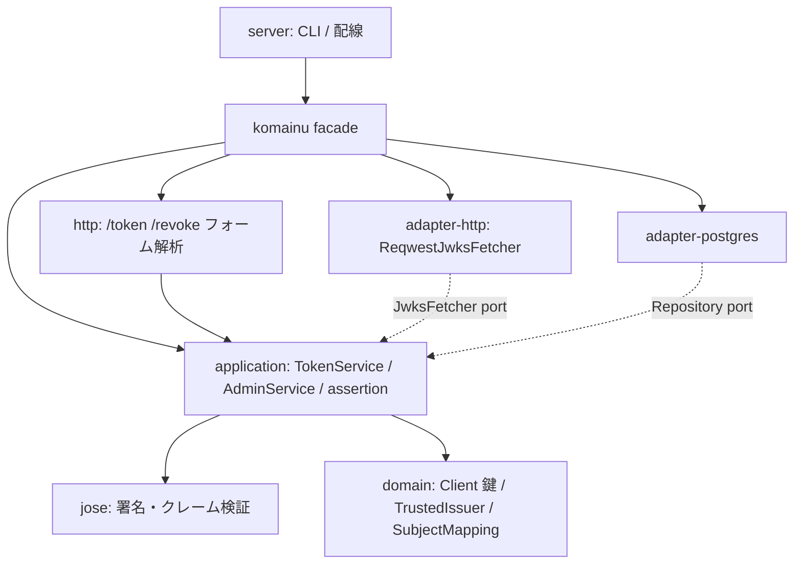
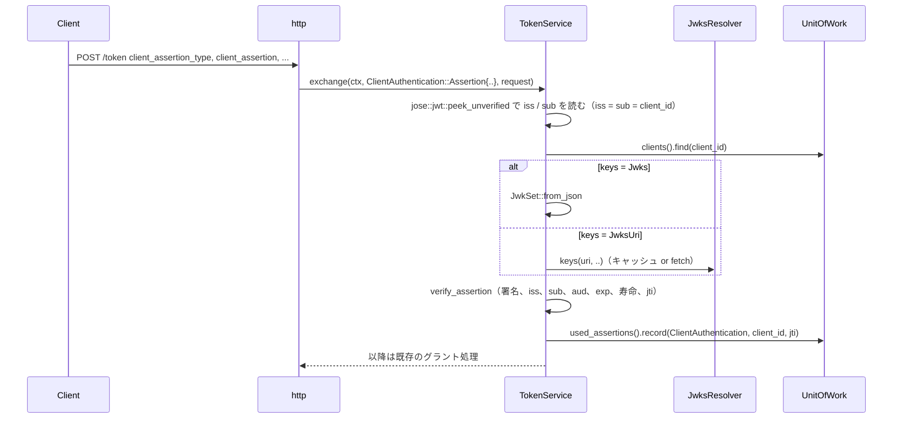
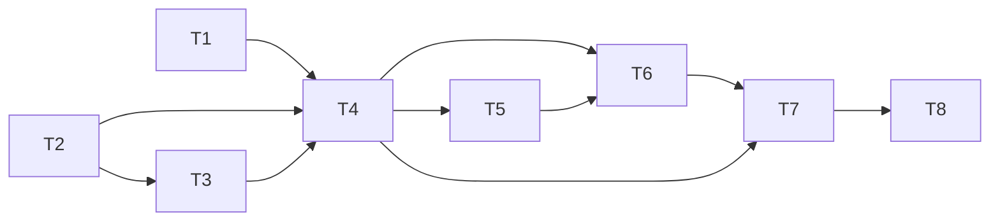

# JWT アサーション（RFC 7521 / 7523）設計書

- 状態: 実装中（T1・T2 は実装済み）
- 最終更新: 2026-11-27
- 関連: [#19](https://github.com/ryoshrimp/komainu/issues/19)、[authorization-server 設計書](../authorization-server/README.md)（ロードマップ 3）、[authorization-server-metadata 設計書](../authorization-server-metadata/README.md)、[jose 設計書](../jose/README.md)、[RFC 7521](https://www.rfc-editor.org/rfc/rfc7521)、[RFC 7523](https://www.rfc-editor.org/rfc/rfc7523)

## 1. 概要

トークンエンドポイントで JWT アサーションを受け付ける。RFC 7523 の 2 つのプロファイルを両方実装する。

- §2.2 クライアント認証（`private_key_jwt`）: クライアントが自分の秘密鍵で署名した JWT を `client_assertion` に入れて認証する。共有シークレットを持たずに済む。
- §2.1 認可グラント（`grant_type=urn:ietf:params:oauth:grant-type:jwt-bearer`）: 事前に登録した外部の発行者が利用者について発行した JWT を、その利用者のアクセストークンに交換する。

2 つは RFC 7521 の共通検証（`iss` / `sub` / `aud` / `exp` / `jti`、署名、リプレイ防止）を共有する。

## 2. 要件

### 2.1 利用者と目的

- クライアント開発者: クライアントシークレットの代わりに公開鍵（JWKS を直接登録、または `jwks_uri`）でトークンエンドポイントとリボケーションエンドポイントの認証を受ける。
- 運用者: 社内 IdP など信頼できる外部発行者を CLI で登録し、その発行者の JWT（`sub` を komainu のユーザーに対応付ける）でアクセストークンを出せるようにする。対応付けは表で持ち、ライブラリ利用者は port を差し替えて独自の対応付けにできる。

### 2.2 スコープ

- やること
  - `client_assertion_type=urn:ietf:params:oauth:client-assertion-type:jwt-bearer` によるクライアント認証（トークン・リボケーション両エンドポイント）
  - クライアント鍵の登録: JWKS 直接（`jwks`）と `jwks_uri` のどちらか一方
  - `jwks_uri` の取得（SSRF 対策、キャッシュ）
  - `urn:ietf:params:oauth:grant-type:jwt-bearer` グラント
  - 外部発行者（信頼する `iss`）の登録・更新・無効化と、発行者ごとの許可クライアント、`sub` とユーザーの対応表
  - 使用済み `jti` の記録とリプレイ拒否、期限切れ記録の削除
  - メタデータ（RFC 8414）への追加、CLI、監査ログ、CHANGELOG と README
- やらないこと
  - SAML アサーション（RFC 7522）（D-1）
  - 外部発行者の鍵を `jwks_uri` で取得すること（D-2）。発行者の鍵は JWKS 直接登録だけ
  - 自己発行アサーションのグラント（`iss` がクライアント自身）。グラントは登録済み外部発行者のものだけ受け付ける
  - `client_secret_jwt`（HS256 などの共有鍵署名）。RS256 / ES256 以外と `none` は拒否する
  - jwt-bearer グラントでのリフレッシュトークン発行
  - 未認証クライアントによる jwt-bearer グラント（RFC 7521 §4.1 では任意だが、komainu では Confidential クライアントの認証を必須にする）
  - 動的クライアント登録（RFC 7591）、アクセストークンの JWT 化
  - 認可エンドポイントでの `request` オブジェクト（JAR）

### 2.3 機能要件

アサーションの例では、`issuer` を `server.public_base_url`（例 `https://as.example.com`）とする。

| ID | 要件 | 受け入れ条件 |
|---|---|---|
| F-1 | `private_key_jwt` のクライアントを登録できる | `komainu client create --name a --auth-method private_key_jwt --jwks-file keys.json --grant-type client_credentials` が成功し、シークレットは出力されない。`client show` に `auth_method: private_key_jwt` と鍵の種類（`jwks` / `jwks_uri`）が出る。`--jwks-file` と `--jwks-uri` を両方、またはどちらも指定しないと終了コード 2。秘密鍵成分（`d` など）を含む JWKS、鍵 0 個、11 個以上、パースできない JSON は終了コード 2 |
| F-2 | `private_key_jwt` でトークンエンドポイントの認証を受けられる | `iss`=`sub`=client_id、`aud`=`https://as.example.com/token`、`exp`=今+60 秒、`jti` 付きで登録鍵（ES256）で署名した JWT を `client_assertion` に入れた `grant_type=client_credentials` 要求が 200 になる。`aud`=`https://as.example.com` でも 200。`client_id` を併記して一致すれば 200、不一致なら 400 `invalid_request` |
| F-3 | 不正なクライアントアサーションを拒否する | 次のいずれも 401 `invalid_client`（`WWW-Authenticate` なし）になり、監査ログ `client_authentication.failed`（`method=private_key_jwt`、`reason`）が 1 件残る: 署名不一致、`alg=none` / `HS256`、`iss`≠`sub`、`aud` 不一致、`exp` 切れ（猶予 60 秒超過）、`exp` が今+300 秒より先、`jti` なし、同じ `jti` の再使用、`auth_method` が `private_key_jwt` でないクライアント、無効化済みクライアント。`client_assertion_type` が jwt-bearer の URN 以外なら 401 `invalid_client` |
| F-4 | 複数の認証方式の併用を拒否する | `client_assertion` と `Authorization: Basic`、または `client_assertion` と `client_secret` を同時に送ると 400 `invalid_request`。`client_assertion_type` と `client_assertion` の片方だけ、またはどちらかが 2 回出現すると 400 `invalid_request` |
| F-5 | `jwks_uri` の鍵で認証できる | `jwks_uri` を登録したクライアントのアサーションが、取得した JWKS で検証されて 200 になる。2 回目以降の要求（1 時間以内）は再取得しない。キャッシュにない `kid` のアサーションが来たら、前回取得から 60 秒以上経っていれば 1 回だけ再取得して検証し直す |
| F-6 | `jwks_uri` の取得を安全に制限する | 次はいずれも取得せずに失敗し、認証は 401 `invalid_client`（監査 `reason=key_fetch_failed`）: `http` スキーム（登録時に終了コード 2 で拒否）、解決先がループバック・プライベート・リンクローカル・CGNAT などグローバルでないアドレス、3xx 応答、5 秒超過、64 KiB 超の応答、200 以外 |
| F-7 | リボケーションエンドポイントでも `private_key_jwt` が使える | `POST /revoke` に F-2 と同じ形のアサーション（`aud` はトークンエンドポイント URL か issuer）を付けると 200 になる。不正なら 401 `invalid_client`。未発行トークンの revoke を同じアサーションで 2 回送ると、2 回目は 401 `invalid_client`（監査 `reason=replay`）。`client_id` と `iss` が不一致なら 400 `invalid_request` |
| F-8 | 外部発行者を登録・管理できる | `komainu issuer create --issuer https://idp.example.com --jwks-file idp.json --client <ID>`（`--client` は 1〜100 個。0 個・101 個以上は終了コード 2）が成功する。存在しないクライアント ID は終了コード 2、登録済みの `--issuer` は終了コード 4。`issuer list` / `show` / `update` / `disable` / `enable` が動き、監査ログ `issuer.*` が残る |
| F-9 | `sub` とユーザーを対応付けられる | `komainu issuer map-subject https://idp.example.com --subject u-123 --username alice` が成功する。未登録の発行者・ユーザーは終了コード 3。同じ `(issuer, subject)` で再実行すると対応先を上書きする。`issuer unmap-subject` で削除でき、`issuer list-subjects` で一覧できる |
| F-10 | jwt-bearer グラントでアクセストークンを得られる | 発行者に許可されたクライアントが自分の方式で認証し、`grant_type=urn:ietf:params:oauth:grant-type:jwt-bearer&assertion=<JWT>` を送ると 200 になり、`refresh_token` は含まれない。`scope` 省略時はクライアントの既定スコープ。`TokenService::verify_access_token` の結果の `subject` は対応付けたユーザーになる |
| F-11 | 不正なグラントアサーションを拒否する | 次はいずれも 400 `invalid_grant` で、監査ログ `assertion.rejected`（`issuer_presented`、`client_id`、`reason`）が 1 件残る: 未登録・無効化済みの `iss`、発行者がそのクライアントを許可していない、署名・`aud`・`exp`・`jti` の不備（F-3 と同じ規則）、同じ `(iss, jti)` の再使用、`sub` の対応付けがない、対応先ユーザーが無効。`assertion` がないと 400 `invalid_request`。クライアントの `grant_types` に jwt-bearer がないと 400 `unauthorized_client` |
| F-12 | メタデータで対応を公開する | `GET /.well-known/oauth-authorization-server` の `token_endpoint_auth_methods_supported` と `revocation_endpoint_auth_methods_supported` に `private_key_jwt` が、`grant_types_supported` に jwt-bearer の URN が含まれ、`token_endpoint_auth_signing_alg_values_supported` と `revocation_endpoint_auth_signing_alg_values_supported` が `["RS256","ES256"]` になる |
| F-13 | 使用済み `jti` の記録が掃除される | `exp`+60 秒を過ぎ、さらに `cleanup.grace_secs` を過ぎた記録は、定期掃除（`MaintenanceService::purge_expired`）で削除され、`PurgeCounts::used_assertions` に件数が出る |

### 2.4 非機能要件

| ID | 項目 | 基準 | 確かめ方 |
|---|---|---|---|
| N-1 | セキュリティ: SSRF | `jwks_uri` の接続先は DNS 解決後の全アドレスがグローバルユニキャストであること。DNS 応答のうち禁止アドレスは接続に使わない（再バインド対策）。プロキシ環境変数を使わず、リダイレクトに従わない | `crates/adapter-http/tests/fetch.rs` |
| N-2 | セキュリティ: リプレイ | 同じ `(種別, 発行者, jti)` は記録が残っている間 2 回目を必ず拒否する。同時に 2 要求が来ても成功は 1 つだけ（DB の主キーで保証） | `crates/testkit` の conformance（PostgreSQL の同時実行テストを含む）、`crates/application/tests/token.rs` |
| N-3 | セキュリティ: 秘匿 | `client_assertion` と `assertion` の値はログ・監査・`Debug` 出力に出さない | `TokenRequest` / `ClientAuthentication` の `Debug` のテスト |
| N-4 | 性能 | JWKS 直接登録とキャッシュ命中時、アサーション検証は外部通信なし。`jwks_uri` の取得は 1 回最大 5 秒（DB トランザクションを開いたまま待つ。D-5） | テストのフェイク fetcher の呼び出し回数 |
| N-5 | 互換性 | 既存の `client_secret_basic` / `client_secret_post` / `none` と既存 3 グラントの振る舞い・既存テストを変えない。例外: facade（`komainu`）は `http` feature があると `ApplicationConfig::issuer` を `public_base_url` から自動で設定するため、既存の埋め込み利用者でもメタデータに `private_key_jwt` などの項目が増える（無効化する API は作らない） | 既存テストがそのまま通る |

### 2.5 前提と制約

- Rust 1.100 / edition 2024、PostgreSQL 16+。既存のクレート構成（domain → application → adapter / http → komainu → server）に従う。
- 署名検証は既存の `komainu-jose`（RS256 / ES256 のみ実装済み）を使う。新しい暗号ライブラリは足さない。
- HTTP クライアントはワークスペースに定義済みの `reqwest`（rustls）を新クレート `komainu-adapter-http` の通常依存にする。
- アサーションの `aud` を判定するため、application はサーバーの issuer 識別子を知る必要がある。`ApplicationConfig::issuer` を追加し、未設定なら両機能は無効（広告もしない）。
- 0.1.0-alpha 系のため、公開 API の破壊的変更（`ClientAuthentication` へのバリアント追加、`PurgeCounts` へのフィールド追加など）は CHANGELOG に書いて許容する。

## 3. 全体構成

| コンポーネント | 責務 | 配置（ディレクトリ） | 詳細 |
|---|---|---|---|
| jose | 複数 `aud` の受理、署名検証前のクレーム読み取り | `crates/jose` | [application.md §jose への追加](application.md#jose-への追加) |
| domain | 認証方式・グラント種別の追加、クライアント鍵、外部発行者、対応表の型と不変条件 | `crates/domain` | [domain.md](domain.md) |
| application | アサーション検証、JWKS キャッシュ、クライアント認証とグラントの組み込み、管理ユースケース、port | `crates/application` | [application.md](application.md) |
| adapter-postgres / testkit | 新テーブルとリポジトリ、インメモリ実装と conformance | `crates/adapter-postgres`、`crates/testkit` | [adapters.md](adapters.md) |
| adapter-http（新規） | `jwks_uri` の取得と SSRF 対策 | `crates/adapter-http` | [adapters.md](adapters.md#komainu-adapter-http新規) |
| http / komainu / server | フォーム解析、メタデータ、facade の配線、CLI | `crates/http`、`crates/komainu`、`crates/server` | [http-server.md](http-server.md) |

### 3.1 技術選定

| 対象 | 採用 | 理由 | 見送った候補 |
|---|---|---|---|
| JWT 検証 | application が `komainu-jose` に直接依存 | jose は I/O のない自前クレートで、検証規則をユースケースと同じ場所でテストできる | 検証を port にしてアダプターに置く（差し替え需要がなく、間接層が増えるだけ） |
| `jwks_uri` 取得 | 新クレート `komainu-adapter-http`（reqwest）、application の `JwksFetcher` port の裏 | ライブラリ利用者が HTTP クライアント依存を facade の feature で外せる | adapter-std に追加（std アダプターが tokio / reqwest に依存する）、server 内（ライブラリ利用者が使えない） |
| JWKS キャッシュ | application の `JwksResolver`（`std::sync::Mutex` + `HashMap`） | TTL・再取得間隔の方針をフェイク fetcher とフェイク時計でテストできる | アダプター内キャッシュ |
| リプレイ防止 | DB テーブル `used_assertions`（主キーで一意） | 複数インスタンスでも一意性が保てる。トランザクションに乗る | プロセス内キャッシュ（複数インスタンスで破れる） |

### 3.2 主要な流れ

#### private_key_jwt によるクライアント認証（`/token`、`/revoke` 共通）

#### jwt-bearer グラント

1. http は通常どおりクライアント認証情報と `grant_type`・`assertion`・`scope` を渡す。
2. `TokenService::exchange` はクライアント認証（どの方式でもよい。Public は不変条件で jwt-bearer を持てない）→ `supports_grant(JwtBearer)` → `assertion` を `peek_unverified` して `iss` で `trusted_issuers().find` → 有効か・クライアントを許可しているか → 発行者の JWKS で `verify_assertion` → `AssertionSubjectResolver::resolve` で `UserId` → ユーザーが有効か → `used_assertions().record(AuthorizationGrant, iss, jti)` → `client.resolve_scope(scope)` → `Grant::for_jwt_bearer` → `issue_tokens(refresh = false)` → 監査 `token.issued` → commit。

### 3.3 設計判断の記録

2026-11-27 に ryoshrimp が確定した。

| ID | 判断 | 理由・見直す条件 |
|---|---|---|
| D-1 | SAML（RFC 7522）は扱わない。共通検証は JWT 専用に作る | 要望がない。必要になれば別の設計書で扱う |
| D-2 | 外部発行者の鍵は JWKS の直接登録だけ。`jwks_uri` は使わない | 発行者は運用者が登録するので鍵の更新も CLI で足りる。`JwksResolver` は発行者にも使える形にしておき、要望が出たら足す |
| D-3 | 後続の処理で失敗した要求では `jti` の記録もロールバックされ、同じアサーションを有効期限内（最大 5 分）に再送できる。例外として、Assertion で認証した `revoke` は、トークンをパースできない・見つからない・grant がすでに無効で `Ok(())` を返す場合も常に commit し、`jti` の記録を残す | 失敗した要求ではトークンが出ていない。記録を別トランザクションで先に確定する方式は採らない。revoke は成功応答（200）を返すので、記録を残さないと同じアサーションを何度でも使える |
| D-4 | `client update` で `client_secret_*` と `private_key_jwt` を相互に切り替えられない（`AdminError::Invalid`） | 鍵とシークレットの付け替えで中途半端な状態を作らない。新しいクライアントを登録してもらう |
| D-5 | `jwks_uri` の取得（1 回最大 5 秒）は DB トランザクションを開いたまま待つ | キャッシュ命中時は通信せず、未知の `kid` による再取得も 60 秒に 1 回に抑えられる。接続プール枯渇が問題になれば、クライアント読み出しと鍵取得をトランザクションの外に出す |
| D-6 | `jwks_uri` の取得に失敗したとき、期限切れのキャッシュは使わない（`invalid_client`） | 失効させた鍵を使い続けないよう、失敗時は閉じる側に倒す |

## 4. コンポーネント間の契約

各契約の詳細（シグネチャ・エラー）はコンポーネント別ファイルにあり、ここは境界の一覧。

| 境界 | 契約 | 定義 |
|---|---|---|
| http → application | `ClientAuthentication::Assertion { client_id: Option<String>, assertion: Secret<String> }`、`TokenRequest::assertion: Option<String>`（Debug で伏せる） | [application.md §公開インターフェース](application.md#公開インターフェース) |
| application → jose | `Validation::accept_audience`、`jwt::peek_unverified`、`jwt::decode`、`JwkSet::from_json`、`JoseError::KeyNotFound` | [application.md §jose への追加](application.md#jose-への追加) |
| application → adapter-http | `trait JwksFetcher { fn fetch<'a>(&'a self, uri: &'a JwksUri) -> BoxFuture<'a, Result<String, JwksFetchError>> }` | [application.md §port](application.md#port) |
| application → adapter-postgres / testkit | `UnitOfWork::{trusted_issuers, subject_mappings, used_assertions}` と各 Repository、`PurgeRepository::purge_expired` の対象追加 | [application.md §port](application.md#port)、[adapters.md](adapters.md) |
| application ← ライブラリ利用者 | `trait AssertionSubjectResolver`（既定 `MappingTableSubjectResolver`） | [application.md §port](application.md#port) |
| server → application | `AdminService` の issuer 系メソッド、`RegisterClient::keys` | [application.md §AdminService](application.md#adminservice) |
| 外部（HTTP） | `/token` と `/revoke` のフォームパラメーター、メタデータの追加フィールド | [http-server.md](http-server.md) |
| 外部（DB） | マイグレーション `0004_assertion.sql` | [adapters.md §データ](adapters.md#データ) |

共通の定数（`crates/application/src/assertion/mod.rs` に `pub const` で置き `lib.rs` から再公開する。時間は `time::Duration`、長さは `usize`。設定にはしない。T4 で作る）:

| 名前 | 値 | 意味 |
|---|---|---|
| `CLIENT_ASSERTION_TYPE_JWT_BEARER` | `"urn:ietf:params:oauth:client-assertion-type:jwt-bearer"` | `client_assertion_type` の唯一の受理値 |
| `ASSERTION_LEEWAY` | 60 秒 | `exp` / `nbf` / `iat` の時計ずれ猶予（jose の `DEFAULT_LEEWAY`） |
| `ASSERTION_MAX_LIFETIME` | 300 秒 | `exp - now` の上限。超えたら拒否 |
| `ASSERTION_MAX_LEN` | 8192 バイト | アサーション文字列の上限（jose の既定と同じ） |
| `JWKS_CACHE_TTL` | 3600 秒 | `jwks_uri` のキャッシュ寿命 |
| `JWKS_MIN_REFETCH_INTERVAL` | 60 秒 | 未知の `kid` による再取得の最小間隔 |

## 5. コンポーネント詳細

- [domain.md](domain.md)
- [application.md](application.md)（jose への追加を含む）
- [adapters.md](adapters.md)（adapter-postgres、testkit、adapter-http）
- [http-server.md](http-server.md)（http、komainu facade、server）

## 6. タスク計画

PR はタスクごとに分ける。T6 で `private_key_jwt` が単独でリリース可能になり、T7 でグラントが加わる。

### T1. jose: 複数 aud と未検証読み取り

- 状態: 実装済み（#43）
- 依存: なし
- 対象: `crates/jose/src/jwt.rs`、`crates/jose/src/lib.rs`
- 内容: `Validation::accept_audience` と `jwt::peek_unverified` を追加する（[application.md §jose への追加](application.md#jose-への追加)）。F-2、F-3 の前提
- 完了条件: `aud` が追加した値だけを含む JWT が `decode` を通る。どれも含まなければ `InvalidAudience`。`peek_unverified` が署名を壊した JWT からも `iss` / `sub` を返し、3 セグメントでない・base64url 不正・長さ超過は `Malformed`
- 検証: `cargo test -p komainu-jose`

### T2. domain: 認証方式・鍵・外部発行者の型

- 状態: 実装済み（#45）
- 依存: なし
- 対象: `crates/domain/src/client/client.rs`、`crates/domain/src/token/grant.rs`、新規 `crates/domain/src/issuer/{mod.rs,issuer.rs,subject.rs}`、新規 `crates/domain/src/shared/jwks.rs`、`crates/domain/src/lib.rs`
- 内容: [domain.md](domain.md) のすべて。F-1、F-8、F-9、F-10 の前提。あわせて、ワークスペース全体のコンパイルを通す最小限の変更: 既存の `NewClient` / `ClientRecord` / `ClientUpdate` のリテラルに `keys: None`（`crates/application/src/admin/mod.rs`、`crates/application/tests/admin.rs`、`crates/testkit/src/store.rs`、`crates/testkit/src/conformance/fixtures.rs`、`crates/adapter-postgres/src/client.rs`、`crates/adapter-postgres/tests/common/mod.rs`、`crates/server/src/cli/client.rs`）と、新バリアントの `match` 腕（[domain.md §実装メモ](domain.md#実装メモ)）
- 完了条件: domain.md §受け入れ条件のユニットテストが通る。ワークスペースの既存テストが通る
- 検証: `cargo test --workspace`、`cargo clippy --workspace --all-targets -- -D warnings`

### T3. 永続化: port・マイグレーション・インメモリ実装

- 依存: T2
- 対象: `crates/application/src/port/{repository.rs,store.rs,mod.rs}`、新規 `crates/adapter-postgres/migrations/0004_assertion.sql`、`crates/adapter-postgres/src/{client.rs,grant.rs,purge.rs,uow.rs,lib.rs}`、新規 `crates/adapter-postgres/src/{trusted_issuer.rs,subject_mapping.rs,used_assertion.rs}`、`crates/testkit/src/store.rs`、`crates/testkit/src/conformance/{cases.rs,fixtures.rs}`、`impl UnitOfWork` がある `crates/testkit/tests/in_memory_conformance.rs`（`BrokenUow`。ほかの実装は `crates/testkit/src/store.rs` と `crates/adapter-postgres/src/uow.rs` だけ）、`PurgeCounts` のリテラルがある `crates/testkit/src/conformance/cases.rs`・`crates/testkit/src/store.rs`・`crates/adapter-postgres/src/purge.rs`（`crates/testkit/src/store.rs` の `..PurgeCounts::default()` は変更不要）、`crates/server/src/cleanup.rs`（`PurgeCounts::used_assertions` をメトリクス `komainu_cleanup_deleted_total{kind="used_assertions"}` と `tracing::info!` に足す）
- 内容: [application.md §port](application.md#port) のうち `TrustedIssuerRepository`・`SubjectMappingRepository`・`UsedAssertionRepository`・`AssertionKind`・`UsedAssertion`・`RecordOutcome`、`UnitOfWork` への 3 メソッド追加、`PurgeCounts::used_assertions`。[adapters.md](adapters.md) の adapter-postgres・testkit の store と conformance（`StaticJwksFetcher` は T4）。F-13、N-2
- 完了条件: adapters.md §受け入れ条件の conformance ケースがインメモリと PostgreSQL の両方で通る
- 検証: `cargo test --workspace`、`cargo test -p komainu-adapter-postgres --features pg-tests`

### T4. application: アサーション検証と JWKS キャッシュ

- 依存: T1、T2、T3
- 対象: ルート `Cargo.toml`（`[workspace.dependencies]` に `komainu-jose = { path = "crates/jose", version = "0.1.0-alpha.3" }` を追加）、`crates/application/Cargo.toml`（`komainu-jose.workspace = true` を追加。ほかの依存は足さない）、新規 `crates/application/src/assertion/{mod.rs,verify.rs,jwks.rs}`、`crates/application/src/port/{jwks.rs,subject.rs,mod.rs}`、`crates/application/src/config.rs`、`crates/application/src/deps.rs`、`crates/application/src/lib.rs`、`crates/testkit/src/{jwks.rs,lib.rs,env.rs}`（`StaticJwksFetcher`、`TestEnv` の差し替え API）、`Dependencies` のリテラルがある `crates/adapter-postgres/tests/postgres.rs`・`crates/komainu/src/builder.rs`（`crates/http/tests/revoke.rs` は `..env.deps.clone()` なので変更不要。この時点では `jwks: Arc::new(JwksResolver::new(None, clock))`、`subject_resolver: Arc::new(MappingTableSubjectResolver)` を渡す。builder の本実装は T6）
- 内容: `verify_assertion`、`JwksResolver`、`JwksFetcher` / `AssertionSubjectResolver` port、`ApplicationConfig::issuer`、`Dependencies` への追加（[application.md](application.md)）。この時点ではトークンエンドポイントから呼ばない
- 完了条件: application.md §受け入れ条件の「検証」「JWKS キャッシュ」（`assertion/verify.rs`・`assertion/jwks.rs` の単体テスト）が通る
- 検証: `cargo test --workspace`

### T5. adapter-http: ReqwestJwksFetcher

- 依存: T4
- 対象: 新規 `crates/adapter-http/{Cargo.toml,src/lib.rs,src/ip.rs,tests/fetch.rs}`、ルート `Cargo.toml`（members に `crates/adapter-http`、`[workspace.dependencies]` に `komainu-adapter-http`。`reqwest` の定義を `features = ["rustls"]` に減らし、`crates/server/Cargo.toml` の `[dev-dependencies]` の `reqwest.workspace = true` を `reqwest = { workspace = true, features = ["cookies"] }` に変える）
- 内容: [adapters.md §komainu-adapter-http](adapters.md#komainu-adapter-http新規)。F-6、N-1
- 完了条件: adapters.md の adapter-http 受け入れ条件が通る
- 検証: `cargo test -p komainu-adapter-http`

### T6. private_key_jwt の組み込み

- 依存: T4、T5
- 対象: `crates/application/src/token/{mod.rs,request.rs}`、`crates/application/src/admin/{mod.rs,error.rs}`、`crates/application/src/audit.rs`、`crates/application/src/capabilities.rs`、`crates/http/src/{form.rs,client_auth.rs,metadata.rs}`、`crates/komainu/{Cargo.toml,src/builder.rs,src/lib.rs}`（`crates/server/Cargo.toml` は `komainu.workspace = true` で既定 feature を取り込むので、`jwks-uri` は自動で有効になり変更不要）、`RegisterClient` のリテラルに `keys` を足す `crates/komainu/examples/{minimal.rs,custom_screens.rs}`・`crates/komainu/tests/builder.rs`・`crates/application/tests/common/mod.rs`・`crates/http/tests/common/mod.rs`・`crates/adapter-postgres/tests/postgres.rs`、`crates/server/src/{wiring.rs,cli/client.rs,cli/output.rs,cli/mod.rs}`（`cli/mod.rs` は網羅 match の `admin_exit` に `AdminError::InvalidJwks` を足す）、テスト `crates/application/tests/{token.rs,revocation.rs,admin.rs,capabilities.rs}`、`crates/http/tests/{token.rs,revoke.rs,metadata.rs}`、`crates/server/tests/cli.rs`
- 内容: クライアント認証の `Assertion` 分岐、`revoke` の変更（Assertion 認証時は早期 return でも commit する。D-3 の例外。match に `TokenError::InvalidRequest => RevocationError::InvalidRequest` を足す）、`AdminError::InvalidJwks`、クライアント登録・更新の鍵（`register_client` のシークレット生成を `ClientSecretBasic` / `ClientSecretPost` のときだけにする）、
メタデータの `private_key_jwt` と署名 alg（`grant_types` に `JwtBearer` はまだ入れない）、facade と server の配線、`client create/update` の CLI。F-1〜F-7、F-12 の `private_key_jwt` 部分、N-3、N-5
- 完了条件: F-1〜F-7 の受け入れ条件がテストで確かめられる。既存テストが通る
- 検証: `cargo test --workspace --features pg-tests`、`cargo clippy --workspace --all-targets --features pg-tests -- -D warnings`（`.github/workflows/ci.yml` と同じ。`pg-tests` は `komainu-adapter-postgres` と `komainu-server` にある）

### T7. jwt-bearer グラントと外部発行者の管理

- 依存: T4、T6
- 対象: `crates/application/src/token/mod.rs`、`crates/application/src/admin/{mod.rs,issuer.rs,error.rs}`、`crates/application/src/audit.rs`、`crates/application/src/capabilities.rs`、`crates/http/src/token.rs`（メトリクスラベル）、新規 `crates/server/src/cli/issuer.rs`、`crates/server/src/cli/{mod.rs,output.rs}`、`crates/server/src/lib.rs`、テスト `crates/application/tests/{token.rs,admin.rs,capabilities.rs}`、`crates/http/tests/{token.rs,metadata.rs}`、`crates/server/tests/{cli.rs,e2e_scenario.rs}`
- 内容: jwt-bearer グラント（拒否監査は `Step::Rejected`）、`AdminError::UnknownClient`、`grant_type_label` への jwt-bearer 追加、`AdminService` の issuer 系、`komainu issuer` CLI、メタデータの `grant_types_supported`。F-8〜F-12
- 完了条件: F-8〜F-12 の受け入れ条件がテストで確かめられる。e2e シナリオに「issuer 登録 → map-subject → jwt-bearer でトークン取得 → verify_access_token」が加わる
- 検証: `cargo test --workspace --features pg-tests`、`cargo clippy --workspace --all-targets --features pg-tests -- -D warnings`（`.github/workflows/ci.yml` と同じ）

### T8. ドキュメント

- 依存: T7
- 対象: `README.md`（What is supported、CLI 例）、`CHANGELOG.md`（Unreleased）、`docs/design/authorization-server/README.md`（ロードマップ 3 を「実装済み」に）、`docs/design/authorization-server/server.md`（CLI の章に `issuer` と `client` の新オプション）、本書の状態
- 内容: 利用者向けの説明と破壊的変更の記載（`ClientAuthentication` / `TokenEndpointAuthMethod` / `GrantType` / `GrantOrigin` / `PurgeCounts` / `ServerCapabilities` / `UnitOfWork` / `AdminError` への追加）、facade 利用時のメタデータの追加項目（`http` feature では issuer が自動設定され、`private_key_jwt` と署名 alg が増える。N-5）

- 完了条件: 上記ファイルに F-1〜F-13 の利用方法と破壊的変更が書かれている
- 検証: 目視、`cargo test --workspace --doc`

## 7. 未決事項

なし（旧 Q-1〜Q-6 は 2026-11-27 に確定し、[§3.3 設計判断の記録](#33-設計判断の記録)に移した）。
