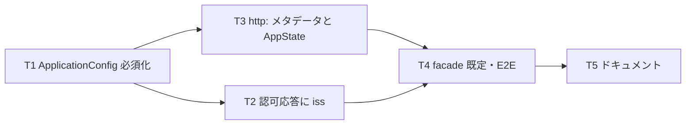

# 認可応答の iss パラメータ（RFC 9207）設計書

- 状態: 設計済み（未実装）
- 最終更新: 2026-11-28
- 関連: [RFC 9207](https://www.rfc-editor.org/rfc/rfc9207)、[Issue #28](https://github.com/ryoshrimp/komainu/issues/28)（本書はその 1 項目目「RFC 9207」だけを扱う）、[認可サーバー設計書 §8 ロードマップ](../authorization-server/README.md#8-ロードマップ)、[認可サーバーメタデータ設計書 U-2](../authorization-server-metadata/README.md#7-未決事項)

## 1. 概要

認可エンドポイントがクライアントの `redirect_uri` へ返すリダイレクト（成功・エラーとも）のクエリに `iss`（認可サーバーの issuer 識別子）を付け、メタデータで `authorization_response_iss_parameter_supported: true` を公開する。クライアントは `iss` を見て、応答が意図した認可サーバーから来たかを確かめられる（mix-up 攻撃対策）。

そのために `ApplicationConfig::issuer` を必須にする（破壊的変更）。`Default` をやめて `ApplicationConfig::new(issuer)` で作る形にし、`iss` とメタデータの `issuer` が食い違わないことを `AppState::new` で確かめる。

## 2. 要件

### 2.1 利用者と目的

| 利用者 | 目的 |
|---|---|
| OAuth クライアント | 認可応答の `iss` をメタデータの `issuer` と比べ、mix-up 攻撃を防ぐ |
| komainu-server の運用者 | 設定を変えずに RFC 9207 に対応する |
| ライブラリ利用者（`komainu` facade / 各 crate を直接使う人） | issuer の設定漏れ・食い違いを型と起動時エラーで防ぐ |

### 2.2 スコープ

やること:

- 成功リダイレクト（`code`）とエラーリダイレクト（`error`）の両方に `iss` を付ける
- メタデータに `authorization_response_iss_parameter_supported: true` を常に出す
- `ApplicationConfig::issuer` を `String` の必須項目にする（`Default` と `with_issuer` を廃止し `new(issuer)` を追加）
- `AppState::new` で `ApplicationConfig::issuer` と `HttpConfig::public_base_url()` の一致を確かめ、食い違えばエラーを返す
- facade（`KomainuBuilder`）と server の組み立てを新しい API に合わせる
- README・CHANGELOG・ロードマップの更新

やらないこと:

- `iss` を付けない設定（RFC 9207 は対応を宣言したら常に付けることを求めるため、切り替えは設けない）
- リダイレクトできないエラー（`redirect_uri` 不正など、HTML のエラー画面を出す場合）への `iss` の付与（RFC 9207 の対象外）
- クライアント側での `iss` の検証（komainu は認可サーバーのみ）
- Issue #28 の他の項目（RFC 8707 / 8252 / 10017 / 9700）

### 2.3 機能要件

以下の URL は説明用の例。テストでは既存の定数（application の `ISSUER = "https://as.example.com"`・`REDIRECT`、http の `BASE` など）で同じ形を確かめればよい。ここでは issuer を `https://as.example.com`、`redirect_uri` を `https://client.example.com/cb` とする。

| ID | 要件 | 受け入れ条件 |
|---|---|---|
| F-1 | 成功応答に `iss` を付ける | 同意済みの認可要求（`state=xyz`）が成功したとき、`Location` が `https://client.example.com/cb?code=<code>&state=xyz&iss=https%3A%2F%2Fas.example.com` になる。`state` がなければ `?code=<code>&iss=https%3A%2F%2Fas.example.com` |
| F-2 | エラー応答に `iss` を付ける | 同意画面で拒否したとき、`Location` が `https://client.example.com/cb?error=access_denied&error_description=<説明>&state=xyz&iss=https%3A%2F%2Fas.example.com` になる。`start` 側のリダイレクト可能なエラー（例: `response_type=token` → `unsupported_response_type`）でも末尾に同じ `iss` が付く |
| F-3 | リダイレクトできないエラーには付けない | `redirect_uri` が登録と一致しないとき、従来どおりエラー画面（HTML）を返し、`Location` は返さない |
| F-4 | `redirect_uri` に既存のクエリがある場合 | `redirect_uri` を `https://client.example.com/cb?x=1` で登録したクライアントの成功応答は `https://client.example.com/cb?x=1&code=<code>&state=xyz&iss=https%3A%2F%2Fas.example.com` になる（既存の `with_query_params` の挙動のまま。テストではそのクライアントを登録して確かめる） |
| F-5 | メタデータで対応を宣言する | `GET /.well-known/oauth-authorization-server` の JSON に `"authorization_response_iss_parameter_supported": true` が常に含まれる |
| F-6 | `iss` とメタデータの `issuer` が一致する | 応答の `iss` をデコードした値が、メタデータの `issuer` と文字列として完全に一致する（F-7 により保証） |
| F-7 | 食い違いを起動時に検出する | 次の組み合わせで `AppState::new` を呼ぶ（Rust では `String` 値。以下は表記の簡略）。① `ApplicationConfig::new("https://a.example.com")` ＋ `HttpConfig::new("https://b.example.com")` → `Err(AppStateError::IssuerMismatch { issuer: "https://a.example.com", public_base_url: "https://b.example.com" })` ② `ApplicationConfig::new("https://a.example.com")` ＋ `HttpConfig::new("https://a.example.com/")`（末尾 `/` は `HttpConfig` の正規化で落ちる）→ `Ok` ③ `ApplicationConfig::new("https://a.example.com/")` ＋ `HttpConfig::new("https://a.example.com")` → `Err(IssuerMismatch)`（application 側は正規化しない） |
| F-8 | issuer は必須 | `ApplicationConfig` は `new(issuer)` でしか作れない（`Default` はない）。`ApplicationConfig::new("").validate()` は `Err(ApplicationConfigError::EmptyIssuer)` |
| F-9 | facade の既定 | `http` feature 有効で `application_config` を渡さずに `build()` すると、`ApplicationConfig::new(http_config.public_base_url())` が使われる。`http` feature 無効で渡さないと `Err(BuildError::MissingApplicationConfig)`。明示した `ApplicationConfig` の issuer が `public_base_url` と食い違えば `Err(BuildError::IssuerMismatch(_))`。エラーの判定順は §4.4 |
| F-10 | server は設定変更なしで対応 | komainu-server は `server.public_base_url`（正規化済み）を issuer に使い、既存の設定ファイルのまま起動でき、F-1・F-2・F-5 を満たす |
| F-11 | private_key_jwt / jwt-bearer が常に有効 | issuer が常にあるため、`disabled_auth_methods` / `disabled_grant_types` で止めない限り、`private_key_jwt` と jwt-bearer は利用可能としてメタデータに載る（server と facade では従来どおり。`ApplicationConfig` を直接作る人にとっての変化）。あわせて `validate()` の `NoAuthMethod` は、`client_secret_basic`・`client_secret_post` を両方止めても `private_key_jwt` が残る限り出なくなる（server で `disabled_auth_methods = ["client_secret_basic", "client_secret_post"]` かつ公開クライアントなしの設定は、従来は起動失敗、今後は起動する。これは意図した変化で CHANGELOG に書く） |

### 2.4 非機能要件

| ID | 項目 | 基準 | 確かめ方 |
|---|---|---|---|
| N-1 | 互換性 | 破壊的変更（`ApplicationConfig::default` / `with_issuer` / `issuer: Option<String>` の廃止、`AppState::new` の戻り値変更、`NoAuthMethod` の条件の変化）を CHANGELOG の `### Changed` に移行方法付きで書く | CHANGELOG のレビュー |
| N-2 | 品質ゲート | CI と同じ `cargo fmt --all -- --check`、`cargo clippy --workspace --all-targets --features pg-tests -- -D warnings`、`cargo test --workspace --features pg-tests` が通る | コマンド（pg-tests は Docker 必須） |

### 2.5 前提と制約

- 応答モードは `query` のみ（`fragment` / `form_post` は未対応）なので、`iss` はクエリにだけ付ける。
- `iss` の値はエンコード前で `ApplicationConfig::issuer` そのもの。エンコードは既存の `RedirectUri::with_query_params`（`form_urlencoded`）に任せる。
- メタデータの `issuer` は従来どおり `HttpConfig::public_base_url()`（末尾 `/` なし）から作る。一致は `AppState::new` で保証する。
- issuer にパスを含む構成（`Komainu::metadata` を利用者が別ルートで返すケース）でも、issuer は `public_base_url` と同じ値である前提は変わらない。

## 3. 全体構成

| コンポーネント | crate | 変更 |
|---|---|---|
| ApplicationConfig | komainu-application `config.rs` | `issuer: String` 必須化、`new(issuer)`、`EmptyIssuer` |
| 認可ユースケース | komainu-application `authorization/mod.rs`, `authorization/error.rs` | `error_location` / `issue_code` で `iss` を付ける、`AuthorizationService::issuer()` |
| issuer 依存の判定 | komainu-application `token/auth.rs`, `token/grant.rs`, `token/mod.rs`, `capabilities.rs` | `issuer.is_some()` 判定の削除 |
| メタデータ・AppState | komainu-http `metadata.rs`, `state.rs`, `lib.rs` | `authorization_response_iss_parameter_supported`、`AppState::new` の一致検査と `AppStateError` |
| facade | komainu `builder.rs` | 既定 config の作り方、判定順、`BuildError` の追加 |
| server | komainu-server `wiring.rs` | `HttpConfig` を先に作り `ApplicationConfig::new(http.public_base_url())` |
| テスト・例・testkit | 各 crate の tests、`crates/testkit/src/env.rs`、`crates/komainu/examples/*.rs` | §5 のとおり |

### 3.1 技術選定

| 対象 | 採用 | 理由 | 見送った候補 |
|---|---|---|---|
| iss を付ける層 | application（location を組み立てる場所） | location はすでに application で完成させており、http は 302 するだけ | http 層で location を書き換える（文字列操作が二重になる） |
| issuer の必須化 | `ApplicationConfig::new(issuer)`、`Default` 廃止 | 型で設定漏れを防げる | `Default` を残し `validate()` で弾く（実行時まで分からない）／`ApplicationConfig` から外す（配線の変更が大きい） |
| 食い違いの検出 | `AppState::new` が `Result` を返す | server・facade・直接利用のどれでも自動で守られる | facade だけで検査（直接利用が漏れる）／メタデータの issuer を `ApplicationConfig` 優先にする（エンドポイント URL との整合が崩れる） |
| メタデータの項目型 | `bool`（常に `true`、省略しない） | issuer が必須なので常に対応 | `Option<bool>`（出し分ける場面がない） |

### 3.2 主要な流れ

起動時:

1. `ApplicationConfig::new(issuer)` → `validate()`（空なら `EmptyIssuer`）
2. `AppState::new(authorization, token, http_config)` が `authorization.issuer() == http_config.public_base_url()` を確かめる。違えば `Err(AppStateError::IssuerMismatch)`

認可応答:

1. http の `/authorize`・`/consent`・`/login` は application が返す `location` をそのまま 302 する（変更なし）
2. application の `issue_code` / `error_location` が、既存パラメータの後ろに `("iss", issuer)` を足して `with_query_params` する

## 4. コンポーネント間の契約

### 4.1 `komainu_application::ApplicationConfig`

```rust
#[derive(Debug, Clone)]
#[non_exhaustive]
pub struct ApplicationConfig {
    // ...既存フィールドは変更なし...
    /// The server's issuer identifier (for example `"https://as.example.com"`, no trailing `/`).
    /// Sent as `iss` in authorization responses (RFC 9207), and assertions must have this
    /// value or `"{issuer}/token"` as `aud`. With `komainu-http` it must equal
    /// `HttpConfig::public_base_url()` (checked by `AppState::new`).
    pub issuer: String,
}

impl ApplicationConfig {
    /// Creates the configuration with the given issuer and the defaults of every other field
    /// (the values the removed `Default` impl had).
    pub fn new(issuer: impl Into<String>) -> Self;
}

pub enum ApplicationConfigError {
    // ...既存...
    /// `issuer` is empty.
    #[error("issuer must not be empty")]
    EmptyIssuer,
}
```

- `impl Default for ApplicationConfig` と `with_issuer` は削除する。フィールドは `pub` のままなので、変更したい人は `config.issuer = ...` で書き換えられる。
- `validate()` は既存の検査の**前**に `issuer.is_empty()` を見て `EmptyIssuer` を返す。それ以外の形式（URL か、末尾 `/` の有無）は検査しない。末尾 `/` は doc で「付けない」と案内するだけにする（application 単体では末尾 `/` 付き issuer の既存テスト `crates/application/tests/token.rs` の `issuer_with_a_trailing_slash_accepts_the_advertised_audiences` が通り続ける。http と組むと F-7 ③ で弾かれる）。
- struct の doc の「Start from [`Default`]」は「Start from [`ApplicationConfig::new`]」に直す。`crates/application/src/capabilities.rs` の「when issuer is set」などの doc も issuer が常にある前提に直す。

### 4.2 `komainu_application::AuthorizationService`

```rust
impl AuthorizationService {
    /// The issuer sent as `iss` in authorization responses (`ApplicationConfig::issuer`).
    pub fn issuer(&self) -> &str;
}
```

- 成功: `params = [("code", ..), ("state", ..)?, ("iss", issuer)]`
- エラー: `params = [("error", ..), ("error_description", ..), ("state", ..)?, ("iss", issuer)]`
- `error_location` と `redirect_error` は自由関数なので、引数 `issuer: &str` を末尾に足す（呼び出し側は `&self.deps.config.issuer`）。`AuthorizeOutcome` / `AuthorizeError` の型は変えない。
- `crates/application/src/authorization/error.rs` の `AuthorizeError::Redirect` の doc（「carries error/error_description/state」）に `iss` を足す。

### 4.3 `komainu_http`

```rust
pub struct AuthorizationServerMetadata {
    // ...既存...
    /// Always `true` (RFC 9207). Serialized after `code_challenge_methods_supported`.
    pub authorization_response_iss_parameter_supported: bool,
}

impl AppState {
    /// Creates the state with the built-in screens.
    ///
    /// `authorization` and `token` must be built from the same `Dependencies`.
    /// Fails when `authorization.issuer()` differs from `config.public_base_url()`, because
    /// the `iss` of authorization responses must equal the metadata `issuer` (RFC 9207).
    pub fn new(
        authorization: AuthorizationService,
        token: TokenService,
        config: HttpConfig,
    ) -> Result<Self, AppStateError>;
}

/// Why [`AppState::new`] failed.
#[derive(Debug, Clone, PartialEq, Eq, thiserror::Error)]
#[non_exhaustive]
pub enum AppStateError {
    /// `ApplicationConfig::issuer` is not `HttpConfig::public_base_url()`.
    #[error("issuer {issuer} does not match public_base_url {public_base_url}")]
    IssuerMismatch { issuer: String, public_base_url: String },
}
```

- 比較は `==`（バイト列の完全一致）。正規化は `HttpConfig` 側の末尾 `/` 除去だけ。
- `AppStateError` は `crates/http/src/state.rs` に置き、crate ルート（`crates/http/src/lib.rs`）から `pub use` する（`HttpConfigError` と同じ扱い）。

### 4.4 `komainu::KomainuBuilder`

`build()` のエラー判定順（先に当たったものを返す）:

1. `MissingStore`
2. std の部品の用意: `MissingComponent(..)`（`std` なし）または `PasswordHasher`（`std` あり、Argon2 の初期化失敗）。今の cfg ブロック（`crates/komainu/src/builder.rs` の clock / random / password_hasher）は分けずにこの位置のままにする
3. `MissingHttpConfig`（`http` あり）
4. application config の決定: 指定があればそれ。なければ `http` ありは `ApplicationConfig::new(http_config.public_base_url())`、`http` なしは `MissingApplicationConfig`
5. `InvalidConfig`（`validate()`）
6. 以降は既存どおり（`JwksFetcher`、`MissingKeySealer`）
7. `IssuerMismatch`（`AppState::new` の失敗。`http` あり）

- 現在は `validate()` を最初に呼んでいるが、4 の後に移す。既存の「issuer が `None` なら `public_base_url` で埋める」処理は削除する。これで `let mut application_config` の `mut` と `#[cfg_attr(not(feature = "http"), expect(unused_mut))]` も要らなくなるので外す（残すと `-D warnings` で落ちる）。
- `MissingApplicationConfig` には `cfg` を付けない（feature を足すと variant が消える非加法的な変化を避けるため）。doc に「`http` feature なしのときだけ返る」と書く。

```rust
pub enum BuildError {
    // ...既存...
    /// No application configuration was given. Returned only without the `http` feature;
    /// with it, the default is `ApplicationConfig::new(http_config.public_base_url())`.
    #[error("an application configuration is required; call KomainuBuilder::application_config")]
    MissingApplicationConfig,
    /// `ApplicationConfig::issuer` differs from `HttpConfig::public_base_url`.
    #[cfg(feature = "http")]
    #[error("invalid HTTP state: {0}")]
    IssuerMismatch(#[source] komainu_http::AppStateError),
}
```

- doc の更新: `application_config` setter の「Default: `ApplicationConfig::default()`」を F-9 の内容に、`http_config` setter の「When `ApplicationConfig::issuer` is unset it becomes the public base URL, which enables `private_key_jwt`.」を「`ApplicationConfig::issuer` must equal its public base URL (otherwise `BuildError::IssuerMismatch`); without an application config, the default uses that URL as the issuer.」に直す。

### 4.5 komainu-server

- `crates/server/src/wiring.rs` で `HttpConfig` を先に作り、`ApplicationConfig::new(http.public_base_url())` から既存の `with_*` を続ける。`with_csrf_cookie_ttl(application.authorization_request_ttl)` は `ApplicationConfig` を作った後に適用する（順序の入れ替えのみ、値は同じ）。`application.validate()` は issuer を入れた後の config に対して呼ぶ（F-11 の起動条件の変化はこれによる）。既存の `with_issuer(http.public_base_url())` の行は削除する。
- 設定ファイルのキーは追加・変更しない。

## 5. コンポーネント詳細

§4 で足りるため省略する。ここではテスト・例・testkit の更新方針を決める。

### 5.1 置き換え先の issuer の値

| 場所 | 値 |
|---|---|
| `crates/application/tests/common/mod.rs` の `config()` | 既存の `ISSUER`（`"https://as.example.com"`）。`ISSUER` 定数の定義は `config()` より前に移してよい |
| `crates/application/src/token/{auth.rs,grant.rs}` の単体テスト、`crates/testkit/src/env.rs`、`crates/adapter-postgres/tests/postgres.rs` | `"https://as.example.com"` |
| `crates/http/tests/common/mod.rs` の `app_config()` と http の各テスト | `BASE`（`HttpConfig` と一致させる） |
| `crates/komainu/tests/builder.rs`、`crates/komainu/examples/*.rs` | その場で使う `HttpConfig` の URL（例: `"https://auth.example.com"`、`"http://127.0.0.1:8080"`） |

`HttpConfig` が `BASE` 以外のテスト（`crates/http/tests/metadata.rs` の `issuer_keeps_the_path_of_public_base_url` など）は、`app_config()` の結果の `issuer` を同じ URL に書き換えてから `Harness::from_config` に渡す。

置き換え対象は `rg 'ApplicationConfig::default\(\)|\.with_issuer\(|\.issuer\.(is_some|is_none|as_deref)' crates` で洗い出す。ほかに `crates/application/src/token/mod.rs` の `own_issuer()` は `.issuer` と `.as_deref()` が別の行で検索に出ないので、戻り値を `Option<&str>` から `&str` に変え、呼び出し側の `None` 分岐と「already refused the grant without an issuer」というコメントを消す（`ApplicationConfig::default()` は 21 か所。ほかに `crates/application/tests/{token.rs,disabling.rs,capabilities.rs}`、`crates/application/tests/common/mod.rs` の `assertion_fixture_with_issuer`、`crates/application/src/token/{auth.rs,grant.rs}`、`crates/http/tests/{jwt_bearer.rs,private_key_jwt.rs}`、`crates/komainu/src/builder.rs`、`crates/server/src/wiring.rs`）。`assertion_fixture_with_issuer(issuer)` は名前を残し、中で `config.issuer = issuer.to_owned()` するように直す。

### 5.2 「issuer なし」前提のテストの扱い

| テスト | 扱い |
|---|---|
| `crates/application/tests/token.rs` の `private_key_jwt_without_issuer_is_not_configured`、`unsupported_without_an_issuer` | 「`disabled_auth_methods` に `PrivateKeyJwt` を入れたとき」「`disabled_grant_types` に `JwtBearer` を入れたとき」に書き換える（同等の拒否を確かめる） |
| `crates/http/tests/jwt_bearer.rs` の `metadata_lists_jwt_bearer_only_with_an_issuer`、`crates/http/tests/private_key_jwt.rs` の `metadata_advertises_private_key_jwt_only_with_an_issuer` | 後半の「issuer なし」を「`disabled_*` で止めたときは載らない」に書き換える |
| `crates/application/tests/capabilities.rs` の `private_clients_only_by_default`、`public_clients_add_none_last`、`fixed_lists`、`issuer_adds_private_key_jwt_and_algs` | 期待値を issuer ありの値（grant_types に jwt-bearer、認証方式に `private_key_jwt`、署名アルゴリズム一覧あり）に直す。`issuer_adds_...` の「issuer なし」の後半は削除する |
| `crates/application/tests/disabling.rs` の `NoAuthMethod` 関連（220〜235 行付近） | `NoAuthMethod` を出すケースは `PrivateKeyJwt` も止める。`with_issuer(ISSUER)` で `Ok` になる検証は「`PrivateKeyJwt` を止めなければ `Ok`」に直す。「最初の違反が勝つ」ケースも 3 方式を止める形にする |
| `crates/application/src/token/{auth.rs,grant.rs}` の単体テストで issuer の有無で結果が変わるもの | issuer なしの側を `disabled_*` で止める形に直すか、意味がなくなれば削除する |
| `crates/http/tests/metadata.rs` の `serves_the_document_with_headers`（JSON 完全一致）、`public_clients_are_off_by_default` | 期待値に `private_key_jwt`・jwt-bearer・署名アルゴリズムを足す（T1）。`authorization_response_iss_parameter_supported` は T3 で足す |

### 5.3 location の完全一致テスト

`crates/application/tests/authorization.rs` の `"{REDIRECT}?error=access_denied&error_description={}&state=xyz"` などは T2 で末尾に `&iss=https%3A%2F%2Fas.example.com` を足す。

### 5.4 facade のテスト

- `missing_store_is_reported`・`missing_http_config_is_reported`・`missing_clock_without_std` は §4.4 の判定順のまま通る。
- 既存テストの書き換え（T1）: `all_components_without_std_build`（`std`・`http` なし）と `without_signing_a_sealer_is_ignored`・`signing()`・`invalid_config_is_reported` は `ApplicationConfig::new("https://auth.example.com")` を渡す形にする。
- `flow::http_config_alone_enables_private_key_jwt_in_the_metadata` は名前を `default_application_config_enables_private_key_jwt_in_the_metadata` に変え、`application_config` を渡さない形にする（`flow::builder()` は `config()` を渡しているので、このテストだけ `store` と `http_config` を個別に渡し `application_config` を渡さない builder をその場で組む）。F-9 の「config を渡さない」テストを兼ねる（T4）。
- 追加（T4）: `http` なしで config を渡さない → `MissingApplicationConfig`、`http` ありで config を渡さない → 成功しメタデータの `issuer` と `ApplicationConfig::issuer` が一致、issuer が違う config → `IssuerMismatch`。

## 6. タスク計画

各タスクの終了時点でワークスペース全体がビルドでき、テストが通る状態にする。各タスクの検証の `cargo test --workspace` は Docker なしで回せる範囲で、`pg-tests`（`crates/server/tests/e2e_scenario.rs`、`crates/adapter-postgres/tests/postgres.rs`）を含む N-2 のコマンドは T4 でまとめて実行する。



### T1: `ApplicationConfig::issuer` の必須化

- 依存: なし
- 対象: `crates/application/src/{config.rs,capabilities.rs}`、`crates/application/src/token/{auth.rs,grant.rs,mod.rs}`、§5.1 の全ファイル、§5.2 のテスト、`crates/server/src/wiring.rs`（§4.5 をここで行う）、`crates/komainu/src/builder.rs`（`unwrap_or_default()` を「指定がなければ `http` ありは `ApplicationConfig::new(public_base_url)`、なしは `MissingApplicationConfig`」にし、`BuildError::MissingApplicationConfig` を足し、§4.4 の 1〜5 の判定順に並べ替える。並べ替えないと `missing_store_is_reported` が落ちるので必須）、`crates/komainu/tests/builder.rs`（§5.4 の既存テストの書き換え）
- 内容: §4.1、§4.4 の判定順、§4.5。`issuer.is_some()` による有効化判定を削除し、`.issuer` の `Option` 扱いを `&str` に直す。
- 完了条件: F-8、F-11。
- 検証: `cargo test --workspace`、`cargo test -p komainu --no-default-features`、`cargo clippy --workspace --all-targets --features pg-tests -- -D warnings`

### T2: 認可応答に `iss` を付ける

- 依存: T1
- 対象: `crates/application/src/authorization/{mod.rs,error.rs}`、`crates/application/tests/authorization.rs`、location を完全一致で比べている他 crate のテストがあればそれも
- 内容: §4.2、§5.3。`AuthorizationService::issuer()` を追加。成功（`state` あり・なし）・エラー（拒否・`start` 側）・既存クエリ付き `redirect_uri`・非リダイレクトのテストを追加する。
- 完了条件: F-1〜F-4 を application のテストで確かめる。
- 検証: `cargo test --workspace`

### T3: メタデータと `AppState::new` の一致検査

- 依存: T1（T2 とは独立）
- 対象: `crates/http/src/{metadata.rs,state.rs,lib.rs}`、`crates/http/tests/{common/mod.rs,metadata.rs,jwks.rs}`、新規 `crates/http/tests/state.rs`、`crates/komainu/src/builder.rs`（`AppState::new(..).map_err(BuildError::IssuerMismatch)?` と variant の追加）
- 内容: §4.3、§4.4 の `IssuerMismatch`。`Harness::from_config` / `with_screens` と `crates/http/tests/jwks.rs` は `AppState::new(..).unwrap()` にする。メタデータのテストに F-5、`crates/http/tests/state.rs` に F-7 の ①〜③ を書く。
- 完了条件: F-5、F-7。
- 検証: `cargo build --workspace`、`cargo test -p komainu-http`、`cargo test -p komainu`

### T4: facade の既定・判定順と E2E

- 依存: T2、T3
- 対象: `crates/komainu/src/builder.rs`、`crates/komainu/tests/builder.rs`、`crates/http/tests/authorize.rs`、`crates/server/tests/e2e_scenario.rs`
- 内容: §4.4 の doc の更新（判定順は T1 で済んでいるので確認のみ）、§5.4 の名前変更と追加のテスト。`crates/http/tests/authorize.rs` で HTTP 経由の `Location` に `iss=<BASE をエンコードした値>` が付くことを確かめる。E2E では認可コード取得後の `iss` が `server.public_base_url` と一致し、メタデータの `authorization_response_iss_parameter_supported` が `true` であることを確かめる。
- 完了条件: F-6、F-9、F-10。
- 検証: `cargo test -p komainu`、`cargo test -p komainu --no-default-features`、`cargo test -p komainu --no-default-features --features std`、`cargo test -p komainu-http`、`cargo test -p komainu-server --features pg-tests --test e2e_scenario`（Docker 必須）、N-2 のコマンド

### T5: ドキュメント

- 依存: T4
- 対象と内容:
  - `README.md`: 「Not supported (yet)」の段落から「the `iss` parameter of authorization responses (RFC 9207),」を消す。「What is supported」の「Authorization server metadata」の項目の直後に次の項目を足す（既存の項目と同じく 100 桁前後で折り返す）。

    - The `iss` parameter in authorization responses
      ([RFC 9207](https://www.rfc-editor.org/rfc/rfc9207)), advertised as
      `authorization_response_iss_parameter_supported`
  - `CHANGELOG.md` の `## [Unreleased]`:
    - `### Added`: 認可応答（成功・エラー）の `iss` と、メタデータの `authorization_response_iss_parameter_supported: true`。
    - `### Changed`: `ApplicationConfig::default` / `with_issuer` の廃止と `ApplicationConfig::new(issuer)`、`issuer: String`、`ApplicationConfigError::EmptyIssuer`、`AppState::new` が `Result<Self, AppStateError>` を返すこと、`BuildError::{MissingApplicationConfig, IssuerMismatch}`、issuer を設定していなかった利用者で private_key_jwt / jwt-bearer が有効になること（止めるには `disabled_auth_methods` / `disabled_grant_types`）、F-11 の `NoAuthMethod` の条件の変化。既存の「Use `ApplicationConfig::with_issuer` when you build the use cases yourself.」を「Pass the issuer to `ApplicationConfig::new` when you build the use cases yourself.」に直す。
  - `docs/design/authorization-server/README.md` §8: RFC 9207 の行を、最後の「済」の行（AS 署名鍵の行）の直後に移し、`| 済 | 認可応答の `iss` パラメータ（RFC 9207）と `authorization_response_iss_parameter_supported`。[設計書](../authorization-response-iss/README.md) | 次のリリースで実装済み（Unreleased） |` にする。
  - `docs/design/authorization-server-metadata/README.md` §7 の U-2: 「仮の扱い」列を「解消: [認可応答の iss 設計書](../authorization-response-iss/README.md) で対応」に書き換える。
  - 本書の「状態」を「実装済み」に、「最終更新」を実装日にする。
- 完了条件: 上記がすべて反映されている。
- 検証: `rg 'ApplicationConfig::default\(\)|\.with_issuer\(' README.md docs/getting-started.md crates` がヒットしない（CHANGELOG は廃止の記載で名前が出るので対象外。過去の設計書 `docs/design/*/` 内の記述は当時の記録なので変更しない）、差分のレビュー

## 7. 未決事項

なし（grill で決定済み）。
