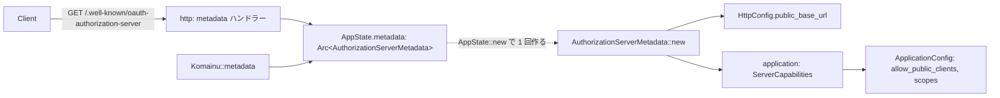
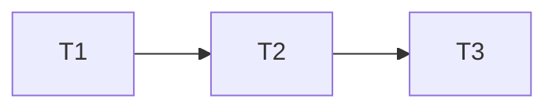

# 認可サーバーメタデータ（RFC 8414）

- 状態: 設計中
- 最終更新: 2026-11-24
- 関連: [RFC 8414](https://www.rfc-editor.org/rfc/rfc8414)、[認可サーバー設計書 §8 ロードマップ](../authorization-server/README.md#8-ロードマップ)、[PKCE 設計書 U-2](../pkce/README.md#7-未決事項)、[トークン失効設計書 U-2](../token-revocation/README.md#7-未決事項)、[Issue #23（公開項目の範囲の見直し）](https://github.com/ryoshrimp/komainu/issues/23)

## 1. 概要

`GET /.well-known/oauth-authorization-server` で、komainu の認可サーバーとしての設定（issuer、各エンドポイントの URL、対応するグラントやクライアント認証方式など）を JSON で返す。クライアントやライブラリは、これを読めば URL や対応方式を手で設定せずに済む。

返す内容は、komainu が実際に対応していることと設定（`public_base_url`、`allow_public_clients`、`[[scopes]]`）から自動で決める。運用者が任意の項目を足す仕組みは今回は用意しない（範囲の見直しは Issue #23）。

## 2. 要件

### 2.1 利用者と目的

| 利用者 | 目的 |
| --- | --- |
| OAuth クライアントの開発者・クライアントライブラリ | issuer を 1 つ設定するだけで、エンドポイントと対応方式を自動で取得する |
| komainu をライブラリとして組み込む開発者 | 同じ内容を Rust の値として取り出し、独自のルーティングやテストに使う |
| 運用者 | 追加の設定なしで公開される。内容が設定と食い違わない |

### 2.2 スコープ

やること:

- `GET /.well-known/oauth-authorization-server` の追加（`komainu_http::router` に含め、常に有効）
- application 層で「何に対応しているか」を返す `ServerCapabilities`
- http 層で issuer と URL を足して JSON にする `AuthorizationServerMetadata`
- facade（`Komainu`）からのメタデータ取得
- issuer にパスがある場合の公開方法のドキュメント
- PKCE 設計書 U-2、トークン失効設計書 U-2 の解消、ロードマップの更新

やらないこと:

- RFC 9207（認可応答の `iss` パラメータ）と `authorization_response_iss_parameter_supported`。ロードマップの別ステップにする
- `signed_metadata`（RFC 8414 §2.1）、`jwks_uri`、OpenID Connect の `/.well-known/openid-configuration`
- `service_documentation`、`op_policy_uri`、`op_tos_uri`、`ui_locales_supported` などの手書き項目、組み込み側による任意フィールドの追加（Issue #23）
- エンドポイントを無効にする設定、`max-age` の設定
- issuer にパスがあるときに、ホスト直下の `/.well-known/oauth-authorization-server/<path>` を komainu 自身が配信すること（§5.2 の手順で運用者・組み込み側が行う）

### 2.3 機能要件

| ID | 要件 | 受け入れ条件 |
| --- | --- | --- |
| F-1 | メタデータを JSON で返す | `GET /.well-known/oauth-authorization-server` が 200、`Content-Type` が `application/json;charset=UTF-8` と完全一致、本文が §4.3 の JSON になる。`?foo=bar` を付けても同じ本文になる |
| F-2 | issuer とエンドポイントは `public_base_url` から作る | `public_base_url = "https://auth.example.com"` のとき `issuer` が `"https://auth.example.com"`、`authorization_endpoint` が `"https://auth.example.com/authorize"`、`token_endpoint` が `"https://auth.example.com/token"`、`revocation_endpoint` が `"https://auth.example.com/revoke"` になる。`"https://example.com/auth"` のとき（ルーターは `/` にマウントしたまま `GET /.well-known/oauth-authorization-server` を送る）は `issuer` が `"https://example.com/auth"`、`authorization_endpoint` が `"https://example.com/auth/authorize"`、`token_endpoint` が `"https://example.com/auth/token"`、`revocation_endpoint` が `"https://example.com/auth/revoke"` になる |
| F-3 | クライアント認証方式は設定に従う（`ApplicationConfig::allow_public_clients`、サーバー設定では `clients.allow_public`） | `allow_public_clients = false` のとき `token_endpoint_auth_methods_supported` と `revocation_endpoint_auth_methods_supported` が `["client_secret_basic","client_secret_post"]`、`true` のとき末尾に `"none"` が加わる |
| F-4 | スコープは `[[scopes]]` の順に載せる | スコープ `read`、`write` を設定したとき `scopes_supported` が `["read","write"]`。スコープを 1 つも設定しないときは `scopes_supported` のキー自体が出ない |
| F-5 | 固定の対応項目を載せる | `response_types_supported` が `["code"]`、`response_modes_supported` が `["query"]`、`grant_types_supported` が `["authorization_code","client_credentials","refresh_token"]`、`code_challenge_methods_supported` が `["S256"]` |
| F-6 | CORS とキャッシュのヘッダーを付ける | 応答に `Access-Control-Allow-Origin: *` と `Cache-Control: public, max-age=3600` が付く。`Pragma` は付かない |
| F-7 | GET と HEAD 以外は受け付けない | `POST` は 405 になる（405 には F-6 のヘッダーは付かない。axum の既定のまま）。`HEAD` は 200、F-6 のヘッダー付きで本文が空 |
| F-8 | Rust から同じ内容を取り出せる | `AppState::metadata()` と `Komainu::metadata()` を `serde_json::to_value` した値が、同じ設定の HTTP 応答の本文を `serde_json::from_slice::<serde_json::Value>` した値と等しい |

### 2.4 非機能要件

| ID | 項目 | 基準 | 確かめ方 |
| --- | --- | --- | --- |
| N-1 | 性能 | リクエストごとに設定を読み直さない。JSON の元になる値は `AppState::new` で 1 回だけ作り、ハンドラーは複製せずにシリアライズする | コードレビュー（ハンドラーが `AppState` の保持する `Arc` を参照してシリアライズするだけであること） |
| N-2 | 一貫性 | 実装に対応方式を足したとき、メタデータの更新漏れが起きにくい | 対応方式の列挙は domain の `as_str()` を使い、文字列を直書きしない（コードレビュー） |
| N-3 | 観測 | 既存の HTTP メトリクスとトレースに乗る | コードレビューのみ（`.route` を `router` の既存ルートと並べ、`.with_state` と各 `.layer` より前に置くこと。メトリクスのテストは追加しない） |

### 2.5 前提と制約

- `public_base_url` は `HttpConfig::new` / `new_insecure` で検証済み（https または明示した http、クエリ・フラグメントなし、末尾 `/` は除去済み）。RFC 8414 §2 の issuer の条件（https、クエリ・フラグメントなし）はこれで満たす。`new_insecure` で http を許したときは issuer も http になる（開発用途）
- ルーターは `/` にマウントする前提（`router` のドキュメントどおり）。パス付きでマウントする組み込み側は `nest` する
- `client_credentials` は機密クライアントだけが使えるが、`grant_types_supported` はサーバー全体での対応を示すので常に載せる
- 失効エンドポイントのクライアント認証は `/token` と同じ `authenticate_client` を使う（`none` も `allow_public_clients` が true のときだけ受け付ける）ので、2 つの `*_auth_methods_supported` は同じ値になる
- メタデータの対応方式は `TokenService` が持つ `ApplicationConfig` を正とする。`AppState::new` に渡す `AuthorizationService` と `TokenService` は同じ `Dependencies`（同じ `ApplicationConfig`）から作る前提で、facade とサーバーは既にそうなっている。この前提を `AppState::new` の doc コメントに書く

## 3. 全体構成



| 層 | 責務 |
| --- | --- |
| application | 何に対応しているか（グラント、認証方式、PKCE 方式、レスポンスタイプ・モード、スコープ）。URL は知らない |
| http | issuer と各エンドポイントの URL を足して RFC 8414 の JSON にし、ヘッダーを付けて返す |
| facade | `Komainu::metadata()` で http の値をそのまま渡す |
| server | 変更なし（`komainu.router()` を `/` に配信しているので自動で公開される） |

### 3.1 技術選定

新しい依存は追加しない。JSON は既存の `serde` / `serde_json`、ヘッダーは `axum::http::header` の定数を使う。CORS は `tower-http` の `CorsLayer` を使わず、このルートの応答に `Access-Control-Allow-Origin` を直接付ける（プリフライトが要らない単純 GET なので）。

### 3.2 主要な流れ

1. 起動時、`AppState::new(authorization, token, config)` が `token.server_capabilities()` と `config` から `AuthorizationServerMetadata` を作り、`Arc` で保持する
2. リクエストが来たら、ハンドラーは保持している値を `IntoResponse` で返す（ヘッダー付与もここで行う）

## 4. コンポーネント間の契約

### 4.1 application: `crates/application/src/capabilities.rs`（新規）

```rust
/// What this authorization server supports, independent of URLs.
/// Every list is in a fixed order (see below) and has no duplicates.
#[derive(Debug, Clone, PartialEq, Eq)]
#[non_exhaustive]
pub struct ServerCapabilities {
    /// Always `[ResponseType::Code]` today.
    pub response_types: Vec<ResponseType>,
    /// Always `[ResponseMode::Query]` today.
    pub response_modes: Vec<ResponseMode>,
    /// `[AuthorizationCode, ClientCredentials, RefreshToken]`.
    pub grant_types: Vec<GrantType>,
    /// `[ClientSecretBasic, ClientSecretPost]`, plus `None` last when
    /// `allow_public_clients` is true.
    pub token_endpoint_auth_methods: Vec<TokenEndpointAuthMethod>,
    /// Same as `token_endpoint_auth_methods`.
    pub revocation_endpoint_auth_methods: Vec<TokenEndpointAuthMethod>,
    /// `[CodeChallengeMethod::S256]`.
    pub code_challenge_methods: Vec<CodeChallengeMethod>,
    /// `ApplicationConfig::scopes` names, in configuration order. May be empty.
    pub scopes: Vec<ScopeToken>,
}

impl ServerCapabilities {
    pub fn from_config(config: &ApplicationConfig) -> Self;
}

/// `response_type` values. Only `code` is supported.
#[derive(Debug, Clone, Copy, PartialEq, Eq)]
#[non_exhaustive]
pub enum ResponseType { Code }
impl ResponseType { pub fn as_str(&self) -> &'static str; } // "code"

/// `response_mode` values. Only `query` is supported.
#[derive(Debug, Clone, Copy, PartialEq, Eq)]
#[non_exhaustive]
pub enum ResponseMode { Query }
impl ResponseMode { pub fn as_str(&self) -> &'static str; } // "query"
```

- `GrantType`、`TokenEndpointAuthMethod`、`CodeChallengeMethod`、`ScopeToken` は `komainu_domain` の既存の型
- `ResponseType` と `ResponseMode` はメタデータのためだけの型なので application に置く。認可エンドポイントの `response_type` 検証（既存の `"code"` 比較）は今回は書き換えない
- `crates/application/src/lib.rs` に `pub mod capabilities;` と `pub use capabilities::{ResponseMode, ResponseType, ServerCapabilities};` を足す
- `TokenService` に追加する:

```rust
impl TokenService {
    /// Equivalent to `ServerCapabilities::from_config(&self.deps.config)`.
    pub fn server_capabilities(&self) -> ServerCapabilities;
}
```

エラーはない（設定は検証済みで、作るだけ）。

### 4.2 http: `crates/http/src/metadata.rs`（新規）

```rust
/// RFC 8414 authorization server metadata, serialized as the response body.
/// Field names are the RFC 8414 / RFC 7009 / RFC 7636 member names.
#[derive(Debug, Clone, PartialEq, Eq, Serialize)]
#[non_exhaustive]
pub struct AuthorizationServerMetadata {
    pub issuer: String,
    pub authorization_endpoint: String,
    pub token_endpoint: String,
    pub revocation_endpoint: String,
    pub response_types_supported: Vec<&'static str>,
    pub response_modes_supported: Vec<&'static str>,
    pub grant_types_supported: Vec<&'static str>,
    pub token_endpoint_auth_methods_supported: Vec<&'static str>,
    pub revocation_endpoint_auth_methods_supported: Vec<&'static str>,
    pub code_challenge_methods_supported: Vec<&'static str>,
    #[serde(skip_serializing_if = "Vec::is_empty")]
    pub scopes_supported: Vec<String>,
}

impl AuthorizationServerMetadata {
    pub fn new(config: &HttpConfig, capabilities: &ServerCapabilities) -> Self;
}

/// 200 with the JSON body and the headers of §4.4.
impl IntoResponse for AuthorizationServerMetadata { ... }

/// Same response as `IntoResponse`, without cloning. Used by the handler.
pub(crate) fn metadata_response(metadata: &AuthorizationServerMetadata) -> Response;
```

`IntoResponse` の実装は `metadata_response(&self)` を呼ぶだけにする。

- `issuer` は `config.public_base_url()` そのもの。エンドポイントは `format!("{issuer}/authorize")`、`"/token"`、`"/revoke"`
- 各 `*_supported` は `capabilities` の対応するリストを同じ順に `as_str()` で変換したもの
- フィールドの宣言順が JSON のキーの順になる（上の順）。テストはキーの順に依存しない
- `crates/http/src/lib.rs` に `mod metadata;` と `pub use metadata::AuthorizationServerMetadata;` を足す
- `AppState` に追加する:

```rust
pub struct AppState {
    // 既存フィールド ...
    pub(crate) metadata: Arc<AuthorizationServerMetadata>,
}

impl AppState {
    /// The metadata served at `/.well-known/oauth-authorization-server`.
    pub fn metadata(&self) -> &AuthorizationServerMetadata;
}
```

`AppState::new` のシグネチャは変えない。`new` の中で `AuthorizationServerMetadata::new(&config, &token.server_capabilities())` を呼ぶ。

### 4.3 HTTP API

`GET /.well-known/oauth-authorization-server`

- リクエスト: パラメータなし。クエリが付いていても無視する
- 認証: なし
- 成功時 200。本文の例（`public_base_url = "https://auth.example.com"`、`allow_public_clients = true`、スコープ `read` `write`）:

```json
{
  "issuer": "https://auth.example.com",
  "authorization_endpoint": "https://auth.example.com/authorize",
  "token_endpoint": "https://auth.example.com/token",
  "revocation_endpoint": "https://auth.example.com/revoke",
  "response_types_supported": ["code"],
  "response_modes_supported": ["query"],
  "grant_types_supported": ["authorization_code", "client_credentials", "refresh_token"],
  "token_endpoint_auth_methods_supported": ["client_secret_basic", "client_secret_post", "none"],
  "revocation_endpoint_auth_methods_supported": ["client_secret_basic", "client_secret_post", "none"],
  "code_challenge_methods_supported": ["S256"],
  "scopes_supported": ["read", "write"]
}
```

- `HEAD`: 200、ヘッダーは GET と同じ、本文なし（axum の `get` ルートが自動で扱う）
- それ以外のメソッド: 405（axum の既定。`Allow` ヘッダーは axum に任せる）
- エラー応答はない（値は起動時に作られている）

### 4.4 応答ヘッダー

| ヘッダー | 値 |
| --- | --- |
| `Content-Type` | `application/json;charset=UTF-8`（既存の `oauth_error::JSON_CONTENT_TYPE` を使う） |
| `Cache-Control` | `public, max-age=3600` |
| `Access-Control-Allow-Origin` | `*` |

`security_headers` layer は HTML 応答だけに付くので、このルートには影響しない。

### 4.5 facade: `crates/komainu/src/builder.rs`

```rust
impl Komainu {
    /// RFC 8414 metadata. Same value the router serves.
    #[cfg(feature = "http")]
    pub fn metadata(&self) -> &komainu_http::AuthorizationServerMetadata;
}
```

中身は `self.state.metadata()`。

## 5. 実装の注意点

### 5.1 ルートの追加

`router` の既存ルートと同じ場所に `.route("/.well-known/oauth-authorization-server", get(metadata::serve))` を足す（`.with_state` と各 `.layer` より前なので既存 layer の内側に入る）。ハンドラー `async fn serve(State(state): State<AppState>) -> Response` は `metadata_response(&state.metadata)` を返す（値は複製しない）。

### 5.2 issuer にパスがある場合

RFC 8414 §3.1 では、issuer が `https://example.com/auth` のとき、メタデータの URL は `https://example.com/.well-known/oauth-authorization-server/auth`（ホスト直下に well-known を置き、その後ろにパス）になる。komainu のルーターは自分のマウント位置より上を配信できないので、次をドキュメントに書く。

- komainu は常に「ルーターから見た相対パス `/.well-known/oauth-authorization-server`」で配信する。`public_base_url` にパスがない場合はこれが RFC どおりの URL になる
- パスがある場合の転送先は構成によって違う
  - 単体サーバー（`komainu serve`）: ルーターは `/` に配信されているので、リバースプロキシは `/auth/...` の `/auth` を剥がしてバックエンドに渡しているはずである。RFC どおりの `/.well-known/oauth-authorization-server/auth` は、バックエンドの `/.well-known/oauth-authorization-server` に転送する。getting-started にはこの構成の nginx 例を載せる:

    ```nginx
    location = /.well-known/oauth-authorization-server/auth {
        proxy_pass http://127.0.0.1:8080/.well-known/oauth-authorization-server;
    }
    location /auth/ {
        proxy_pass http://127.0.0.1:8080/;
    }
    ```

  - 組み込みで `Router::nest("/auth", komainu.router())` している場合: `/.well-known/oauth-authorization-server/auth` を `/auth/.well-known/oauth-authorization-server` に回す（自分のルートで `Komainu::metadata()` を返してもよい）。これは facade の rustdoc（`Komainu::metadata`）に書く
- 組み込み側は `Komainu::metadata()` の値を自分のルートで返してもよい（`AuthorizationServerMetadata` は `IntoResponse` を実装している）

### 5.3 その他

- `ServerCapabilities::from_config` の固定リストは、domain の enum の全バリアントを機械的に並べない。将来バリアントが増えても、対応を実装するまで載せないため、明示的に列挙する
- CHANGELOG の `Unreleased` には `Added`（エンドポイント、`ServerCapabilities`、`ResponseType`、`ResponseMode`、`TokenService::server_capabilities`、`AuthorizationServerMetadata`、`AppState::metadata`、`Komainu::metadata`）を書く。既存 API は壊さない

## 6. タスク計画



### T1 application: `ServerCapabilities`

- 依存: なし
- 対象: `crates/application/src/capabilities.rs`（新規）、`crates/application/src/lib.rs`、`crates/application/src/token/mod.rs`、`crates/application/tests/token.rs`（または新規 `crates/application/tests/capabilities.rs`）
- 内容: §4.1 の型、`from_config`、`TokenService::server_capabilities`
- 完了条件:
  - `allow_public_clients = false` で `token_endpoint_auth_methods` が `[ClientSecretBasic, ClientSecretPost]`、`true` で末尾に `None` が加わる。`revocation_endpoint_auth_methods` も同じ
  - スコープ `read`、`write` を設定すると `scopes` がその順、未設定なら空
  - `grant_types`、`code_challenge_methods`、`response_types`、`response_modes` が §4.1 の値
  - `TokenService::server_capabilities()` が `from_config(&config)` と等しい
- 検証: `cargo test -p komainu-application`、`cargo clippy --workspace --all-targets --features pg-tests -- -D warnings`

### T2 http: メタデータとエンドポイント、facade

- 依存: T1
- 対象: `crates/http/src/metadata.rs`（新規）、`crates/http/src/lib.rs`、`crates/http/src/state.rs`、`crates/http/tests/common/mod.rs`、`crates/http/tests/metadata.rs`（新規）、`crates/komainu/src/builder.rs`、`crates/komainu/tests/builder.rs`
- 内容: §4.2〜§4.5、§5.1、§5.2 の組み込み向けの rustdoc
- テストの準備: `crates/http/tests/common/mod.rs` の `Harness` に `pub state: AppState` を足し、`from_config` と `with_screens` で `router(state.clone())` に渡す前の値を保持する。HEAD と POST は `Request::builder().method("HEAD")` / `.method("POST")` で組み立てて `router.oneshot` に渡す
- 完了条件:
  - F-1〜F-7 の受け入れ条件を `crates/http/tests/metadata.rs` で確かめる（F-1 の本文比較は `app_config().with_allow_public_clients(true)` で作り、§4.3 の例と一致させる。`allow_public_clients` の切り替えとスコープなしは、`ApplicationConfig` を変えて `TestEnv::new` に渡し、`Harness::from_config` で作る。パス付き issuer は `HttpConfig::new("https://example.com/auth").unwrap()` を `from_config` に渡し、ルーターは `/` のまま `GET /.well-known/oauth-authorization-server` を送る）
  - F-8（http）: `harness.state.metadata()` を `serde_json::to_value` した値が HTTP の本文を `serde_json::from_slice::<serde_json::Value>` した値と等しい
  - F-8（facade）: `crates/komainu/tests/builder.rs` の `#[cfg(feature = "http")]` のテストで `komainu.router()` に GET を送り、本文が `serde_json::to_value(komainu.metadata())` と等しい
  - 既存の http テストが通る
- 検証: `cargo test -p komainu-http -p komainu`、`cargo clippy --workspace --all-targets --features pg-tests -- -D warnings`、`cargo fmt --all -- --check`

### T3 ドキュメントと E2E

- 依存: T2
- 対象: `crates/server/tests/e2e_scenario.rs`、`README.md`、`docs/getting-started.md`、`CHANGELOG.md`、`docs/design/authorization-server/README.md`、`docs/design/pkce/README.md`、`docs/design/token-revocation/README.md`、この設計書
- 内容:
  - E2E（`crates/server/tests/e2e_scenario.rs`）: シナリオの最初に `GET {base}/.well-known/oauth-authorization-server` を送り、200 であること、`issuer == base`、`token_endpoint == "{base}/token"`、`revocation_endpoint == "{base}/revoke"`、E2E の設定は `clients.allow_public` を有効にしていないので `token_endpoint_auth_methods_supported` に `"none"` が無いことを確かめる。E2E の `Harness` に `token_endpoint: String` と `revocation_endpoint: String` のフィールドを足し、`token()` と `revoke()` だけその値を使うように置き換える（`authorize_url()` と `post_form()` は変えない）。`Harness` は起動待ち（`/readyz` のループ）の後に作る。起動待ちとメタデータの取得には `Harness` 用と同じ設定の `Client` を先に作って使い、取得した値とその `Client` で `Harness` を組み立てる
  - `README.md`: `## What is supported` の「Grants and endpoints」の一覧に `- Authorization server metadata (`GET /.well-known/oauth-authorization-server`, RFC 8414)` を足し、「Not supported (yet): …」の段落に RFC 9207 と署名付きメタデータを足す
  - `docs/getting-started.md`: `## Operations notes` に §5.2 の単体サーバー向けの説明と nginx 例を書く。設定名はサーバー設定のキー（`server.public_base_url`、`clients.allow_public`）で書く
  - `CHANGELOG.md`: §5.3 の内容を `## [Unreleased]` の `### Added` に足す
  - `docs/design/authorization-server/README.md` のロードマップ表: RFC 8414 の行を既存の形式に合わせ、順番「済」、状態「次のリリースで実装済み（Unreleased）」にする。RFC 9207 の行を表の末尾に、順番は既存の最大の番号 + 1、状態「未着手」で足す（既存の行の番号は変えない）
  - PKCE 設計書 U-2・トークン失効設計書 U-2: 表の「仮の扱い」列を「解消: [認可サーバーメタデータ](../authorization-server-metadata/README.md) で公開」に書き換える。この設計書の状態を「実装済み」にする
- 完了条件: E2E が通る。上記ドキュメントの差分がある
- 検証: `cargo test -p komainu-server --features pg-tests --test e2e_scenario`（Docker が必要。CI の `cargo test --workspace --features pg-tests` と同じ前提）、ドキュメントは目視

## 7. 未決事項

| ID | 内容 | 仮の扱い | 決める人・時期 |
| --- | --- | --- | --- |
| U-1 | 公開する項目の範囲を広げるか（手書き項目、任意フィールド、`scopes_supported` を隠す設定、署名付きメタデータなど） | 今回は §2.2 の範囲だけ | ユーザー。Issue #23 で議論 |
| U-2 | RFC 9207（認可応答の `iss`） | 今回は入れない。ロードマップの別ステップ | ユーザー。この設計の実装後 |
| U-3 | `max-age=3600` を設定可能にするか | 固定 | ユーザー。運用で不都合が出たとき |
