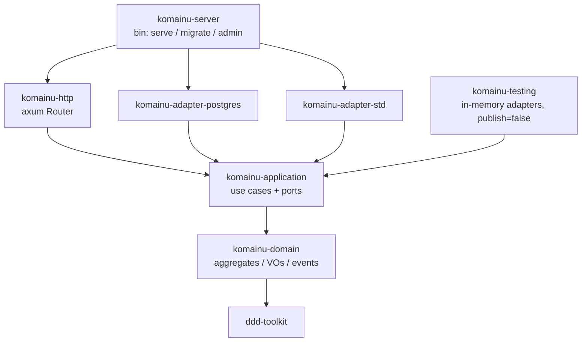
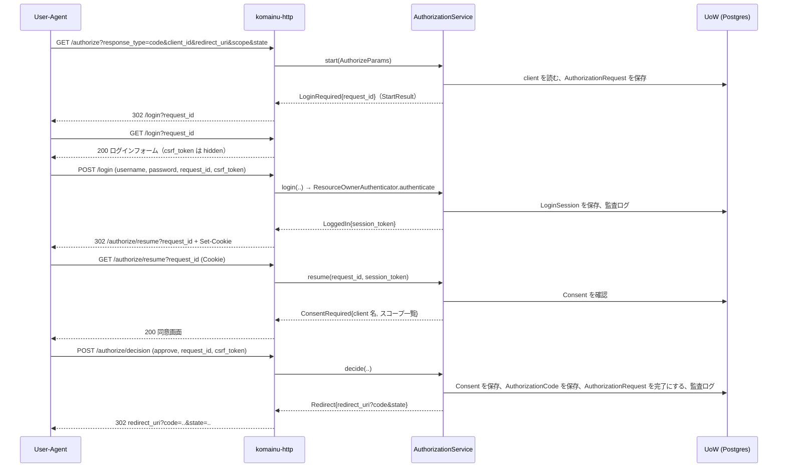
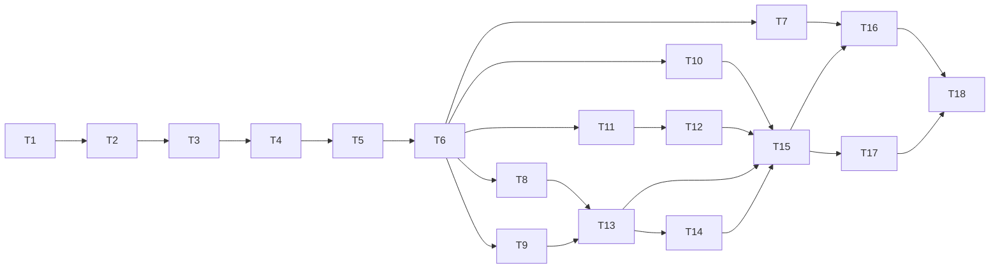

# komainu 認可サーバー（RFC 6749 コア）設計書

- 状態: 草案
- 最終更新: 2026-11-22
- 関連: [RFC 6749](https://www.rfc-editor.org/rfc/rfc6749)、[ddd-toolkit](https://github.com/ryoshrimp/ddd-toolkit)（0.5.0 時点）

## 1. 概要

komainu は Rust で書く OAuth 2.0 認可サーバーである。今回の段階では RFC 6749 の認可コードグラント（§4.1）、クライアントクレデンシャルグラント（§4.4）、リフレッシュトークン（§6）だけを実装する。PKCE、OIDC、Introspection（RFC 7662）、Revocation（RFC 7009）、Dynamic Client Registration（RFC 7591）などは後のステップで足していく。そのため、拡張しやすいドメインモデルと port/adapter 構成を最初に固めておく。目的は OAuth 仕様の学習と、将来 OSS として公開することである。組み込み用のライブラリ crate 群と、それを組み立てた単体サーバーバイナリの両方を提供する。

## 2. 要件

### 2.1 利用者と目的

| 利用者 | 目的 |
|---|---|
| 運用者 | `komainu` バイナリを設定ファイルで起動し、CLI でクライアントとユーザーを登録して、自分のシステムの認可サーバーとして使う |
| 組み込み利用者（Rust 開発者） | `komainu-application` / `komainu-http` を自分の axum アプリに組み込む。port を実装して DB や認証方式を差し替える |
| クライアント開発者 | RFC 6749 に従ってアクセストークンを取得する |
| リソースサーバー開発者 | ライブラリ API `TokenService::verify_access_token` でアクセストークンを検証する（HTTP での検証は RFC 7662 を実装するステップで用意する） |

### 2.2 スコープ

- やること
  - 認可エンドポイント（`response_type=code` のみ）、トークンエンドポイント（`authorization_code` / `client_credentials` / `refresh_token`）
  - クライアント認証: `client_secret_basic`（必須）と `client_secret_post`（クライアントごとに許可）
  - リソースオーナーの認証: port で抽象化する。既定実装として ID/パスワードの内蔵ユーザーストア、ログイン画面、ログインセッションを持つ
  - 同意画面と、同意内容の記憶（クライアントごとに同意を省略する設定も持つ）
  - リフレッシュトークンのローテーションと、再利用を検知したときの系列ごとの失効
  - 認可コードが再利用されたときに、そのコードから発行したトークンを失効させる（§4.1.2）
  - アクセストークン検証のライブラリ API
  - 管理 CLI（クライアントとユーザーの作成・一覧・表示・更新・無効化、DB マイグレーション）
  - 運用: tracing による構造化ログ、監査ログ（DB に保存）、Prometheus メトリクス、ヘルスチェック、期限切れデータの定期削除、グレースフルシャットダウン
  - PostgreSQL アダプタ（sqlx）
- やらないこと
  - PKCE（RFC 7636）、OIDC、JWT アクセストークン（RFC 9068）、Introspection / Revocation エンドポイント、RFC 7591、メタデータ（RFC 8414）
  - Implicit グラント（§4.2）、Resource Owner Password Credentials グラント（§4.3）、拡張グラント（§4.5）
  - 管理用の REST API と UI（RFC 7591 を実装した後で検討する）
  - リダイレクト型の外部 IdP 連携（SAML、外部 OIDC など）。認証 port は「ユーザー名とパスワードを検証する」形に限る
  - PostgreSQL 以外の DB アダプタ（テスト用のインメモリ実装は公開しない内部 crate として持つ）
  - ログイン試行のレート制限（失敗は監査ログに記録するだけ。運用ではリバースプロキシで制限する前提）
  - TLS の終端（リバースプロキシが行う。`public_base_url` は https を必須にする。例外はローカル開発用の `server.allow_insecure_http = true` だけ。[server.md §設定](server.md#設定)）
  - 画面テンプレートの実行時差し替えと多言語化（画面は英語のみ）
  - 同意の一部だけを許可する操作（同意は要求スコープを全部許可するか拒否するかの二択）

### 2.3 機能要件

RFC の節番号は RFC 6749 のもの。

| ID | 要件 | 受け入れ条件 |
|---|---|---|
| F-1 | 認可コードを発行できる | 有効なクライアントの `GET /authorize?response_type=code&client_id=..&redirect_uri=..&scope=..&state=xyz` に対し、ログインと同意を経ると、`302` で `redirect_uri?code=<43文字>&state=xyz` にリダイレクトされる |
| F-2 | 認可リクエストの誤りを §4.1.2.1 に従って返す | `client_id` が不明、または `redirect_uri` が登録値と一致しないときは、リダイレクトせず `400` のエラー画面を返す。それ以外の誤り（例: 未登録スコープ）では `redirect_uri?error=invalid_scope&state=xyz` へ `302` でリダイレクトする |
| F-3 | 認可コードをトークンに交換できる | 発行から 60 秒以内のコードを `grant_type=authorization_code` で送ると、`200` で `access_token`、`token_type=Bearer`、`expires_in=3600`、`scope` を返し、クライアントが `refresh_token` グラントを持つときは `refresh_token` も返す。レスポンスには `Cache-Control: no-store` と `Pragma: no-cache` が付く |
| F-4 | 認可コードは 1 回しか使えない | 交換済みのコードをもう一度送ると `400 invalid_grant` になり、1 回目の交換で発行したアクセストークンとリフレッシュトークンは検証で無効になる |
| F-5 | クライアントクレデンシャルでトークンを発行できる | `client_credentials` グラントを持つ confidential クライアントが正しく認証すると、`200` でアクセストークンを返す。`refresh_token` は含まない（§4.4.3） |
| F-6 | リフレッシュトークンでトークンを再発行できる | 有効なリフレッシュトークンを送ると、新しいアクセストークンと新しいリフレッシュトークンを返し、古いリフレッシュトークンは使えなくなる |
| F-7 | リフレッシュトークンの再利用を検知できる | ローテーション済みのリフレッシュトークンを送ると `400 invalid_grant` になり、同じ系列のトークンはすべて無効になる |
| F-8 | クライアントを認証できる | Basic 認証の誤りは `401 invalid_client` と `WWW-Authenticate: Basic realm="komainu"` を返す。Basic とボディの両方に資格情報があるときは `400 invalid_request` を返す |
| F-9 | 同意を記憶できる | 一度同意したスコープの範囲内で再度認可を求めたときは、同意画面を出さずにコードを発行する。`skip_consent=true` のクライアントでは同意画面を一度も出さない |
| F-10 | アクセストークンを検証できる | `TokenService::verify_access_token` は、有効なトークンなら `Ok(Some(AccessTokenInfo))` を返し、期限切れ・失効済み・未知のトークンなら `Ok(None)` を返す |
| F-11 | 管理 CLI でクライアントとユーザーを管理できる | `komainu client create ...` はクライアント ID とシークレットを一度だけ表示する。`client disable` を実行すると、そのクライアントのトークンはすべて検証で無効になる |
| F-12 | 監査ログを残せる | コード発行、トークン発行、再利用の検知、ログインの成功と失敗、クライアント認証の失敗、管理操作が、`audit_events` テーブルに 1 件ずつ記録される |
| F-13 | 期限切れデータを掃除できる | 削除ジョブの実行後、期限から 24 時間以上たった認可コード・トークン・セッション・認可リクエストが DB から消えている |

### 2.4 非機能要件

| ID | 項目 | 基準 | 確かめ方 |
|---|---|---|---|
| N-1 | トークンの強度 | 認可コード・アクセストークン・リフレッシュトークン・クライアントシークレット・セッション ID は、CSPRNG で生成した 32 バイトを base64url（パディングなし、43 文字）で表す | `komainu-adapter-std` の単体テスト |
| N-2 | 秘密情報の保存 | 上記の値は SHA-256 ハッシュだけを DB に保存し、平文は保存しない。パスワードは Argon2id（argon2 crate の既定パラメータ）で保存する | 結合テストで DB の列を確認する |
| N-3 | 秘密情報のログ出力 | トークン、コード、シークレット、パスワード、セッション ID の平文がログと監査ログに出ない | `Secret<T>` で包む。T18 の E2E テストで、ログ出力に平文が含まれないことを確かめる |
| N-4 | 時間定数比較 | シークレットとハッシュの比較は時間定数で行う | `subtle::ConstantTimeEq` を使っていることをレビューで確認する |
| N-5 | 原子性 | コードの交換、トークンの発行、監査ログの書き込みは 1 つの DB トランザクションで行う。同じコードで並行して交換を 10 回要求しても、成功するのは 1 回だけ | 結合テスト（並行で 10 回要求） |
| N-6 | クリックジャッキング対策（§10.13） | HTML を返すレスポンスには `X-Frame-Options: DENY` と `Content-Security-Policy: frame-ancestors 'none'` を付ける | HTTP テスト |
| N-7 | CSRF 対策（§10.12） | ログインと同意の POST は、フォームの `csrf_token`、Cookie `komainu_csrf`、認可リクエストに保存したハッシュの 3 つが一致しないと `400` になる。Cookie は `HttpOnly; SameSite=Lax` で、`session.cookie_secure=true` のときは `Secure` も付ける | HTTP テスト |
| N-8 | 可観測性 | すべての HTTP リクエストに `x-request-id` を付け（受け取った値がなければ UUIDv7 を生成する）、ログと監査ログに同じ値を記録する | HTTP テスト |
| N-9 | 停止 | SIGTERM を受けたら新しい接続の受け付けを止め、処理中のリクエストを最大 30 秒（設定値）待ってから終了する | 手動確認（§6 T15） |
| N-10 | 性能の目安 | ローカルの PostgreSQL で、`client_credentials` のトークン発行が p95 50ms 以下 | E2E テストの後に `oha` などで 100 並列 30 秒計測する（参考値。CI では確かめない） |

### 2.5 前提と制約

- Rust stable（1.100 で確認）、edition 2024。MSRV は定めない（ddd-toolkit 0.5.0 の MSRV は 1.88 なので、1.100 で満たす）。
- 非同期ランタイムは tokio。ただし `komainu-domain` と `komainu-application` は tokio に依存しない。
- DB は PostgreSQL 16 以上。
- ddd-toolkit は `komainu-domain` だけが依存し、使うのは derive（`ValueObject` / `Entity` / `AggregateRoot` / `DomainEvent`）と `Secret<T>` に限る。ほかの crate は domain が再エクスポートする `komainu_domain::Secret` と `komainu_domain::AggregateRoot`（`pull_events` のため）だけを使う。Repository などの port は komainu で独自に定義する。破壊的変更の影響をドメイン層に閉じ込めるため。
- ライセンスは MIT OR Apache-2.0（ddd-toolkit と同じ）。
- 既存のコードはない（README.md だけ）。命名は Rust の標準（crate はケバブケース、型は UpperCamelCase）に従う。
- コードコメントと rustdoc は英語で書く（OSS 公開のため）。

### 2.6 用語

| 用語 | 意味 |
|---|---|
| Subject | リソースオーナーを指す不透明な文字列 ID。内蔵ユーザーストアではユーザー ID（UUID 文字列） |
| AuthorizationRequest | `/authorize` で受け取り検証した要求。ログインと同意の間、DB に保持する |
| Grant | 1 回の認可（コード交換 1 回、または client_credentials 要求 1 回）から派生するトークン群をまとめる集約。Grant を失効させると、それにぶら下がるアクセストークンとリフレッシュトークンがすべて無効になる |
| 系列 | 同じ Grant にぶら下がるリフレッシュトークンの連なり |
| ローテーション | リフレッシュトークンを使ったときに新しいものを発行し、古いものを使用済みにすること |
| UoW | Unit of Work。1 つの DB トランザクションと、その中で使うリポジトリの束 |

## 3. 全体構成

| コンポーネント | 責務 | 配置（ディレクトリ） | 詳細 |
|---|---|---|---|
| komainu-domain | 集約、値オブジェクト、ドメインイベント、ドメインのルール。I/O と async は持たない | `crates/domain` | [domain.md](domain.md) |
| komainu-application | ユースケース（アプリケーションサービス）と port の trait。トランザクション境界を決める | `crates/application` | [application.md](application.md) |
| komainu-adapter-postgres | port の PostgreSQL 実装（sqlx）とマイグレーション | `crates/adapter-postgres` | [adapters.md](adapters.md) |
| komainu-adapter-std | 時計、CSPRNG、Argon2 のパスワードハッシュ | `crates/adapter-std` | [adapters.md](adapters.md) |
| komainu-testing | テスト用のインメモリ adapter（公開しない） | `crates/testing` | [adapters.md](adapters.md) |
| komainu-http | エンドポイント、画面、OAuth エラーへの変換、HTTP ミドルウェア | `crates/http` | [http.md](http.md) |
| komainu-server | 設定の読み込み、DI の組み立て、サーバー起動、CLI、定期削除ジョブ | `crates/server` | [server.md](server.md) |

### 3.1 技術選定

版は 2026-11-22 時点の最新。`Cargo.toml` では `"0.8"` のようにマイナーまでで指定し、`Cargo.lock` をコミットする。

| 対象 | 採用 | 理由 | 見送った候補 |
|---|---|---|---|
| Web | axum 0.8 + tower-http 0.7 | tokio との親和性と、組み込み利用者の多さ | actix-web |
| DB | sqlx 0.9（`postgres`, `runtime-tokio`, `tls-rustls`, `uuid`, `time`, `json`, `migrate`） | 依頼どおり。マイグレーションも同梱できる | diesel、sea-orm |
| テンプレート | askama 0.16 | コンパイル時に型検査され、自動でエスケープされる | tera（実行時に差し替えられるが、今回は不要） |
| パスワード | argon2 0.6（Argon2id） | OWASP の推奨 | bcrypt |
| トークンのハッシュ | sha2 0.11 | 高エントロピーの値なので、遅いハッシュは要らない | argon2（トークン要求ごとに重い） |
| 乱数 | rand 0.10（`OsRng`） | CSPRNG | — |
| 日時 | time 0.3 | sqlx と相性が良い | chrono |
| ID | uuid 1（v7） | 時系列で並び、インデックスに優しい | ULID |
| CLI | clap 4（derive） | 標準的 | — |
| 設定 | figment 0.10（TOML ＋ 環境変数） | ファイルと環境変数の重ね合わせが簡単 | config-rs |
| ログ | tracing + tracing-subscriber 0.3（`json`, `env-filter`） | 標準的 | — |
| メトリクス | metrics 0.24 + metrics-exporter-prometheus 0.18 | facade とエクスポーターを分けられる | prometheus crate |
| 結合テスト | testcontainers-modules 0.15（`postgres`） | 実 DB で原子性を確かめるため | 共有 DB |
| E2E テスト | reqwest 0.12（`rustls-tls`, `cookies`、自動リダイレクト無効） | — | — |
| DDD の部品 | ddd-toolkit 0.5（facade 0.5.0 = core 0.5.0 + macro 0.6.0。workspace 側で `default-features = false`） | 自作。derive と `Secret<T>` だけを使う（§2.5） | — |
| エラー型 | thiserror 2 | — | anyhow（ライブラリ crate では使わない。server の `run()` と CLI の最上位のエラー表示だけ可） |

### 3.2 主要な流れ

#### 認可コードフロー（初回、未ログイン）

ログイン済みで同意も記憶されていれば、`start` がそのまま `Redirect` を返し、`/authorize` が直接 `302` でクライアントに戻す。

#### トークン交換（authorization_code）

1. `komainu-http` がフォームと `Authorization` ヘッダーを解析し、`TokenRequest` と `ClientAuthentication` を組み立てる。
2. `TokenService::exchange` が UoW を開始する。クライアントを認証し、認可コードを `FOR UPDATE` で読む。検証後に Grant、AccessToken、RefreshToken を作り、コードを交換済みにして保存する。最後に監査イベントを書いてコミットする。
3. コードが交換済みだったときは、Grant を失効させてコミットしてから `invalid_grant` を返す。

#### トークン検証（リソースサーバー）

`TokenService::verify_access_token(token)` がハッシュでアクセストークンを引き、期限と Grant の状態を確かめて `AccessTokenInfo` を返す。

## 4. コンポーネント間の契約

| 契約 | 提供側 | 利用側 | 定義 |
|---|---|---|---|
| ドメインモデル（集約、VO、イベント） | domain | application, adapters | [domain.md](domain.md) |
| port trait（`UnitOfWorkFactory`、各リポジトリ、`Clock`、`SecureRandom`、`PasswordHasher`、`ResourceOwnerAuthenticator`） | application | adapters, server | [application.md §公開インターフェース](application.md#公開インターフェース) |
| ユースケース API（`AuthorizationService`、`TokenService`、`AdminService`、`MaintenanceService`）とエラー型 | application | http, server | [application.md](application.md) |
| HTTP API（`/authorize`、`/token` など）と画面 | http | クライアント、ブラウザ | [http.md](http.md) |
| `komainu_http::router` の組み込み API | http | server、組み込み利用者 | [http.md](http.md) |
| DB スキーマ | adapter-postgres | 運用者 | [adapters.md §データ](adapters.md#データ) |
| 設定ファイル、CLI、ops エンドポイント（`/healthz`、`/readyz`、`/metrics`） | server | 運用者 | [server.md](server.md) |
| 監査イベントの形式 | application（`AuditEvent`） | adapters、運用者 | [application.md §監査イベント](application.md#監査イベント) |

層をまたぐときの依存の向き（守らなければならない）:

- domain は他の komainu crate に依存しない。
- application は domain だけに依存する。sqlx、axum、tokio には依存しない（`std::future` と `std::pin` だけ使う）。
- adapters と http は application に依存する。両者は互いに依存しない。

## 5. コンポーネント詳細

- [domain.md](domain.md)
- [application.md](application.md)
- [adapters.md](adapters.md)（adapter-postgres、adapter-std、testing）
- [http.md](http.md)
- [server.md](server.md)

## 6. タスク計画

### T1. ワークスペースの土台

- 依存: なし
- 対象: `Cargo.toml`（workspace）、`crates/*/Cargo.toml` と空の `src/lib.rs`（server は `src/main.rs`）、`rust-toolchain.toml`（`channel = "1.100"`、`components = ["rustfmt", "clippy"]`）、`LICENSE-MIT`、`LICENSE-APACHE`、`.github/workflows/ci.yml`、`.gitignore`
- 内容: §3 の 7 crate を作る。`[workspace.dependencies]` に §3.1 の依存を版付きで並べ、各 crate は `workspace = true` で参照する。ddd-toolkit は workspace 側を `{ version = "0.5", default-features = false }` とし、komainu-domain 側で `{ workspace = true, features = ["derive", "secret", "serde"] }` とする（メンバー側の `default-features = false` は Cargo に無視されるため）。`[workspace.lints]` で `unsafe_code = "forbid"`、clippy の `all = "warn"` を設定する。CI で fmt、clippy（`-D warnings`）、test を走らせる。testcontainers を使うテストは `--features pg-tests` のときだけ動かす（CI の ubuntu ランナーでは有効にする）。
- 完了条件: `cargo build --workspace` と `cargo clippy --workspace --all-targets -- -D warnings` が通る。§4 の依存の向きが Cargo.toml で守られている。`cargo tree -p komainu-domain -e features -i ddd-toolkit` に `cqrs`、`event_sourcing`、`delivery`、`process` が出ない。
- 検証: `cargo build --workspace && cargo clippy --workspace --all-targets -- -D warnings && cargo test --workspace`

### T2. domain: 共通の値オブジェクト

- 依存: T1
- 対象: `crates/domain/src/{lib.rs, error.rs, shared/*.rs}`
- 内容: [domain.md §共通の値オブジェクト](domain.md#共通の値オブジェクト) の `ClientId`、`ClientName`、`Subject`、`ScopeToken`、`ScopeSet`、`RedirectUri`、`State`、`TokenHash`、`OpaqueToken`、`UserId`、`Username`、`Password`、`NewPassword`、`PasswordHash`、`AuthorizationRequestId`、`GrantId`、列挙型（`ClientType` など）と `DomainError`。
- 完了条件: domain.md の該当する受け入れ条件がすべて単体テストになっていて、通る。
- 検証: `cargo test -p komainu-domain`

### T3. domain: client と identity

- 依存: T2
- 対象: `crates/domain/src/client/*.rs`、`crates/domain/src/identity/*.rs`
- 内容: `Client` 集約、`User` 集約、`LoginSession` 集約とそれぞれのイベント（F-11）。
- 完了条件: domain.md の Client・User・LoginSession の受け入れ条件が通る。
- 検証: `cargo test -p komainu-domain -- client:: identity::`

### T4. domain: authorization

- 依存: T3
- 対象: `crates/domain/src/authorization/*.rs`
- 内容: `AuthorizationRequest`、`AuthorizationCode`、`Consent` 集約とイベント（F-1、F-2、F-4、F-9）。
- 完了条件: domain.md の該当する受け入れ条件が通る。
- 検証: `cargo test -p komainu-domain -- authorization::`

### T5. domain: token

- 依存: T4
- 対象: `crates/domain/src/token/*.rs`
- 内容: `Grant`、`AccessToken`、`RefreshToken` とイベント（F-3〜F-7、F-10）。
- 完了条件: domain.md の該当する受け入れ条件が通る。
- 検証: `cargo test -p komainu-domain -- token::`

### T6. application: port、エラー、テスト用 adapter

- 依存: T5
- 対象: `crates/application/src/{lib.rs, context.rs, config.rs, deps.rs, ids.rs, audit.rs, authentication.rs, port/*.rs}`、`crates/testing/src/*.rs`
- 内容: [application.md](application.md) の port trait と `StoreError`、`RequestContext`、`AuditEvent`、`ApplicationConfig`、`Dependencies`、ID とトークンの生成、`BuiltinAuthenticator`（`TestEnv` が使うので T8 ではなくここで作る）。`komainu-testing` に `InMemoryUnitOfWorkFactory`、`FixedClock`、`SequenceRandom`、`PlainPasswordHasher`、`TestEnv` を作る（[adapters.md §komainu-testing](adapters.md#komainu-testing)）。ユースケースごとのエラー型（`authorization/error.rs` など）は T7〜T9 で作る。
- 完了条件: インメモリ UoW で「保存 → commit → 別の UoW で読める」「commit せずに drop → 読めない」のテストが通る。
- 検証: `cargo test -p komainu-testing`

### T7. application: 管理ユースケース

- 依存: T6
- 対象: `crates/application/src/admin/*.rs`、`crates/application/tests/admin.rs`
- 内容: `AdminService`（クライアントとユーザーの CRUD、シークレットのローテーション、無効化に伴う Grant の失効）。F-11、F-12。
- 完了条件: application.md の AdminService の受け入れ条件が、インメモリ adapter のテストで通る。
- 検証: `cargo test -p komainu-application --test admin`

### T8. application: 認可フローのユースケース

- 依存: T6
- 対象: `crates/application/src/authorization/*.rs`、`crates/application/tests/authorization.rs`
- 内容: `AuthorizationService`（start / login_form / login / resume / decide / logout）。F-1、F-2、F-9、F-12。
- 完了条件: application.md の AuthorizationService の受け入れ条件が通る。
- 検証: `cargo test -p komainu-application --test authorization`

### T9. application: トークンのユースケース

- 依存: T6
- 対象: `crates/application/src/token/*.rs`、`crates/application/src/maintenance.rs`、`crates/application/tests/{token.rs, maintenance.rs}`
- 内容: `TokenService`（exchange、verify_access_token）、`MaintenanceService`（purge_expired）。F-3〜F-8、F-10、F-13。
- 完了条件: application.md の TokenService と MaintenanceService の受け入れ条件が通る。
- 検証: `cargo test -p komainu-application --test token --test maintenance`

### T10. adapter-std

- 依存: T6
- 対象: `crates/adapter-std/src/*.rs`
- 内容: `SystemClock`、`OsSecureRandom`、`Argon2PasswordHasher`（N-1、N-2）。
- 完了条件: adapters.md の adapter-std の受け入れ条件が通る。
- 検証: `cargo test -p komainu-adapter-std`

### T11. adapter-postgres: マイグレーションと UoW の骨格

- 依存: T6
- 対象: `crates/adapter-postgres/migrations/0001_init.sql`、`crates/adapter-postgres/src/{lib.rs, uow.rs, error.rs, client.rs, user.rs, session.rs, audit.rs}`、`crates/adapter-postgres/tests/common/mod.rs`
- 内容: 全テーブルのマイグレーション、`PgUnitOfWorkFactory`、`PgUnitOfWork`、Client・User・LoginSession・AuditLog のリポジトリ。
- 完了条件: testcontainers の PostgreSQL に対して、該当リポジトリの保存と読み出しが往復し、`StoreError` への変換（一意制約違反 → `Conflict`）の結合テストが通る。
- 検証: `cargo test -p komainu-adapter-postgres --features pg-tests`

### T12. adapter-postgres: 残りのリポジトリ

- 依存: T11
- 対象: `crates/adapter-postgres/src/{authorization_request.rs, authorization_code.rs, consent.rs, grant.rs, access_token.rs, refresh_token.rs, purge.rs}`
- 内容: 残りのリポジトリと、`FOR UPDATE` で読むメソッド、期限切れデータの削除。N-5。
- 完了条件: adapters.md の adapter-postgres の受け入れ条件（並行交換のテストを含む）が通る。
- 検証: `cargo test -p komainu-adapter-postgres --features pg-tests`

### T13. http: トークンエンドポイントと共通ミドルウェア

- 依存: T8、T9（`AppState` が両方のサービスを持つため）
- 対象: `crates/http/src/{lib.rs, state.rs, token.rs, client_auth.rs, oauth_error.rs, middleware.rs, metrics.rs}`
- 内容: `HttpConfig`、`AppState`、`router()`（この時点では `/token` だけを載せる）、`POST /token`、クライアント資格情報の解析、エラー JSON、request id、アクセスログ、HTTP メトリクス。F-3〜F-8、N-8。
- 完了条件: http.md の `/token` の受け入れ条件が、インメモリ adapter を使った `tower::ServiceExt::oneshot` テストで通る。
- 検証: `cargo test -p komainu-http --test token`（テストは `crates/http/tests/token.rs` に置く）

### T14. http: 認可エンドポイントと画面

- 依存: T13
- 対象: `crates/http/src/{lib.rs（`router()` に認可系のルートを足す）, authorize.rs, login.rs, consent.rs, cookies.rs, security_headers.rs}`、`crates/http/templates/*.html`
- 内容: `/authorize`、`/login`、`/authorize/resume`、`/authorize/decision`、`/logout` と各画面。F-1、F-2、F-9、N-6、N-7。
- 完了条件: http.md の認可系の受け入れ条件が通る。
- 検証: `cargo test -p komainu-http --test authorize`（`/authorize`、`/login`、同意、`/logout`、セキュリティヘッダーのテストをすべて `crates/http/tests/authorize.rs` に置く）

### T15. server: 設定、起動、ops エンドポイント、停止

- 依存: T10、T12、T13、T14
- 対象: `crates/server/src/{main.rs, lib.rs, config.rs, wiring.rs, serve.rs, ops.rs, telemetry.rs, cli/mod.rs}`、`config/komainu.example.toml`
- 内容: 設定の読み込みと検証、DI の組み立て、メインと ops の 2 つのリスナー、ログとメトリクスの初期化、グレースフルシャットダウン。CLI は `serve`（`--migrate` を含む）と `migrate` のサブコマンドだけをここで作る。`lib.rs` の `pub mod cleanup` は T17 で足す（T15 では宣言しない）。削除ジョブの起動も T17 で足す。serve と ops の受け入れ条件は `crates/server/tests/serve.rs` に置く。`/metrics` の `komainu_token_requests_total` の確認は T15 の時点で行える（`/token` は T13 で完成している）N-8、N-9。
- 完了条件: server.md の serve の受け入れ条件が通る。`docker run postgres` を立てた状態で `komainu migrate` の後に `komainu serve` で起動し、`curl localhost:9090/readyz` が `200` を返す。SIGTERM を送ると 30 秒以内に終了コード 0 で終わる。
- 検証: `cargo test -p komainu-server --lib config`、`cargo test -p komainu-server --features pg-tests --test serve` と、上の手動手順

### T16. server: 管理 CLI

- 依存: T7、T15
- 対象: `crates/server/src/cli/{client.rs, user.rs, output.rs}`、`crates/server/src/cli/mod.rs`（サブコマンドの追加）
- 内容: `client *`、`user *` のサブコマンド。F-11。
- 完了条件: server.md の CLI の受け入れ条件が、testcontainers を使った `assert_cmd` のテストで通る。
- 検証: `cargo test -p komainu-server --features pg-tests cli`

### T17. server: 定期削除ジョブ

- 依存: T15
- 対象: `crates/server/src/cleanup.rs`、`crates/server/src/serve.rs`（`cleanup.enabled` のときにジョブを起動し、停止時に止める）
- 内容: `cleanup.interval_secs` ごとに `MaintenanceService::purge_expired` を呼び、件数をメトリクスとログに出す。F-13。
- 完了条件: server.md の cleanup の受け入れ条件が通る。
- 検証: `cargo test -p komainu-server --features pg-tests cleanup`

### T18. E2E シナリオテストと公開用ドキュメント

- 依存: T16、T17
- 対象: `crates/server/tests/e2e_*.rs`、`README.md`、`docs/getting-started.md`
- 内容: 実サーバーを起動し、reqwest で F-1〜F-12 を一通り通すシナリオ。README に概要・対応範囲・起動手順・設定・CLI を書く。
- 完了条件: E2E テストが通る。テスト中のサーバーのログ（tracing の出力をテスト用のバッファに書き出す）を、テストで発行したアクセストークン、リフレッシュトークン、認可コード、クライアントシークレット、パスワード、セッション Cookie の値で検索して、どれも 0 件である（N-3）。README の手順どおりに、新しい環境で client_credentials のトークンを取得できる。
- 検証: `cargo test -p komainu-server --features pg-tests e2e`

## 7. 未決事項

| ID | 内容 | 仮の扱い | 決める人・時期 |
|---|---|---|---|
| Q-1 | ddd-toolkit の次の破壊的変更（0.6 以降）への追従 | crates.io の `0.5.0` を使う（`ddd-toolkit = "0.5"`）。0.4.7 からの追従は反映済み（`Secret` の import パス、`expose_secret_ref`、`Secret` の `Clone` と `PartialEq` の廃止、validator が `&Self` を受け取ること。[domain.md §実装メモ](domain.md#実装メモ)）。次の版が出たら domain だけを直す | ユーザー・toolkit の次の版が出たとき |
| Q-2 | クライアントシークレットをローテーションしたときの猶予期間 | 猶予なし（古いシークレットはすぐ無効になる） | ユーザー・運用を始める前 |
| Q-3 | 画面のカスタマイズ（ブランディング、多言語） | askama の固定テンプレート（英語）。差し替えは組み込み利用者が `komainu-http` を使わずに画面を自作する形 | ユーザー・OSS 公開前 |
| Q-4 | リダイレクト型の外部 IdP 連携を認証 port でどう扱うか | 今回はユーザー名とパスワードの検証 port だけ | ユーザー・OIDC のステップの前 |
| Q-5 | リフレッシュトークンの絶対的な期限（系列全体の寿命） | なし（ローテーションのたびに 30 日の期限を引き直す） | ユーザー・運用を始める前 |
| Q-6 | 監査ログの外部出力（SIEM 連携、outbox） | DB の `audit_events` だけ。ddd-toolkit 0.5.0 の outbox は experimental な `ddd_toolkit::delivery` に移ったので、experimental でなくなるまで採用しない | ユーザー・OSS 公開前 |
| Q-7 | CSRF Cookie が 1 つだけなこと | `komainu_csrf` は 1 つなので、同じブラウザの複数のタブで同時に認可を進めると、後から始めたほうの値で上書きされ、先のタブは `CsrfMismatch` になる。Cookie 名に `request_id` を含める方式は採らない（Cookie が溜まるため） | ユーザー・OSS 公開前 |
| Q-8 | パスワード変更時のセッションと Grant の扱い | `set_user_password` は既存のログインセッションも Grant も失効させない | ユーザー・運用を始める前 |
| Q-9 | 認可エンドポイントでの `StoreError` | リダイレクトしてよい段階でも `500` のエラー画面にする（§4.1.2.1 の `server_error` / `temporarily_unavailable` のリダイレクトは使わない） | ユーザー・OSS 公開前 |
| Q-10 | リバースプロキシ越しのクライアント IP | `X-Forwarded-For` は見ず、接続元の IP を監査に記録する（信頼するプロキシの設定が要るため） | ユーザー・運用を始める前 |
