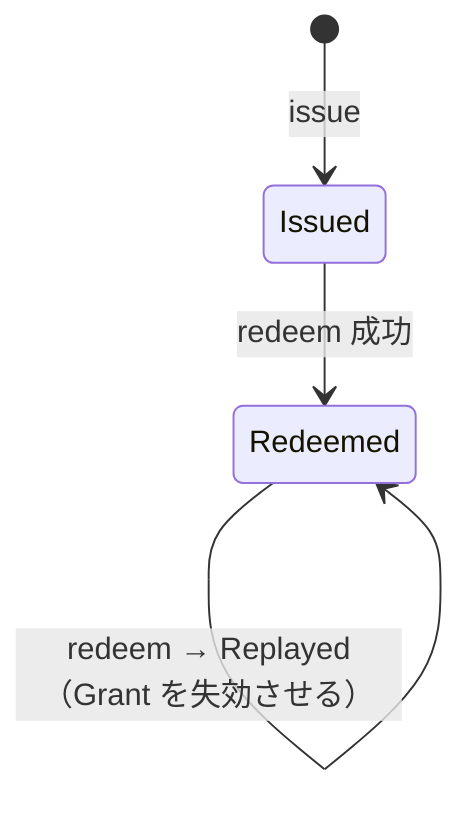
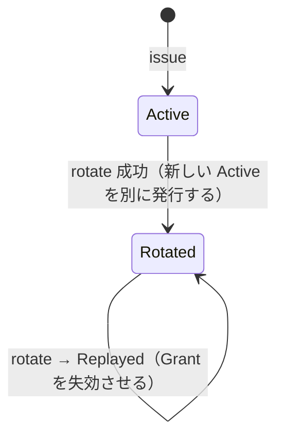

# komainu-domain

- 責務: OAuth 2.0 の概念（クライアント、認可リクエスト、認可コード、同意、Grant、トークン）とリソースオーナー（内蔵ユーザー、ログインセッション）を、集約と値オブジェクトで表し、仕様上のルールを守らせる。I/O、async、乱数の生成、設定の読み込みはしない。
- 配置: `crates/domain`
- 関連要件: F-1〜F-11、N-1、N-2、N-4

## 公開インターフェース

### 依存

`ddd-toolkit = "0.4"`（features: `derive`、`serde`。`serde` は server の設定で `Secret<String>` を deserialize するため。server は ddd-toolkit に直接依存せず、`komainu_domain::Secret` を使う）、`time = "0.3"`、`uuid = "1"`（`v7` は使わず、型としてだけ使う）、`url = "2"`、`sha2 = "0.11"`、`subtle = "2"`、`thiserror = "2"`、`zeroize = "1"`。

### モジュール構成

```
crates/domain/src/
  lib.rs                // 下のモジュールを pub mod で公開し、`pub use ddd_toolkit::Secret;` で再エクスポートする
  error.rs              // DomainError
  shared/               // 共通の値オブジェクト
    mod.rs  client_id.rs  subject.rs  scope.rs  redirect_uri.rs  state.rs  token.rs
  client/               // Client 集約
    mod.rs  client.rs  event.rs
  identity/             // User 集約、LoginSession 集約
    mod.rs  user.rs  session.rs  event.rs
  authorization/        // AuthorizationRequest、AuthorizationCode、Consent
    mod.rs  request.rs  code.rs  consent.rs  event.rs
  token/                // Grant、AccessToken、RefreshToken
    mod.rs  grant.rs  access_token.rs  refresh_token.rs  event.rs
```

### 共通の方針

- 値オブジェクトの作り方は、下の表の「実装」列に従う。
  - **derive**: ddd-toolkit の `#[derive(ValueObject)]` で作る。検証が要るものは `#[value_object(validate = .., error = DomainError)]` を付け、`try_new` で作る。derive は `Debug`、`Clone`、`PartialEq`、`Eq`、`Hash` を値に基づいて自動で実装するので、これらを二重に derive しない。
  - **手書き**: `ValueObject` derive を使わず、表と下の節に書いたメソッドと、指定したトレイトを手で実装する。`Debug` に平文を出さない型や、中身が `Secret` で `Hash` を持てない型がこれに当たる。
  - 「Ord」列が ✓ の型には、標準の `#[derive(PartialOrd, Ord)]` も付ける（`BTreeMap` のキーや一覧の並び順に使う）。並び順は中身の値の順（`String` はバイト順、`Uuid` はバイト順、`[u8; 32]` は辞書順）。
- 集約の ID のアクセサは、ddd-toolkit の `#[derive(Entity)]` が `#[entity(id)]` のフィールドから生成する `pub fn id(&self) -> &Id` だけを使う。下のシグネチャに `id()` は書かない（同じ名前で手書きするとコンパイルエラーになる）。`Copy` な ID（`UserId` など）は呼び出し側で `*x.id()` とする。
- 集約は `#[derive(Entity, AggregateRoot)]` で作る。イベントは集約ごとに 1 つの enum（`#[derive(DomainEvent)]`）にまとめ、`#[aggregate(events)] events: Vec<XxxEvent>` に積む。application がコミットの前に `pull_events()` で取り出す。
- 集約のフィールドは非公開にする。永続化のために、集約ごとに全フィールドを `pub` で持つ `XxxRecord` 構造体を用意し、次の 2 つを提供する。
  - `pub fn to_record(&self) -> XxxRecord`
  - `pub fn from_record(record: XxxRecord) -> Self`（DB から復元する。イベントは積まない。Record の各フィールドはすでに検証済みの型なので、ここでは検証しない）
- 時刻は `time::OffsetDateTime`（UTC）、期間は `time::Duration` で受け取る。現在時刻は引数 `now` で外から渡す。
- 期限の判定は `now >= expires_at` のとき「期限切れ」とする（境界の時刻ちょうどは期限切れ）。
- 集約の ID の生成（UUIDv7）は application が行い、domain は受け取るだけ。

### 共通の値オブジェクト

| 型 | 中身 | 検証（`try_new`） | 実装 | Ord | 補足 |
|---|---|---|---|---|---|
| `ClientId` | `String` | 1〜64 文字、`[A-Za-z0-9._~-]` だけ | derive | ✓ | application は UUIDv7 のハイフン付き文字列で採番する |
| `ClientName` | `String` | 1〜100 文字（`char` 単位）、制御文字を含まない | derive | | |
| `Subject` | `String` | 1〜255 バイト、制御文字を含まない | derive | ✓ | |
| `UserId` | `uuid::Uuid` | なし（`new`） | derive（`Copy` も付ける） | ✓ | `Subject` への変換は `Subject::from(UserId)`（ハイフン付き小文字） |
| `Username` | `String` | 3〜64 文字、`[A-Za-z0-9._-]` だけ。ASCII 小文字に変換してから保持する | derive | ✓ | 一意性は大文字小文字を区別しない |
| `Password` | `Secret<String>` | 1〜128 文字（`char` 単位） | 手書き: `try_new(Secret<String>) -> Result<Password, DomainError>`、`expose(&self) -> &str`、`Debug`（`Password([REDACTED])`）。`Clone` は実装しない | | 8 文字以上という登録時の規則は `Password` ではなく `NewPassword`（次の行）が持つ |
| `NewPassword` | `Password` | `Password` の検証に加えて 8 文字以上 | 手書き: `try_new(Secret<String>)`、`as_password(&self) -> &Password`、`Debug`（`NewPassword([REDACTED])`） | | ユーザー作成とパスワード変更でだけ使う |
| `PasswordHash` | `String` | 空でない（PHC 文字列形式は adapter の責任） | derive | | |
| `ScopeToken` | `String` | 1 文字以上、各文字が NQCHAR（`%x21 / %x23-5B / %x5D-7E`、§3.3） | derive | ✓ | |
| `ScopeSet` | `BTreeSet<ScopeToken>` | 下を参照 | 手書き: `ValueObject` derive は使わず、標準の `#[derive(Debug, Clone, PartialEq, Eq, Hash)]` を付ける | | |
| `RedirectUri` | `String` | 下を参照 | derive | | |
| `State` | `String` | 1〜1024 文字、各文字が VSCHAR（`%x20-7E`、附録 A.5） | derive | | 1024 は komainu 独自の上限 |
| `OpaqueToken` | `Secret<String>` | 1〜512 バイト、各文字が VSCHAR | 手書き: 下の節のメソッドと `Debug`（`OpaqueToken([REDACTED])`）。`Clone`、`PartialEq`、`Hash` は実装しない | | 平文のトークン、コード、シークレット、CSRF トークン、セッショントークン |
| `TokenHash` | `[u8; 32]` | なし | 手書き: `Clone`、`Copy`、`PartialEq`、`Eq`、`Hash`、`PartialOrd`、`Ord` を標準の derive で付け、`Debug` だけを手で書く | ✓ | `OpaqueToken` の SHA-256。`Debug` は `TokenHash(` + 先頭 4 バイトの 16 進表記（小文字 8 文字）+ `…)` |
| `AuthorizationRequestId` / `GrantId` | `uuid::Uuid` | なし（`new`） | derive（`Copy` も付ける） | ✓ | |

`ScopeSet` の公開メソッド:

```rust
impl ScopeSet {
    /// Parses a space-delimited scope string (RFC 6749 §3.3).
    /// Errors on empty input, leading/trailing/consecutive spaces, or invalid characters.
    /// Duplicate tokens are merged.
    pub fn parse(s: &str) -> Result<ScopeSet, DomainError>;
    pub fn empty() -> ScopeSet;
    pub fn from_tokens(tokens: impl IntoIterator<Item = ScopeToken>) -> ScopeSet;
    pub fn is_empty(&self) -> bool;
    pub fn is_subset(&self, other: &ScopeSet) -> bool;
    pub fn union(&self, other: &ScopeSet) -> ScopeSet;
    pub fn iter(&self) -> impl Iterator<Item = &ScopeToken>;
}
impl std::fmt::Display for ScopeSet { /* 辞書順にスペース 1 つで連結。空なら "" */ }
```

`RedirectUri` の検証と公開メソッド:

- 検証: `url::Url::parse` が成功する絶対 URI であること、フラグメント（`#`）を含まないこと、2000 バイト以下であること（§3.1.2）。スキームの制限はクライアントの種類で変わるため、`Client` が検証する。
- 等しさは、元の文字列のバイト列が完全一致するかで判断する（§3.1.2.3 の単純な文字列比較）。正規化はしない。

```rust
impl RedirectUri {
    pub fn as_str(&self) -> &str;
    pub fn scheme(&self) -> &str;
    /// Host for http/https URIs; None otherwise.
    pub fn host(&self) -> Option<&str>;
    /// Appends params to the existing query component, keeping existing params (§3.1.2, §4.1.2).
    /// Values are application/x-www-form-urlencoded.
    pub fn with_query_params(&self, params: &[(&str, &str)]) -> String;
}
```

`OpaqueToken` と `TokenHash`:

```rust
impl OpaqueToken {
    pub fn try_new(value: Secret<String>) -> Result<OpaqueToken, DomainError>;
    pub fn expose(&self) -> &str;
    pub fn hash(&self) -> TokenHash; // SHA-256 of UTF-8 bytes
}
impl TokenHash {
    pub fn from_bytes(bytes: [u8; 32]) -> TokenHash;
    pub fn as_bytes(&self) -> &[u8; 32];
    /// Constant-time comparison (subtle).
    pub fn ct_eq(&self, other: &TokenHash) -> bool;
}
```

列挙型（`Copy`、`Eq`、`Hash`、`Ord`）。文字列との変換は `as_str()` と `FromStr` で行い、文字列表現は RFC の値（括弧内）とする。

| 型 | 値 |
|---|---|
| `ClientType` | `Confidential`（`confidential`）、`Public`（`public`） |
| `TokenEndpointAuthMethod` | `ClientSecretBasic`（`client_secret_basic`）、`ClientSecretPost`（`client_secret_post`）、`None`（`none`） |
| `GrantType` | `AuthorizationCode`（`authorization_code`）、`ClientCredentials`（`client_credentials`）、`RefreshToken`（`refresh_token`） |

### DomainError

```rust
#[derive(Debug, Clone, PartialEq, Eq, thiserror::Error)]
pub enum DomainError {
    #[error("invalid {field}: {reason}")]
    InvalidValue { field: &'static str, reason: &'static str },
    #[error("client invariant violated: {0}")]
    ClientInvariant(&'static str),
    #[error("operation not allowed in current state: {0}")]
    InvalidState(&'static str),
}
```

`field` には型名を snake_case にした値（`client_id`、`scope`、`redirect_uri` など）を入れる。application はこれを CLI のメッセージや `invalid_request` の説明文に使う。

### Client 集約（`client`）

```rust
pub struct NewClient {
    pub id: ClientId,
    pub name: ClientName,
    pub client_type: ClientType,
    pub auth_method: TokenEndpointAuthMethod,
    pub redirect_uris: Vec<RedirectUri>,
    pub grant_types: BTreeSet<GrantType>,
    pub allowed_scopes: ScopeSet,
    pub default_scopes: ScopeSet,
    pub skip_consent: bool,
}

pub struct ClientUpdate {           // None means "leave unchanged"
    pub name: Option<ClientName>,
    pub redirect_uris: Option<Vec<RedirectUri>>,
    pub grant_types: Option<BTreeSet<GrantType>>,
    pub allowed_scopes: Option<ScopeSet>,
    pub default_scopes: Option<ScopeSet>,
    pub skip_consent: Option<bool>,
    pub auth_method: Option<TokenEndpointAuthMethod>,
}

pub enum ClientStatus { Active, Disabled }

impl Client {
    pub fn register(new: NewClient, secret_hash: Option<TokenHash>, now: OffsetDateTime) -> Result<Client, DomainError>;
    pub fn update(&mut self, update: ClientUpdate, now: OffsetDateTime) -> Result<(), DomainError>;
    pub fn rotate_secret(&mut self, new_hash: TokenHash, now: OffsetDateTime) -> Result<(), DomainError>;
    pub fn disable(&mut self, now: OffsetDateTime);
    pub fn enable(&mut self, now: OffsetDateTime);

    pub fn name(&self) -> &ClientName;
    pub fn client_type(&self) -> ClientType;
    pub fn auth_method(&self) -> TokenEndpointAuthMethod;
    pub fn is_active(&self) -> bool;
    pub fn skip_consent(&self) -> bool;
    pub fn supports_grant(&self, grant: GrantType) -> bool;
    pub fn redirect_uris(&self) -> &[RedirectUri];
    pub fn grant_types(&self) -> &BTreeSet<GrantType>;
    pub fn allowed_scopes(&self) -> &ScopeSet;
    pub fn default_scopes(&self) -> &ScopeSet;
    pub fn created_at(&self) -> OffsetDateTime;
    pub fn updated_at(&self) -> OffsetDateTime;
    /// Constant-time. Always false for public clients.
    pub fn verify_secret(&self, presented: &OpaqueToken) -> bool;
    /// §3.1.2.3: requested must exactly match a registered URI;
    /// when omitted, succeeds only if exactly one URI is registered.
    pub fn resolve_redirect_uri(&self, requested: Option<&RedirectUri>) -> Result<RedirectUri, RedirectUriError>;
    /// §3.3: None -> default_scopes (error if empty); Some -> must be a subset of allowed_scopes.
    pub fn resolve_scope(&self, requested: Option<&ScopeSet>) -> Result<ScopeSet, ScopeError>;
}

pub enum RedirectUriError { NotRegistered, Missing }
pub enum ScopeError { NotAllowed, NoDefault }
```

不変条件（`register` と `update` の後に検査し、破れていれば `DomainError::ClientInvariant` を返して状態を変えない）:

1. `grant_types` は空でない。
2. `Confidential` なら `secret_hash` は `Some`、`auth_method` は `ClientSecretBasic` か `ClientSecretPost`。
3. `Public` なら `secret_hash` は `None`、`auth_method` は `None`、`grant_types` に `ClientCredentials` を含まない。
4. `grant_types` に `AuthorizationCode` を含むなら、`redirect_uris` は 1〜10 個で重複がない。含まないなら `redirect_uris` は空。
5. `grant_types` に `RefreshToken` を含むなら `AuthorizationCode` も含む。
6. `default_scopes ⊆ allowed_scopes`。
7. 各 `redirect_uri` のスキームが次のどれかに当てはまる。
   - `https`
   - `http` で、ホストが `localhost`、`127.0.0.1`、`[::1]` のどれか
   - `Public` クライアントの場合だけ、`http`・`https` 以外のスキーム（ネイティブアプリ用）
8. `update` では `client_type` を変えられない。`rotate_secret` は `Public` なら `InvalidState` を返す。

イベント（`ClientEvent`、各バリアントに `client_id` と `occurred_at` を含む）: `Registered`、`Updated`、`SecretRotated`、`Disabled`、`Enabled`。`disable` と `enable` は、すでにその状態なら何もせず、イベントも積まない。

### User 集約と LoginSession 集約（`identity`）

```rust
pub enum UserStatus { Active, Disabled }

impl User {
    pub fn create(id: UserId, username: Username, password_hash: PasswordHash, now: OffsetDateTime) -> User;
    pub fn change_password(&mut self, new_hash: PasswordHash, now: OffsetDateTime);
    pub fn disable(&mut self, now: OffsetDateTime);   // idempotent
    pub fn enable(&mut self, now: OffsetDateTime);    // idempotent
    pub fn username(&self) -> &Username;
    pub fn password_hash(&self) -> &PasswordHash;
    pub fn subject(&self) -> Subject;
    pub fn is_active(&self) -> bool;
    pub fn created_at(&self) -> OffsetDateTime;
    pub fn updated_at(&self) -> OffsetDateTime;
}

impl LoginSession {
    /// id is the hash of the session cookie value.
    pub fn start(id: TokenHash, subject: Subject, now: OffsetDateTime, ttl: Duration) -> LoginSession;
    pub fn subject(&self) -> &Subject;
    pub fn is_valid_at(&self, now: OffsetDateTime) -> bool; // now < expires_at
}
```

イベント `UserEvent`: `Created`、`PasswordChanged`、`Disabled`、`Enabled`（`user_id`、`occurred_at` を含む）。`LoginSession` はイベントを持たない（ログインの監査は application が書く）。

### AuthorizationRequest 集約（`authorization`）

認可エンドポイントで検証済みの要求を、ログインと同意が終わるまで保持する。

```rust
pub enum AuthorizationRequestStatus { Pending, Approved, Denied }

pub struct NewAuthorizationRequest {
    pub id: AuthorizationRequestId,
    pub client_id: ClientId,
    pub redirect_uri: RedirectUri,        // resolved by Client::resolve_redirect_uri
    pub redirect_uri_provided: bool,      // whether redirect_uri was in the request (§4.1.3)
    pub scope: ScopeSet,                  // resolved by Client::resolve_scope
    pub state: Option<State>,
    pub csrf_token_hash: TokenHash,
}

impl AuthorizationRequest {
    pub fn create(new: NewAuthorizationRequest, now: OffsetDateTime, ttl: Duration) -> AuthorizationRequest;
    pub fn client_id(&self) -> &ClientId;
    pub fn redirect_uri(&self) -> &RedirectUri;
    pub fn scope(&self) -> &ScopeSet;
    pub fn state(&self) -> Option<&State>;
    pub fn status(&self) -> AuthorizationRequestStatus;
    pub fn subject(&self) -> Option<&Subject>;
    pub fn is_expired(&self, now: OffsetDateTime) -> bool;
    pub fn verify_csrf(&self, presented: &OpaqueToken) -> bool; // constant-time
    pub fn approve(&mut self, subject: Subject, now: OffsetDateTime) -> Result<(), AuthorizationRequestError>;
    pub fn deny(&mut self, subject: Subject, now: OffsetDateTime) -> Result<(), AuthorizationRequestError>;
}

pub enum AuthorizationRequestError { NotPending, Expired }
```

- `approve` と `deny` は `Pending` で期限内のときだけ成功し、`subject` を記録して状態を進める。`Pending` 以外なら `NotPending`、期限切れなら `Expired`（両方に当てはまるときは `NotPending`）。
- イベント `AuthorizationRequestEvent`: `Approved`、`Denied`（`request_id`、`client_id`、`subject`、`scope`、`occurred_at`）。

### AuthorizationCode 集約

ID は `TokenHash`（コードの平文の SHA-256）。

```rust
pub enum AuthorizationCodeStatus {
    Issued,
    Redeemed { grant_id: GrantId, redeemed_at: OffsetDateTime },
}

impl AuthorizationCode {
    /// Requires request.status() == Approved; otherwise InvalidState.
    pub fn issue(code_hash: TokenHash, request: &AuthorizationRequest, now: OffsetDateTime, ttl: Duration)
        -> Result<AuthorizationCode, DomainError>;
    pub fn client_id(&self) -> &ClientId;
    pub fn subject(&self) -> &Subject;
    pub fn scope(&self) -> &ScopeSet;
    pub fn status(&self) -> &AuthorizationCodeStatus;
    pub fn redeem(
        &mut self,
        client_id: &ClientId,
        redirect_uri: Option<&RedirectUri>,
        grant_id: GrantId,
        now: OffsetDateTime,
    ) -> Result<(), RedeemCodeError>;
}

pub enum RedeemCodeError {
    Replayed { grant_id: GrantId }, // already redeemed: caller must revoke this grant (§4.1.2)
    ClientMismatch,
    Expired,
    RedirectUriMismatch,
}
```

`redeem` は次の順に判定し、最初に当てはまったものを返す。

1. すでに `Redeemed` → `Replayed { grant_id }`（交換済みのときの Grant ID）。イベント `ReplayDetected` を積む。
2. `client_id` が発行先と違う → `ClientMismatch`
3. 期限切れ → `Expired`
4. 発行時に `redirect_uri_provided == true` だった場合、`redirect_uri` が `None` か、保存値と一致しない → `RedirectUriMismatch`。`false` だった場合、`redirect_uri` が `Some` で保存値と一致しない → `RedirectUriMismatch`
5. 成功 → `Redeemed` にしてイベント `Redeemed` を積む。

イベント `AuthorizationCodeEvent`: `Issued`、`Redeemed`、`ReplayDetected`（`client_id`、`subject`、`grant_id`（`Issued` 以外）、`occurred_at`）。コードの平文とハッシュはイベントに含めない。

### Consent 集約

ID は `ConsentId { pub subject: Subject, pub client_id: ClientId }`（標準の `#[derive(Debug, Clone, PartialEq, Eq, Hash, PartialOrd, Ord)]`）。

```rust
impl Consent {
    /// Records ConsentEvent::Granted.
    pub fn grant(subject: Subject, client_id: ClientId, scope: ScopeSet, now: OffsetDateTime) -> Consent;
    /// Adds scopes (union). Records ConsentEvent::Granted with the new full set.
    pub fn extend(&mut self, scope: &ScopeSet, now: OffsetDateTime);
    pub fn covers(&self, requested: &ScopeSet) -> bool; // requested ⊆ granted
    pub fn scope(&self) -> &ScopeSet;
}
```

イベント `ConsentEvent`: `Granted`（`subject`、`client_id`、`scope`、`occurred_at`）。

### Grant 集約（`token`）

```rust
pub enum GrantOrigin {
    AuthorizationCode { code_hash: TokenHash },
    ClientCredentials,
}
pub enum RevocationReason { CodeReplay, RefreshTokenReplay, ClientDisabled, UserDisabled }
pub enum GrantStatus {
    Active,
    Revoked { revoked_at: OffsetDateTime, reason: RevocationReason },
}

impl Grant {
    pub fn from_authorization_code(id: GrantId, code: &AuthorizationCode, now: OffsetDateTime) -> Grant;
    pub fn for_client_credentials(id: GrantId, client_id: ClientId, scope: ScopeSet, now: OffsetDateTime) -> Grant;
    /// Idempotent: no-op (no event) when already revoked.
    pub fn revoke(&mut self, reason: RevocationReason, now: OffsetDateTime);
    pub fn client_id(&self) -> &ClientId;
    pub fn subject(&self) -> Option<&Subject>; // None for client_credentials
    pub fn scope(&self) -> &ScopeSet;
    pub fn is_active(&self) -> bool;
}
```

イベント `GrantEvent`: `Created`（`grant_id`、`client_id`、`subject`、`scope`、`origin`（`"authorization_code"` か `"client_credentials"`））、`Revoked`（`grant_id`、`reason`）。

### AccessToken 集約

ID は `TokenHash`。

```rust
impl AccessToken {
    /// scope must be a subset of grant.scope(); grant must be active. Otherwise InvalidState.
    pub fn issue(token_hash: TokenHash, grant: &Grant, scope: ScopeSet, now: OffsetDateTime, ttl: Duration)
        -> Result<AccessToken, DomainError>;
    pub fn grant_id(&self) -> GrantId;
    pub fn client_id(&self) -> &ClientId;
    pub fn subject(&self) -> Option<&Subject>;
    pub fn scope(&self) -> &ScopeSet;
    pub fn issued_at(&self) -> OffsetDateTime;
    pub fn expires_at(&self) -> OffsetDateTime;
    pub fn is_valid_at(&self, now: OffsetDateTime) -> bool; // now < expires_at
}
```

イベント `AccessTokenEvent`: `Issued`（`grant_id`、`client_id`、`subject`、`scope`、`expires_at`）。

### RefreshToken 集約

ID は `TokenHash`。スコープは常に Grant のスコープと同じ（§6: 新しいリフレッシュトークンのスコープは元と同じでなければならない）。

```rust
pub enum RefreshTokenStatus { Active, Rotated { rotated_at: OffsetDateTime } }

impl RefreshToken {
    /// grant must be active; otherwise InvalidState.
    pub fn issue(token_hash: TokenHash, grant: &Grant, now: OffsetDateTime, ttl: Duration)
        -> Result<RefreshToken, DomainError>;
    pub fn grant_id(&self) -> GrantId;
    pub fn client_id(&self) -> &ClientId;
    pub fn rotate(&mut self, client_id: &ClientId, now: OffsetDateTime) -> Result<(), RotateRefreshTokenError>;
}

pub enum RotateRefreshTokenError {
    Replayed { grant_id: GrantId }, // already rotated: caller must revoke the grant
    ClientMismatch,
    Expired,
}
```

`rotate` の判定順: `Rotated` → `Replayed`（イベント `ReplayDetected` を積む）、クライアントが違う → `ClientMismatch`、期限切れ → `Expired`、それ以外 → `Rotated` にしてイベント `Rotated` を積む。

イベント `RefreshTokenEvent`: `Issued`、`Rotated`、`ReplayDetected`（`grant_id`、`client_id`、`occurred_at`）。

## データ

domain は永続化の形式を持たない。`XxxRecord` の各フィールドは、上の集約のフィールドと 1 対 1 で対応する。DB の列との対応は [adapters.md §データ](adapters.md#データ) に書く。

## 振る舞い

認可コードの状態遷移:



リフレッシュトークンの状態遷移:



Grant の失効は、アクセストークンとリフレッシュトークンの行を書き換えずに表す。検証のたびに Grant の状態を見る（application の `verify_access_token` と refresh の処理）。

## エラー

| 状況 | 返すもの | 呼び出し側の扱い |
|---|---|---|
| 値オブジェクトの検証に失敗 | `DomainError::InvalidValue` | application が入力エラー（`invalid_request`、CLI の検証エラー）にする |
| Client の不変条件が破れる | `DomainError::ClientInvariant` | CLI の検証エラーにする |
| 状態が合わない操作（`Public` の `rotate_secret` など） | `DomainError::InvalidState` | application のバグか CLI の検証エラーにする |
| リダイレクト URI、スコープ、コード交換、リフレッシュの失敗 | 各操作専用の enum | application が OAuth のエラーコードに対応づける（[application.md §エラー](application.md#エラー)） |

## 設定

該当なし（TTL などはすべて引数で受け取る）。

## 受け入れ条件

- `ScopeSet::parse("read write read")` は `{read, write}` になり、`to_string()` は `"read write"` になる。
- `ScopeSet::parse("")`、`parse(" read")`、`parse("read  write")`、`parse("re\"ad")` はどれもエラーになる。
- `RedirectUri::try_new("https://a.example/cb#x")` はエラー、`try_new("/cb")` もエラーになる。
- `RedirectUri("https://a.example/cb?x=1").with_query_params(&[("code","abc"),("state","s t")])` は `https://a.example/cb?x=1&code=abc&state=s+t` を返す。
- `https://a.example/cb` を登録した Client で、`resolve_redirect_uri(Some("https://a.example/cb/"))` は `NotRegistered` を返す。
- 2 つの URI を登録した Client で、`resolve_redirect_uri(None)` は `Missing` を返す。1 つだけなら、その URI を返す。
- `allowed_scopes={read,write}`、`default_scopes={}` の Client で、`resolve_scope(None)` は `NoDefault`、`resolve_scope(Some({admin}))` は `NotAllowed` を返す。
- `Confidential` で `secret_hash=None` の `register` は `ClientInvariant` を返す。
- `Confidential` クライアントの `redirect_uris` に `http://example.com/cb` を入れると `ClientInvariant` を返す。`http://127.0.0.1:8080/cb` は成功する。
- `Public` クライアントに `ClientCredentials` を入れると `ClientInvariant` を返す。
- `verify_secret` は、正しいシークレットなら `true`、1 文字違えば `false` を返す。`Public` では常に `false` を返す。
- `Username::try_new("Alice")` は `"alice"` になる。`"al"` と `"a b c"` はエラーになる。
- `NewPassword::try_new` は 7 文字ならエラー、8 文字なら成功する。`Password::try_new` は 1 文字でも成功し、空文字と 129 文字はエラーになる。
- `issued_at=T`、`ttl=60s` の認可コードは、`T+59s` の `redeem` で成功し、`T+60s` では `Expired` を返す。
- 交換済みのコードに `redeem` すると、`Replayed { grant_id }` を返し、`grant_id` は 1 回目に渡したものと同じになる。
- `redirect_uri_provided=true` で発行したコードに、`redirect_uri=None` で `redeem` すると `RedirectUriMismatch` を返す。
- `Grant::revoke` を 2 回呼んでも、積まれる `Revoked` イベントは 1 件だけ。
- 失効した Grant に `AccessToken::issue` すると `InvalidState` を返す。
- ローテーション済みのリフレッシュトークンに `rotate` すると `Replayed` を返す。
- `Consent({read})` について、`covers({read})` は `true`、`covers({read, write})` は `false`。`extend({write})` の後は `covers({read, write})` が `true` になる。
- `TokenHash` の `Debug` 出力は 8 文字の 16 進数と `…` だけで、32 バイト全部は出ない。
- `OpaqueToken`、`Password`、`NewPassword` の `Debug` 出力に平文が含まれず、`[REDACTED]` が含まれる。

## 実装メモ

- ddd-toolkit 0.4.7 の `Secret<T>` で使える API は `new`、`as_inner(&self) -> &T`、`into_inner(self) -> T`、`expose_secret(&self, f)` だけ。`Password::expose` と `OpaqueToken::expose` は `as_inner()` で実装する。改修版（Unreleased）では `expose_secret_ref` などが増え、`Secret` の `Clone` がなくなる。domain は `Secret` を `Clone` しない前提で書いておけば、追従のときに直すのは `expose` の中だけで済む（README の Q-1）。
- `Secret` の `Debug` は `[REDACTED]` を出す。手書きの `Debug` もこの文字列に揃える。
