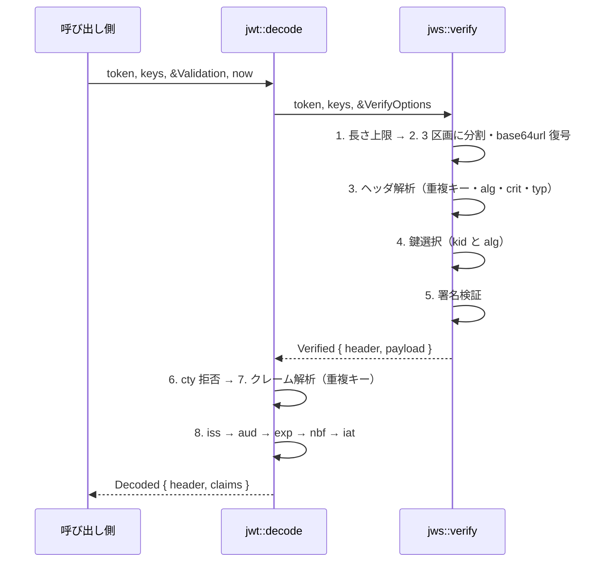
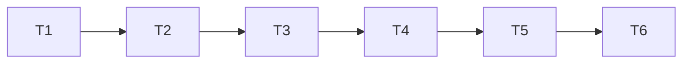

# JOSE クレート（`komainu-jose`）設計書

- 状態: 草案
- 最終更新: 2026-11-24
- 関連: [RFC 7515 JWS](https://www.rfc-editor.org/rfc/rfc7515)、[RFC 7517 JWK](https://www.rfc-editor.org/rfc/rfc7517)、[RFC 7518 JWA](https://www.rfc-editor.org/rfc/rfc7518)、[RFC 7519 JWT](https://www.rfc-editor.org/rfc/rfc7519)、[RFC 7520](https://www.rfc-editor.org/rfc/rfc7520)、[RFC 7638 JWK Thumbprint](https://www.rfc-editor.org/rfc/rfc7638)、[RFC 8725 JWT BCP](https://www.rfc-editor.org/rfc/rfc8725)、[RFC 9068 JWT アクセストークン](https://www.rfc-editor.org/rfc/rfc9068)

## 1. 概要

komainu が将来 JWT アクセストークン（RFC 9068）と OpenID Connect の ID トークンを発行するための土台として、JWS の署名・検証、JWK / JWK Set の入出力、JWT のクレーム検証を行うクレート `komainu-jose` をワークスペースに追加する。

汎用 JOSE ライブラリとの機能競争はしない。komainu が必要とする狭い範囲（RS256 と ES256、JWS Compact Serialization、公開鍵の JWK）だけを、誤用しにくい API で提供する。暗号プリミティブは自作せず RustCrypto（`rsa`、`p256`、`sha2`）に任せる。crates.io に公開し、README で「komainu 向けの JOSE 実装」と明記する。

鍵の保存、ローテーション、`jwks_uri` エンドポイントは本設計の範囲外とし、JWT アクセストークン / OIDC の設計で扱う。本クレートは渡された鍵で署名・検証・JWK 変換をするだけで、I/O をせず、現在時刻も自分で読まない。

## 2. 要件

### 2.1 利用者と目的

| 利用者 | 目的 |
|---|---|
| komainu の後続実装（JWT アクセストークン、OIDC） | 署名鍵の生成、JWT の発行、JWKS の公開用 JSON の生成、JWT の検証 |
| komainu 以外の Rust 開発者（crates.io 経由） | RS256 / ES256 の JWT を、既定で安全側に倒れる API で扱う |
| メンテナ（学習目的） | JOSE の仕様と攻撃パターン（alg 混同、`none`、`crit`、重複キーなど）を実装とテストで確かめる |

### 2.2 スコープ

やること:

- アルゴリズム RS256（RSASSA-PKCS1-v1_5 + SHA-256）と ES256（ECDSA P-256 + SHA-256）
- 鍵の生成（ES256、RSA 2048 / 3072 / 4096 ビット）
- 鍵の読み書き: 秘密鍵は PKCS#8（PEM / DER）、公開鍵は SPKI（PEM / DER）と JWK（公開鍵のみ）
- JWK Set の読み書き、RFC 7638 の JWK Thumbprint
- JWS Compact Serialization の署名と検証
- JWT の発行と検証（`iss`・`aud`・`exp` 必須、`nbf`・`iat` は存在すれば検査、`typ` の要求）
- RFC テストベクタ、`jsonwebtoken` との相互検証、proptest、cargo-fuzz ターゲット
- CI への `cargo deny check advisories` の追加、リリーススクリプトへの登録

やらないこと:

- JWE（暗号化）。将来の別設計
- EdDSA、RS384 / RS512、PS256 系、ES384 / ES512、HS256 系（対称鍵）。`Algorithm` を `#[non_exhaustive]` にして後から足せるようにする
- `alg: none`（永久に対応しない）
- JWS JSON Serialization（General / Flattened）、Unencoded Payload（RFC 7797）、ネストした JWT
- 秘密鍵の JWK 入出力
- ヘッダの `jku`・`x5u`・`jwk`・`x5c` による鍵の取得や信頼（値は読み捨てる）
- 鍵の保存・ローテーション・`jwks_uri`、HTTP 経由の JWKS 取得
- 署名前・検証前にヘッダを覗く API（検証なしのデコード）

### 2.3 機能要件

| ID | 要件 | 受け入れ条件 |
|---|---|---|
| F1 | RS256 で署名・検証できる | RFC 7515 付録 A.2 と RFC 7520 §4.1 の鍵とヘッダで署名すると、RFC 記載の JWS と 1 文字も違わない。その JWS を検証すると payload が RFC 記載のバイト列と一致する |
| F2 | ES256 で署名・検証できる | RFC 7515 付録 A.3 の JWS を A.3 の公開鍵で検証すると成功する。自分で署名した JWS を同じ鍵の `VerifyingKey` で検証すると成功し、署名を復号したバイト列の 1 バイトを変えて正規形の base64url で再エンコードすると `InvalidSignature` になる |
| F3 | 鍵を生成できる | `SigningKey::generate_es256()` と `SigningKey::generate_rsa(RsaKeySize::Bits2048)` が返す鍵で署名した JWS を、その `verifying_key()` で検証すると成功する |
| F4 | PKCS#8 / SPKI を読み書きできる | 生成した鍵を `to_pkcs8_pem` → `from_pkcs8_pem` と往復させると、往復前の鍵で作った署名を往復後の公開鍵で検証できる（DER も同様）。公開鍵の `to_spki_pem` → `from_spki_pem` も同様 |
| F5 | 公開鍵を JWK で読み書きできる | `VerifyingKey` を JWK にして読み戻すと、元の鍵と `==` で等しい。`d` などの秘密鍵パラメータを含む JWK を読むと `InvalidKey` になる |
| F6 | JWK Set を読み書きできる | 2 鍵を持つ `JwkSet` を `to_json` → `from_json` で往復すると、同じ 2 鍵が同じ順で得られる。`kty: "oct"` の鍵を含む JWK Set を読むと、その鍵だけ読み飛ばして成功する |
| F7 | JWK Thumbprint を計算できる | RFC 7638 §3.1 の RSA 公開鍵の thumbprint が `NzbLsXh8uDCcd-6MNwXF4W_7noWXFZAfHkxZsRGC9Xs` になる |
| F8 | alg は鍵に束縛される | ES256 鍵だけを渡して `alg: RS256` ヘッダの JWS を検証すると、署名区画がでたらめな値でも `AlgorithmMismatch`（kid 一致時）または `KeyNotFound`（kid なし時）になる（`InvalidSignature` にならない） |
| F9 | 危険なヘッダを拒否する | `alg: none`、未知の alg、`crit` を含むヘッダの JWS を検証すると、それぞれ `UnsupportedAlgorithm`、`UnsupportedAlgorithm`、`UnsupportedHeader("crit")` になる |
| F10 | 入力を厳格に解釈する | 長さが上限超、ドットが 2 個でない、パディング付きや非正規の base64url、重複キーを持つヘッダ、のどれかの JWS を `jws::verify` で検証すると `Malformed` になる。重複キーを持つクレームの JWT を `jwt::decode` で検証すると `Malformed("claims: duplicate key")` になる |
| F11 | `typ` を指定・要求できる | `SignOptions::new().typ("at+jwt")` で署名した JWT は、`typ` に `at+jwt` を要求する検証で成功し、`typ` なしの JWT は同じ検証で `InvalidTyp` になる |
| F12 | JWT の必須クレームを検証する | `iss`・`aud`・`exp` のどれかが無い JWT を検証すると `MissingClaim("<名前>")` になる。`iss` 不一致は `InvalidIssuer`、`aud` 不一致は `InvalidAudience` になる |
| F13 | 時刻を引数で受け取って検証する | leeway 60 秒、`exp = T` のとき、`now = T + 59s` では成功し、`now = T + 60s` では `Expired` になる。`nbf = T` のとき `now = T - 61s` で `NotYetValid` になる |
| F14 | 独自クレームを型で扱える | `#[derive(Serialize, Deserialize)]` の構造体を独自クレームとして発行・検証でき、往復で値が変わらない。独自クレームが登録クレーム名（`iss` など）を出力すると発行が `DuplicateClaim` になる |
| F15 | 既存実装と相互運用できる | 本クレートで署名した JWT を `jsonwebtoken` 12 が検証でき、`jsonwebtoken` 12 で署名した JWT を本クレートが検証できる（RS256・ES256 の両方） |

### 2.4 非機能要件

| ID | 項目 | 基準 | 確かめ方 |
|---|---|---|---|
| N1 | パニックしない | 任意のバイト列・文字列を `jws::verify`、`jwt::decode`、`VerifyingKey::from_jwk`、`JwkSet::from_json` に渡してもパニックしない | proptest（CI、既定 256 ケース）と cargo-fuzz（手動） |
| N2 | 秘密情報を漏らさない | `SigningKey` の `Debug` 出力に鍵素材が含まれない。秘密鍵の PEM / DER は `Secret` で受け渡す。エラーの `Display` にトークンや鍵の中身を含めない | 単体テストで `format!("{:?}", key)` を確かめる。エラー型が `&'static str` 以外の文字列を持たないことをレビューで確かめる |
| N3 | 依存の脆弱性 | `cargo deny check advisories` が CI で通る。`rsa` は 0.10 以上（RUSTSEC-2023-0071 の対策済み版） | CI ジョブ |
| N4 | unsafe なし | `unsafe_code = "forbid"`（ワークスペース共通） | `cargo clippy` |
| N5 | ドキュメント | 公開アイテムすべてに rustdoc があり、`cargo doc -p komainu-jose --no-deps` が警告なしで通る。クレート README に「komainu 向け」「対応しない機能」を書く | `crates/jose/src/lib.rs` の `#![deny(missing_docs)]` によりビルドで検出。加えて `RUSTDOCFLAGS="-D warnings" cargo doc -p komainu-jose --no-deps` |

性能目標は置かない。RSA 4096 の鍵生成は数秒かかることがあるが、鍵生成は起動時やローテーション時だけに呼ばれる前提とする。

### 2.5 前提と制約

- ワークスペース規約に従う: edition 2024、toolchain 1.100、`[lints] workspace = true`、エラーは `thiserror`、時刻は `time::OffsetDateTime`
- 暗号処理は RustCrypto に限る。`rsa` 0.10 の PKCS#1 v1.5 署名は feature `pkcs1v15` が必要
- `ddd-toolkit` 0.5 は「合う所だけ使う」。秘密鍵の入出力に `Secret`、`Kid` に `ValueObject` derive を使う。公開 API に `ddd_toolkit::secret::Secret` が現れるため、ルートで再エクスポートする
- 本クレートは他の komainu クレートに依存しない（他のクレートも当面は本クレートに依存しない）

## 3. 全体構成

単一クレートなので、モジュール単位で示す。

| モジュール | 責務 | 配置 |
|---|---|---|
| `algorithm` | `Algorithm` 列挙と文字列変換 | `crates/jose/src/algorithm.rs` |
| `kid` | `Kid` 値オブジェクト | `crates/jose/src/kid.rs` |
| `error` | `JoseError` | `crates/jose/src/error.rs` |
| `key` | `SigningKey`・`VerifyingKey`・`RsaKeySize`、生成と PKCS#8 / SPKI | `crates/jose/src/key.rs`（大きくなれば `key/` に分割してよい） |
| `jwk` | JWK / JWK Set の JSON 入出力、Thumbprint | `crates/jose/src/jwk.rs` |
| `jws` | JWS Compact の署名・検証、`Header` | `crates/jose/src/jws.rs` |
| `jwt` | クレーム型、`Validation`、`encode` / `decode` | `crates/jose/src/jwt.rs` |
| `b64`（非公開） | base64url（パディングなし・正規形のみ）のエンコードとデコード | `crates/jose/src/b64.rs` |
| `json`（非公開） | 重複キーを拒否する JSON オブジェクトの解析 | `crates/jose/src/json.rs` |
| テスト | RFC ベクタ、相互検証、proptest | `crates/jose/tests/{rfc_vectors,interop,proptest}.rs` |
| fuzz | cargo-fuzz ターゲット（ワークスペース外） | `crates/jose/fuzz/` |

依存の向き（左が右を使う）:

- `jwt` → `jws`, `json`, `key`
- `jws` → `key`, `json`, `b64`, `kid`, `algorithm`
- `jwk` → `key`, `json`, `b64`, `kid`, `algorithm`
- `key` → `algorithm`, `kid`

`VerifyingKey::from_jwk`・`to_jwk`・`thumbprint`・`Serialize`・`SigningKey::with_thumbprint_kid` は `impl` ブロックごと `jwk.rs` に置く（同じクレート内なので別モジュールから `impl` できる）。これで `key` は `jwk` に依存しない。`key` の非公開フィールドは `pub(crate)` で `jwk` から読めるようにする。

### 3.1 技術選定

| 対象 | 採用 | 理由 | 見送った候補 |
|---|---|---|---|
| RSA | `rsa` 0.10（features: `std`, `encoding`, `getrandom`, `pkcs1v15`、`default-features = false`） | Pure Rust。0.10 で crypto-bigint に移り RUSTSEC-2023-0071 の対策が入った | `aws-lc-rs`（C 依存とビルド要件が増える）、`ring`（PKCS#8 生成の制約、鍵生成なし） |
| ECDSA P-256 | `p256` 0.14（既定 features: `arithmetic`, `ecdsa`, `pem`, `precomputed-tables`, `std`） | RustCrypto で `rsa` と揃う。署名は RFC 6979 の決定的 nonce | 同上 |
| ハッシュ | `sha2` 0.11（ワークスペース既存） | `rsa` 0.10・`p256` 0.14 と同じ版 | — |
| base64url | `base64` 0.23（ワークスペース既存） | パディング拒否と末尾ビットの正規性検査を設定できる | — |
| JSON | `serde` / `serde_json`（既存） | 重複キー検査は自前の Visitor で行う（§5.8） | `serde_json::Value` 経由（重複キーを後勝ちで黙って潰すため不採用） |
| 値オブジェクト・秘密値 | `ddd-toolkit` 0.5（features: `derive`, `secret`） | メンテナ自身のクレートで、使いにくさをフィードバックできる | `secrecy`、`zeroize` 直接 |
| 相互検証（dev） | `jsonwebtoken` 12（features: `rust_crypto`, `use_pem`） | 利用者が多い。12 は `rsa` 0.10・`p256` 0.14 を使うので脆弱な `rsa` 0.9 を引き込まない | `josekit`（OpenSSL 依存） |
| 性質テスト（dev） | `proptest` 1 | CI で回せる | — |
| ファジング | `cargo-fuzz`（`libfuzzer-sys`） | 標準的。nightly が必要なので CI には入れない | — |
| 脆弱性検査 | `cargo-deny`（`EmbarkStudios/cargo-deny-action@v2`、`advisories` のみ） | RustSec DB を CI で見る | `cargo-audit`（deny の方が後で licenses / bans に広げやすい） |

### 3.2 主要な流れ

JWT 検証（`jwt::decode`）の順序。署名を確かめる前にクレーム JSON を解析しない。



## 4. 公開 API（契約）

ルートで次を再エクスポートする。

```rust
// crates/jose/src/lib.rs
pub mod jws;
pub mod jwt;

pub use algorithm::Algorithm;
pub use error::JoseError;
pub use jwk::JwkSet;
pub use key::{RsaKeySize, SigningKey, VerifyingKey};
pub use kid::Kid;
pub use ddd_toolkit::secret::Secret;
```

`jws` と `jwt` はモジュールとして公開し、利用者は `komainu_jose::jwt::decode` のように呼ぶ。

### 4.1 `Algorithm`

```rust
#[non_exhaustive]
#[derive(Debug, Clone, Copy, PartialEq, Eq, Hash)]
pub enum Algorithm {
    Rs256,
    Es256,
}

impl Algorithm {
    /// "RS256" / "ES256"
    pub fn as_str(self) -> &'static str;
}

impl core::str::FromStr for Algorithm {
    type Err = JoseError; // 不一致は JoseError::UnsupportedAlgorithm。大文字小文字は区別する
}
impl core::fmt::Display for Algorithm; // as_str と同じ
```

`"none"` を含め、`"RS256"`・`"ES256"` 以外の文字列はすべて `UnsupportedAlgorithm`。

### 4.2 `Kid`

```rust
#[derive(ddd_toolkit::ValueObject)]
#[value_object(validate = validate_kid, error = JoseError)]
pub struct Kid(String);
fn validate_kid(value: &Kid) -> Result<(), JoseError>; // crates/domain/src/shared/client_id.rs と同じ形
// 生成: Kid::try_new(String) -> Result<Kid, JoseError>
// 参照: as_inner(&self) -> &String（derive が生成）
// serde フラグは付けない（JWK とヘッダの解析は自前で行い、Kid::try_new を呼ぶ）
impl core::fmt::Display for Kid; // 中身をそのまま出す（秘密ではない）
```

- 検証規則: 1〜256 バイト、各バイトが `0x21..=0x7E`（空白を含まない印字可能 ASCII）。違反は `JoseError::InvalidValue { field: "kid", reason: "..." }`
- 比較はバイト列の完全一致（大文字小文字を区別）

### 4.3 鍵

```rust
#[non_exhaustive]
#[derive(Debug, Clone, Copy, PartialEq, Eq)]
pub enum RsaKeySize { Bits2048, Bits3072, Bits4096 }

/// 秘密鍵。alg は鍵の種類で決まる（RSA → RS256、P-256 → ES256）。
#[derive(Clone)]
pub struct SigningKey { /* 非公開 */ }

impl SigningKey {
    pub fn generate_es256() -> Result<Self, JoseError>;
    pub fn generate_rsa(size: RsaKeySize) -> Result<Self, JoseError>;

    pub fn from_pkcs8_pem(pem: &Secret<String>) -> Result<Self, JoseError>;
    pub fn from_pkcs8_der(der: &Secret<Vec<u8>>) -> Result<Self, JoseError>;
    pub fn to_pkcs8_pem(&self) -> Result<Secret<String>, JoseError>;
    pub fn to_pkcs8_der(&self) -> Result<Secret<Vec<u8>>, JoseError>;

    pub fn with_kid(self, kid: Kid) -> Self;
    /// kid を RFC 7638 Thumbprint（§5.4）にする
    pub fn with_thumbprint_kid(self) -> Self;
    pub fn kid(&self) -> Option<&Kid>;
    pub fn algorithm(&self) -> Algorithm;
    /// 同じ kid を持つ公開鍵
    pub fn verifying_key(&self) -> VerifyingKey;
}

/// 例: `SigningKey { alg: ES256, kid: Some("k1"), .. }`。鍵素材は出さない
impl core::fmt::Debug for SigningKey;

/// 公開鍵。
#[derive(Debug, Clone)]
pub struct VerifyingKey { /* 非公開 */ }

impl VerifyingKey {
    pub fn from_spki_pem(pem: &str) -> Result<Self, JoseError>;
    pub fn from_spki_der(der: &[u8]) -> Result<Self, JoseError>;
    pub fn to_spki_pem(&self) -> Result<String, JoseError>;
    pub fn to_spki_der(&self) -> Result<Vec<u8>, JoseError>;

    /// JWK（JSON 文字列）から読む。§5.4 の規則に従う
    pub fn from_jwk(json: &str) -> Result<Self, JoseError>;
    /// JWK（JSON 文字列）を出す。§5.4 の出力形式
    pub fn to_jwk(&self) -> String;
    /// RFC 7638 Thumbprint（SHA-256、base64url パディングなし、43 文字）
    pub fn thumbprint(&self) -> String;

    pub fn with_kid(self, kid: Kid) -> Self;
    pub fn kid(&self) -> Option<&Kid>;
    pub fn algorithm(&self) -> Algorithm;
}

/// alg・kid・公開鍵パラメータがすべて等しいとき等しい
impl PartialEq for VerifyingKey;
impl Eq for VerifyingKey;

/// JWK オブジェクトとして直列化する（to_jwk と同じ内容）
impl serde::Serialize for VerifyingKey;
```

PKCS#8 / SPKI の読み込み手順（`rsa` 0.10 の decode は id-RSASSA-PSS の OID も受け付けるため、種類の判定は自分で先に行う）:

1. PEM のみ: 入力の前後の空白・改行を `trim` してから PEM として解析する（`pkcs8::der::pem::decode_vec` を使う。`pkcs8` は直接依存に加える）。復号した DER は `zeroize::Zeroizing<Vec<u8>>` に入れ、秘密鍵の中間バッファを残さない（`to_pkcs8_pem` / `to_pkcs8_der` が `rsa` / `p256` から受け取る `Zeroizing` の値も、`Secret` に移すまでコピーしない）。PEM として読めなければ `InvalidKey("pem")`
2. PEM のみ: ラベルを検査する。秘密鍵は `PRIVATE KEY`、公開鍵は `PUBLIC KEY` のみ受け付ける。`ENCRYPTED PRIVATE KEY`・`RSA PRIVATE KEY`・`EC PRIVATE KEY`・`RSA PUBLIC KEY` など他のラベルは `InvalidKey("expected pkcs8")`（公開鍵は `InvalidKey("expected spki")`）
3. DER を `pkcs8::PrivateKeyInfoRef` / `pkcs8::spki::SubjectPublicKeyInfoRef` として解析する。失敗は `InvalidKey("der")`
4. アルゴリズム OID が rsaEncryption（1.2.840.113549.1.1.1）なら RSA、id-ecPublicKey（1.2.840.10045.2.1）かつ曲線パラメータが prime256v1（1.2.840.10045.3.1.7）なら ES256。それ以外（P-384、Ed25519、id-RSASSA-PSS など）は `InvalidKey("unsupported key type")`
5. 判定した種類に応じて `rsa` / `p256` の `DecodePrivateKey::from_pkcs8_der` / `DecodePublicKey::from_public_key_der` に渡す。失敗は `InvalidKey("der")`
6. RSA の法のビット長が 2048 以上 4096 以下でなければ `InvalidKey("rsa modulus size")`。公開指数 `e` が 3 未満・偶数・2^33-1 超なら `InvalidKey("rsa e")`（どちらも PKCS#8 / SPKI / JWK の読み込みで共通。生成は `RsaKeySize` と e = 65537 で範囲内に限られる）

### 4.4 JWK Set

```rust
#[derive(Debug, Clone, Default, PartialEq, Eq)]
pub struct JwkSet { /* keys: Vec<VerifyingKey> */ }

impl JwkSet {
    /// 同じ kid が 2 つ以上あると InvalidKey("duplicate kid")。kid なしの鍵は複数あってよい
    pub fn new(keys: Vec<VerifyingKey>) -> Result<Self, JoseError>;
    pub fn keys(&self) -> &[VerifyingKey];
    pub fn find(&self, kid: &Kid) -> Option<&VerifyingKey>;
    /// §5.5 の規則で読む
    pub fn from_json(json: &str) -> Result<Self, JoseError>;
    /// `{"keys":[<JWK>, ...]}`。順序は keys() の順
    pub fn to_json(&self) -> String;
}

impl serde::Serialize for JwkSet; // to_json と同じ内容
```

### 4.5 JWS（`komainu_jose::jws`）

```rust
pub const DEFAULT_MAX_TOKEN_LEN: usize = 8192;

#[derive(Debug, Clone, Default)]
pub struct SignOptions { /* typ: Option<String> */ }
impl SignOptions {
    pub fn new() -> Self;
    /// ヘッダの typ。検査は sign 時（§5.6）
    pub fn typ(self, typ: impl Into<String>) -> Self;
}

#[derive(Debug, Clone)]
pub struct VerifyOptions { /* typ: Option<String>, max_token_len: usize */ }
impl VerifyOptions {
    /// typ を要求しない、max_token_len = DEFAULT_MAX_TOKEN_LEN
    pub fn new() -> Self;
    /// ヘッダの typ がこの値と一致することを要求する（比較規則は §5.6）
    pub fn require_typ(self, typ: impl Into<String>) -> Self;
    pub fn max_token_len(self, len: usize) -> Self;
}
impl Default for VerifyOptions; // new() と同じ

/// 検証済みヘッダ。解析したのは alg・kid・typ・cty のみ
#[derive(Debug, Clone, PartialEq, Eq)]
pub struct Header { /* 非公開 */ }
impl Header {
    pub fn algorithm(&self) -> Algorithm;
    pub fn kid(&self) -> Option<&Kid>;
    pub fn typ(&self) -> Option<&str>;
    pub fn cty(&self) -> Option<&str>;
}

#[derive(Debug, Clone, PartialEq, Eq)]
pub struct Verified {
    pub header: Header,
    pub payload: Vec<u8>,
}

/// JWS Compact を返す。ヘッダは alg（鍵から）、kid（鍵にあれば）、typ（指定があれば）
pub fn sign(payload: &[u8], key: &SigningKey, options: &SignOptions) -> Result<String, JoseError>;

/// keys の中から §5.7 の規則で鍵を選んで検証する
pub fn verify(token: &str, keys: &[VerifyingKey], options: &VerifyOptions) -> Result<Verified, JoseError>;
```

### 4.6 JWT（`komainu_jose::jwt`）

```rust
pub const DEFAULT_LEEWAY: std::time::Duration = std::time::Duration::from_secs(60);
pub const MAX_LEEWAY: std::time::Duration = std::time::Duration::from_secs(3600);

#[derive(Debug, Clone, PartialEq, Eq)]
pub enum Audience {
    One(String),       // JSON 文字列
    Many(Vec<String>), // JSON 配列
}
impl Audience {
    pub fn contains(&self, aud: &str) -> bool;
}

/// 登録クレーム。時刻は秒単位（直列化時に小数秒を切り捨てる）
#[derive(Debug, Clone, Default, PartialEq, Eq)]
pub struct RegisteredClaims {
    pub iss: Option<String>,
    pub sub: Option<String>,
    pub aud: Option<Audience>,
    pub exp: Option<time::OffsetDateTime>,
    pub nbf: Option<time::OffsetDateTime>,
    pub iat: Option<time::OffsetDateTime>,
    pub jti: Option<String>,
}

/// 独自クレームなし。直列化は空のマップ `{}`（serialize_map で 0 要素）、
/// 逆直列化は serde::de::IgnoredAny で何でも読み捨てる
#[derive(Debug, Clone, Copy, Default, PartialEq, Eq)]
pub struct NoCustomClaims;
impl serde::Serialize for NoCustomClaims;
impl<'de> serde::Deserialize<'de> for NoCustomClaims;

#[derive(Debug, Clone, Default, PartialEq, Eq)]
pub struct Claims<T = NoCustomClaims> {
    pub registered: RegisteredClaims,
    pub custom: T,
}

#[derive(Debug, Clone)]
pub struct Validation { /* issuer, audience, leeway, typ, max_token_len */ }
impl Validation {
    /// leeway = DEFAULT_LEEWAY、typ 要求なし、max_token_len = jws::DEFAULT_MAX_TOKEN_LEN
    pub fn new(issuer: impl Into<String>, audience: impl Into<String>) -> Self;
    /// 秒未満は切り捨て。3600 秒を超える値は 3600 秒に切り詰める（MAX_LEEWAY）
    pub fn leeway(self, leeway: std::time::Duration) -> Self;
    pub fn require_typ(self, typ: impl Into<String>) -> Self;
    pub fn max_token_len(self, len: usize) -> Self;
}

#[derive(Debug, Clone, PartialEq, Eq)]
pub struct Decoded<T> {
    pub header: crate::jws::Header,
    pub claims: Claims<T>,
}

pub fn encode<T: serde::Serialize>(
    claims: &Claims<T>,
    key: &SigningKey,
    options: &crate::jws::SignOptions,
) -> Result<String, JoseError>;

pub fn decode<T: serde::de::DeserializeOwned>(
    token: &str,
    keys: &[VerifyingKey],
    validation: &Validation,
    now: time::OffsetDateTime,
) -> Result<Decoded<T>, JoseError>;
```

### 4.7 エラー

```rust
#[non_exhaustive]
#[derive(Debug, Clone, PartialEq, Eq, thiserror::Error)]
pub enum JoseError {
    #[error("invalid {field}: {reason}")]
    InvalidValue { field: &'static str, reason: &'static str },
    #[error("malformed input: {0}")]
    Malformed(&'static str),
    #[error("unsupported algorithm")]
    UnsupportedAlgorithm,
    #[error("unsupported header parameter: {0}")]
    UnsupportedHeader(&'static str),
    #[error("no matching key")]
    KeyNotFound,
    #[error("algorithm does not match the key")]
    AlgorithmMismatch,
    #[error("invalid signature")]
    InvalidSignature,
    #[error("invalid typ")]
    InvalidTyp,
    #[error("invalid key: {0}")]
    InvalidKey(&'static str),
    #[error("key generation failed")]
    KeyGeneration,
    #[error("encoding failed: {0}")]
    Encoding(&'static str),
    #[error("missing claim: {0}")]
    MissingClaim(&'static str),
    #[error("invalid claim: {0}")]
    InvalidClaim(&'static str),
    #[error("duplicate claim: {0}")]
    DuplicateClaim(&'static str),
    #[error("invalid issuer")]
    InvalidIssuer,
    #[error("invalid audience")]
    InvalidAudience,
    #[error("token expired")]
    Expired,
    #[error("token not yet valid")]
    NotYetValid,
}
```

| 状況 | 返すもの | 呼び出し側の扱い |
|---|---|---|
| `Kid`・`typ` の値が規則違反 | `InvalidValue { field, reason }` | 設定・プログラムの誤り。起動時なら起動失敗 |
| 入力の形式違反（トークンの長さ・区画・base64url、ヘッダ / クレーム / JWK / JWK Set の JSON 構文・非オブジェクト・重複キー、ヘッダ項目の型） | `Malformed(reason)` | 検証失敗として扱う（AS なら `invalid_token` / `invalid_client`）。理由は外部に返さない |
| alg が未対応・`none` | `UnsupportedAlgorithm` | 同上 |
| `crit` がある、JWT に `cty` がある | `UnsupportedHeader("crit" / "cty")` | 同上 |
| 鍵が選べない / 鍵と alg が合わない | `KeyNotFound` / `AlgorithmMismatch` | 同上。JWKS の再取得は本クレートの範囲外 |
| 署名が合わない | `InvalidSignature` | 同上 |
| `typ` 不一致・欠落 | `InvalidTyp` | 同上 |
| 鍵の読み込み失敗・未対応の鍵種別・鍵長範囲外・秘密鍵パラメータ入り JWK | `InvalidKey(reason)` | 設定の誤り。起動失敗または鍵を無視 |
| OS 乱数の失敗など | `KeyGeneration` | 内部エラー |
| PEM / DER / JSON への書き出し失敗、独自クレームの直列化失敗 | `Encoding(what)` | 内部エラー |
| 必須クレームなし / 型違い | `MissingClaim(name)` / `InvalidClaim(name)` | 検証失敗 |
| 独自クレームが登録クレーム名を出力 | `DuplicateClaim(name)` | プログラムの誤り |
| `iss` / `aud` 不一致、期限切れ、有効期間前 | `InvalidIssuer` / `InvalidAudience` / `Expired` / `NotYetValid` | 検証失敗 |

エラーはトークン・鍵・クレーム値を保持しない（N2）。`reason` と名前はすべて `&'static str`。

## 5. 詳細

### 5.1 base64url（`b64`）

- エンコード: URL-safe アルファベット、パディングなし
- デコード: `=` を含む入力、URL-safe 以外の文字、末尾の未使用ビットが 0 でない入力（非正規形）を拒否する
- エンジンは 1 つを両方向に使う: `GeneralPurpose::new(&alphabet::URL_SAFE, GeneralPurposeConfig::new().with_encode_padding(false).with_decode_padding_mode(DecodePaddingMode::RequireNone).with_decode_allow_trailing_bits(false))`（`base64` 0.23）
- デコード失敗は呼び出し元が `Malformed("base64url")` に変換する。JWK のパラメータ復号失敗は `InvalidKey("base64url")`

### 5.2 鍵の生成

- 乱数は OS 乱数（`rsa` / `p256` の `getrandom` 連携、または `rand` 0.10 の `CryptoRng`）。どれを使うかは実装者が選んでよい。失敗時は `KeyGeneration`
- RSA の公開指数は 65537
- 生成した鍵の kid は `None`

### 5.3 署名と検証の計算

- RS256: RSASSA-PKCS1-v1_5、DigestInfo 付き SHA-256（`rsa::pkcs1v15::SigningKey::<Sha256>::new`）。署名長は法のバイト長と等しく、違えば `InvalidSignature`
- ES256: ECDSA P-256 + SHA-256、RFC 6979 の決定的 nonce。署名は r‖s の 64 バイト固定長（DER ではない）。64 バイトでない、r または s が 0 や位数以上なら `InvalidSignature`。高 S 値も受け付ける（RFC 7518 が低 S を要求しないため）
- 署名対象は `ASCII(BASE64URL(header) || '.' || BASE64URL(payload))`。ヘッダは解析した値から再構成せず、受け取った文字列をそのまま使う

### 5.4 JWK（単一鍵）

出力形式（キーの順序固定、kid は鍵にあるときだけ）。JWK・JWK Set・JWS ヘッダ・Thumbprint 入力の JSON は、`serialize_map` / `serialize_struct` で書いた順に出力する（`serde_json::Map` 経由で組み立てない）:

- RSA: `{"kty":"RSA","kid":"..","use":"sig","alg":"RS256","n":"..","e":".."}`
- EC: `{"kty":"EC","kid":"..","use":"sig","alg":"ES256","crv":"P-256","x":"..","y":".."}`
- `n`・`e` は先頭のゼロバイトを除いた符号なしビッグエンディアン、`x`・`y` は 32 バイト固定（RFC 7518 §6.2.1.2、§6.3.1.1）

読み込み規則（`VerifyingKey::from_jwk`）:

1. JSON の解析失敗は §5.8 の理由文字列（`jwk`）。例: 重複キーは `Malformed("jwk: duplicate key")`。`kty`・`crv`・`use`・`alg`・`kid` が文字列でなければ `InvalidKey("<メンバー名>")`
2. `kty` がなければ `InvalidKey("kty")`。`"RSA"` か `"EC"` 以外は `InvalidKey("unsupported key type")`。EC で `crv` がなければ `InvalidKey("crv")`、`"P-256"` 以外は `InvalidKey("unsupported key type")`
3. 秘密鍵パラメータ（RSA: `d`,`p`,`q`,`dp`,`dq`,`qi`,`oth`、EC: `d`）があれば `InvalidKey("private key parameters")`
4. `use` があり `"sig"` 以外なら `InvalidKey("use")`
5. `alg` があれば `Algorithm` として解釈し、鍵の種類と合わなければ `InvalidKey("alg")`、未知の値は `UnsupportedAlgorithm`。なければ鍵の種類から決める
6. `kid` があれば `Kid` として検証し、違反は `InvalidKey("kid")`
7. RSA（この順）: `n` または `e` が空、または先頭がゼロバイト → `InvalidKey("rsa n")` / `InvalidKey("rsa e")`。法が 2048〜4096 ビット以外 → `InvalidKey("rsa modulus size")`。`e` が 3 未満・偶数・2^33-1 超 → `InvalidKey("rsa e")`（§4.3 手順 6 と同じ規則）。その後 `rsa::PublicKey::new`（`RsaPublicKey` は deprecated）が拒否したら（偶数の `n`、`e >= n` など）`InvalidKey("rsa n")`
8. EC: `x`・`y` が 32 バイトでない、または曲線上の点でなければ `InvalidKey("ec point")`
9. `key_ops`・`x5c`・`x5t` などそれ以外のメンバーは読み捨てる（RFC 7517 §4）

Thumbprint（RFC 7638）: 必須メンバーだけを辞書順に並べた空白なしの JSON（RSA: `{"e":..,"kty":"RSA","n":..}`、EC: `{"crv":"P-256","kty":"EC","x":..,"y":..}`）の SHA-256 を base64url（パディングなし）にする。kid・alg・use は含めない。

### 5.5 JWK Set

`JwkSet::from_json` の規則:

1. JSON 全体の失敗は §5.8 の理由文字列（`jwks`）。`keys` がない・配列でない場合は `Malformed("jwks: keys")`
2. `keys` の各要素を次の表で扱う（上から順に判定）

| 要素の状態 | 扱い |
|---|---|
| オブジェクトでない | 全体を `Malformed("jwks: keys")` |
| `kty` がない・文字列でない | 全体を `InvalidKey("kty")` |
| `kty` が `"RSA"`・`"EC"` 以外 | 読み飛ばす（RFC 7517 §5） |
| `crv`・`use`・`alg` のどれかがあって文字列でない | 全体を `InvalidKey("crv")` / `InvalidKey("use")` / `InvalidKey("alg")` |
| EC で `crv` が `"P-256"` 以外、`use` が `"sig"` 以外、`alg` が `Algorithm` として未知 | 読み飛ばす |
| `alg` が既知だが鍵の種類と合わない（RSA 鍵に `ES256` など） | 全体を `InvalidKey("alg")` |
| 上記以外 | §5.4 で読み、失敗すればそのエラーで全体を失敗にする（秘密鍵パラメータ入り、鍵長範囲外など） |

3. 同じ kid が 2 つ以上あれば `InvalidKey("duplicate kid")`
4. 読み飛ばした結果 0 鍵になっても成功する

### 5.6 JWS の署名（`jws::sign`）

- ヘッダは次の順で直列化する: `alg`、`kid`（鍵にあれば）、`typ`（指定があれば）。空白なしの JSON
- 例: `{"alg":"RS256","kid":"bilbo.baggins@hobbiton.example"}`（RFC 7520 §4.1 と一致する）
- `typ` の検査: 1〜64 バイトの印字可能 ASCII（`0x21..=0x7E`）。違反は `InvalidValue { field: "typ", .. }`。`VerifyOptions::require_typ`・`Validation::require_typ` に渡した値の検査は verify / decode の呼び出し時に行い、違反は同じエラー
- payload は呼び出し側のバイト列をそのまま base64url にする

`typ` の比較規則（RFC 7515 §4.1.9）: 両辺から先頭の `application/` を ASCII 大文字小文字を無視して取り除き、残りを ASCII 大文字小文字を無視して比較する。`require_typ("at+jwt")` は `at+jwt`・`AT+JWT`・`application/at+jwt` に一致する。

### 5.7 JWS の検証（`jws::verify`）

次の順で検査し、最初に失敗したエラーを返す。

0. `require_typ` に渡した値が §5.6 の `typ` 規則に違反していれば `InvalidValue { field: "typ", .. }`（トークンを見る前に検査する）
1. `token.len() > max_token_len` → `Malformed("token too long")`
2. `.` がちょうど 2 個でなければ `Malformed("segments")`。ヘッダ区画と署名区画のどちらかが空なら `Malformed("segments")`（payload 区画は空を許す）
3. 各区画を §5.1 で復号。失敗は `Malformed("base64url")`
4. ヘッダを §5.8 で解析（理由文字列は `header: ...`）
5. `alg` がない・文字列でない → `Malformed("header.alg")`。未対応・`none` → `UnsupportedAlgorithm`
6. `crit` があれば（値に関係なく）`UnsupportedHeader("crit")`
7. `kid`・`typ`・`cty` が文字列でない、または `kid` が `Kid` の規則に違反 → `Malformed("header.kid")` など項目名入り
8. typ 要求があり、`typ` がない・一致しない → `InvalidTyp`
9. 鍵選択:
   - ヘッダに kid がある: kid が等しい鍵を `keys` の先頭から探し、最初の 1 つを使う（同じ kid の鍵が複数あっても 2 つ目以降は使わない）。なければ `KeyNotFound`。見つかった鍵の alg がヘッダの alg と違えば `AlgorithmMismatch`
   - ヘッダに kid がない: alg がヘッダと等しい鍵を `keys` の順に候補とする。候補が 0 個なら `KeyNotFound`
10. 署名検証。kid ありは 1 鍵だけ、kid なしは候補を順に試して最初に成功した鍵を採用する。すべて失敗すれば `InvalidSignature`
11. `Verified { header, payload }` を返す

`jku`・`x5u`・`jwk`・`x5c`・`x5t` などそのほかのヘッダ項目は読み捨てる（鍵選択に使わない）。

### 5.8 厳格な JSON 解析（`json`）

- serde の `Deserializer::deserialize_any` を使う独自の Visitor で、オブジェクトのキー重複を**すべての階層**で検査する。重複を見つけたら失敗
- ヘッダ・クレーム・JWK・JWK Set の解析で共通に使い、結果は `serde_json::Map<String, Value>` として返す（重複がないことを確かめた後なので `Map` に入れてよい）
- 入力は UTF-8 必須。JSON の前後の空白は許す
- 失敗時の理由文字列は、入力の種類 `<kind>`（`header`・`claims`・`jwk`・`jwks`）ごとに次で固定する。エラー型は `Malformed`（JWK と JWK Set も鍵の内容ではなく JSON の形式違反なので `Malformed` とする）

| 失敗 | 理由文字列 |
|---|---|
| UTF-8 でない | `"<kind>: utf-8"` |
| JSON の構文エラー | `"<kind>: syntax"` |
| トップレベルがオブジェクトでない | `"<kind>: not an object"` |
| どこかの階層でキーが重複 | `"<kind>: duplicate key"` |

このほか `"jwks: keys"`（`keys` がない・配列でない・要素がオブジェクトでない、§5.5）がある。`Malformed` の引数は `&'static str` なので、4 × 4 の組と `"jwks: keys"` を定数として持つ（例: `"header: duplicate key"`）。

### 5.9 JWT の発行（`jwt::encode`）

1. `custom` を `serde_json::to_value` で直列化する。直列化失敗は `Encoding("custom claims")`。`Value::Object` 以外は `Encoding("custom claims must be an object")`
2. 独自クレームのキーが `iss`・`sub`・`aud`・`exp`・`nbf`・`iat`・`jti` のどれかなら `DuplicateClaim(<そのクレーム名>)`
3. 出力 JSON を `serde_json::Serializer` の `serialize_map` で手書きする（`serde_json` の `preserve_order` feature はワークスペース全体の出力順を変えるため使わない）。順序: 登録クレームを `iss`・`sub`・`aud`・`exp`・`nbf`・`iat`・`jti` の順（`None` は出力しない）、続いて独自クレームを `Map` の反復順（辞書順）。時刻は `unix_timestamp()`（整数秒）。`aud` は `One` なら文字列、`Many` なら配列
4. `jws::sign(json_bytes, key, options)`

`encode` は必須クレームを強制しない（`decode` 側で検査する）。

### 5.10 JWT の検証（`jwt::decode`）

1. `VerifyOptions::new().max_token_len(validation の値)` に、`validation` に typ 要求があれば `.require_typ(..)` を足したもので `jws::verify(token, keys, &options)` を呼ぶ
2. ヘッダに `cty` があれば `UnsupportedHeader("cty")`（ネストした JWT に対応しないため）
3. payload を §5.8 で解析（理由文字列は `claims: ...`）
4. 登録クレームを取り出す。型が合わなければ `InvalidClaim(<名前>)`:
   - `iss`・`sub`・`jti`: 文字列
   - `aud`: 文字列、または文字列の配列
   - `exp`・`nbf`・`iat`: JSON の整数（`i64` に収まり、`OffsetDateTime::from_unix_timestamp` が受け付ける範囲）。小数・指数表記・文字列は `InvalidClaim`
5. 残りのメンバーを `Value::Object` として `T::deserialize` に渡す。失敗は `InvalidClaim("custom claims")`
6. 検査（この順）。時刻の比較は `OffsetDateTime` の加減算ではなく、unix 秒の `i64` で行う（`now_s = now.unix_timestamp()`、`leeway_s = leeway.as_secs()`。`Validation::leeway` は 3600 秒を超える値を 3600 秒に切り詰めるため `i64` に収まる）。加減算は `saturating_add` / `saturating_sub` を使い、パニックしない:
   - `iss` なし → `MissingClaim("iss")`、`validation.issuer` と完全一致しない → `InvalidIssuer`
   - `aud` なし → `MissingClaim("aud")`、`validation.audience` を含まない → `InvalidAudience`
   - `exp` なし → `MissingClaim("exp")`、`now_s >= exp_s.saturating_add(leeway_s)` → `Expired`
   - `nbf` があり `now_s < nbf_s.saturating_sub(leeway_s)` → `NotYetValid`
   - `iat` があり `iat_s > now_s.saturating_add(leeway_s)` → `InvalidClaim("iat")`
7. `Decoded { header, claims }` を返す

### 5.11 テスト

| ファイル | 内容 |
|---|---|
| `crates/jose/tests/rfc_vectors.rs` | RFC 7515 A.2（RS256 署名一致と検証）、A.3（ES256 検証）、RFC 7520 §4.1（RS256 署名一致と検証）、RFC 7638 §3.1（Thumbprint）。RFC の秘密鍵は JWK で書かれているため、テスト内で `rsa::PrivateKey::from_components`（`rsa` 0.10 の正式名。`RsaPrivateKey` は deprecated で clippy `-D warnings` に落ちる。整数は `rsa::BoxedUint`）/ `p256::SecretKey::from_slice` から PKCS#8 DER を作り `SigningKey::from_pkcs8_der` で読む |
| `crates/jose/tests/interop.rs` | `jsonwebtoken` 12 との双方向（RS256・ES256）。鍵は PEM で両者に渡す |
| `crates/jose/tests/proptest.rs` | N1: 任意の `String` / `Vec<u8>` で `jws::verify`、`jwt::decode`、`VerifyingKey::from_jwk`、`JwkSet::from_json` がパニックしない。発行 → 検証の往復で独自クレームが変わらない |
| 各モジュールの単体テスト | §5 の各規則（拒否ケースごとに 1 テスト以上）。F8〜F13 の受け入れ条件 |

テスト用の鍵は `crates/jose/tests/fixtures/` に置き、生成コマンドを `crates/jose/tests/fixtures/README.md` に書く（OpenSSL 3 を想定）。テストは鍵を生成しない（F3 の生成テストを除く）。

| ファイル | 用途 | 作り方 |
|---|---|---|
| `rsa2048.pem` / `rsa2048.pub.pem` | 正常系 | `openssl genpkey -algorithm RSA -pkeyopt rsa_keygen_bits:2048 -out rsa2048.pem`、`openssl pkey -in rsa2048.pem -pubout -out rsa2048.pub.pem` |
| `es256.pem` / `es256.pub.pem` | 正常系 | `openssl genpkey -algorithm EC -pkeyopt ec_paramgen_curve:P-256 -out es256.pem`、公開鍵は同上 |
| `rsa1024.pem`、`rsa8192.pub.pem` | 鍵長の拒否 | `rsa_keygen_bits:1024` / `8192`（8192 は公開鍵だけ置く） |
| `es384.pem` | 鍵種別の拒否 | `ec_paramgen_curve:P-384` |
| `rsa2048.pkcs1.pem` | ラベルの拒否 | `openssl pkey -in rsa2048.pem -traditional -out rsa2048.pkcs1.pem`（ラベル `RSA PRIVATE KEY`） |
| `rsa2048.enc.pem` | ラベルの拒否 | `openssl pkcs8 -topk8 -in rsa2048.pem -v2 aes-256-cbc -passout pass:test -out rsa2048.enc.pem` |
| `rsa-pss.pem` | OID の拒否 | `openssl genpkey -algorithm RSA-PSS -pkeyopt rsa_keygen_bits:2048 -out rsa-pss.pem` |

debug ビルドでの RSA の鍵生成（F3、2048 ビット）と署名を速くするため、ルートの `Cargo.toml` に `[profile.dev.package.rsa] opt-level = 3` と `[profile.dev.package.crypto-bigint] opt-level = 3` を追加する。F3 の RSA 生成テストは 2048 ビット 1 回だけとし、3072 / 4096 は `#[ignore]` 付きのテストにする。

publish するパッケージから `tests/fixtures` と `fuzz` を除くため、`crates/jose/Cargo.toml` に `exclude = ["fuzz/", "tests/fixtures/"]` を書く（テスト自体は crates.io 版では動かなくてよい）。

## 6. タスク計画



### T1. クレートの骨組みと基本型

- 依存: なし
- 対象:
  - `Cargo.toml`: members に `crates/jose`、`exclude = ["crates/jose/fuzz"]`、workspace.dependencies に `komainu-jose`（path + version、他の内部クレートと同じ形）・`rsa`・`p256`・`pkcs8 = { version = "0.11", features = ["pem", "std"] }`（PEM 解析と OID 判定を直接使うため。`rsa` に `pem` feature はなく、`p256` の feature に頼らない）・`zeroize = "1"`（中間バッファ用）・`proptest = "1"`・`jsonwebtoken`（features は §3.1）を追加、`ddd-toolkit` の「only komainu-domain depends on it」コメントを「komainu-domain and komainu-jose」に更新、§5.11 の `[profile.dev.package.*]`
  - `crates/jose/Cargo.toml`: 既存クレート（`crates/domain/Cargo.toml`）と同じメタデータ（`name = "komainu-jose"`、description、`version`/`edition`/`license`/`repository` の `.workspace = true`、`readme = "README.md"`、keywords `["jose", "jwt", "jws", "jwk", "oauth"]`、categories `["cryptography", "authentication"]`、`[lints] workspace = true`）と §5.11 の `exclude`。`ddd-toolkit` は features `derive`・`secret`（`Kid` は serde を使わず、`Secret` も逆直列化しないため `serde` は不要）
  - `crates/jose/README.md`、`crates/jose/src/{lib,algorithm,kid,error,b64,json}.rs`（`lib.rs` に `#![deny(missing_docs)]`）
  - ルート `README.md` のクレート一覧の表に `komainu-jose` を追加
  - `scripts/release.py`: `ORDER` の先頭に `"komainu-jose"`
  - `scripts/test_release.py`: `test_publish_skips_existing_versions` の `published` の `side_effect` が 8 要素の直書きなので、`[True] + [False] * (len(release.ORDER) - 1)` の形に直す（直さないと `StopIteration` で落ちる）
  - `deny.toml`（新規）: `[advisories]` に `version = 2`、`yanked = "deny"`、`unmaintained = "workspace"`、`ignore = []`。licenses / bans / sources の節は書かない
  - `.github/workflows/ci.yml`: ジョブ `deny` を追加（`actions/checkout@v4` → `EmbarkStudios/cargo-deny-action@v2`、`with: command: check advisories`）
- 内容: §4.1、§4.2、§4.7、§5.1、§5.8、N3〜N5
- 既存の依存に advisory が見つかった場合: 本タスクでは修正せず、`deny.toml` の `ignore` に RUSTSEC ID と理由のコメントを付けて追加し、PR の説明に書く（修正は別 PR）
- 完了条件: `Algorithm`・`Kid`・`JoseError`・`b64`・`json` の単体テストがある（`Kid` の境界 0 / 1 / 256 / 257 バイト、空白、非 ASCII。base64url のパディング・非正規形。JSON の入れ子の重複キー）。クレート README に「komainu 向け」と対応しない機能の一覧がある
- 検証: `cargo test -p komainu-jose`、`cargo fmt --all -- --check`、`cargo clippy --workspace --all-targets --features pg-tests -- -D warnings`、`cargo deny check advisories`、`python3 -m unittest discover -s scripts -p 'test_*.py'`

### T2. 鍵（生成・PKCS#8・SPKI）

- 依存: T1
- 対象: `crates/jose/src/key.rs`、`crates/jose/tests/fixtures/`（§5.11 の表の鍵と `README.md`）
- 内容: §4.3、§5.2（F3、F4、N2）
- 完了条件: F3・F4 の受け入れ条件、鍵種別・鍵長・ラベルの拒否（§5.11 の fixture: RSA 1024 / 8192、P-384、RSA-PSS、PKCS#1 PEM、暗号化 PEM）、`Debug` に鍵素材が出ないことのテストがある。この時点の署名テストは T4 で書くため、F3・F4 の「署名して検証」は `rsa` / `p256` の API を直接使って確かめてよい
- 検証: `cargo test -p komainu-jose`

### T3. JWK・JWK Set・Thumbprint

- 依存: T2
- 対象: `crates/jose/src/jwk.rs`（`VerifyingKey` の `from_jwk`・`to_jwk`・`thumbprint`・`Serialize`、`SigningKey::with_thumbprint_kid` の `impl` もここに置く）
- 内容: §4.3 の JWK 部分、§4.4、§5.4、§5.5（F5、F6、F7）
- 完了条件: F5〜F7 と §5.4・§5.5 の各規則のテストがある
- 検証: `cargo test -p komainu-jose`

### T4. JWS の署名・検証

- 依存: T3（RFC ベクタの公開鍵を JWK で読むため）
- 対象: `crates/jose/src/jws.rs`、`crates/jose/tests/rfc_vectors.rs`
- 内容: §4.5、§5.3、§5.6、§5.7（F1、F2、F8〜F11）
- 完了条件: F1・F2・F8〜F11 と §5.7 の各手順の拒否テストがある
- 検証: `cargo test -p komainu-jose`

### T5. JWT の発行・検証

- 依存: T4
- 対象: `crates/jose/src/jwt.rs`
- 内容: §4.6、§5.9、§5.10（F12〜F14）
- 完了条件: F12〜F14 と §5.10 の各手順のテストがある。leeway の境界（`exp + leeway` ちょうどで `Expired`、1 秒前で成功）と、`leeway(3601 秒)` が 3600 秒として振る舞うこと（`exp = T`、`now = T + 3600s` で `Expired`、`T + 3599s` で成功）を含む
- 検証: `cargo test -p komainu-jose`

### T6. 相互検証・性質テスト・ファジング・文書

- 依存: T5
- 対象: `crates/jose/tests/{interop,proptest}.rs`、`crates/jose/fuzz/{Cargo.toml,fuzz_targets/{jws_verify,jwt_decode,jwk_parse}.rs}`、`crates/jose/README.md`、`CHANGELOG.md`
- 内容: §5.11（F15、N1、N5）
- 完了条件: F15・N1 のテストが CI で通る。fuzz ターゲット 3 本が `cargo +nightly fuzz build` でビルドでき、README にファジングの実行方法（`cd crates/jose && cargo +nightly fuzz run jws_verify`）がある。`CHANGELOG.md` に `komainu-jose` の追加を書く
- 検証: `cargo test -p komainu-jose`、`RUSTDOCFLAGS="-D warnings" cargo doc -p komainu-jose --no-deps`、`cd crates/jose && cargo +nightly fuzz run jws_verify -- -max_total_time=60`（手動）

## 7. 未決事項

| ID | 内容 | 仮の扱い | 決める人・時期 |
|---|---|---|---|
| U1 | 鍵の保存・ローテーション・`jwks_uri` の設計 | 本クレートの範囲外。鍵は `SigningKey` / `VerifyingKey` として外から渡す | メンテナ・JWT アクセストークン設計時 |
| U2 | 小数の NumericDate（`exp: 1300819380.5`）を受け付けるか | 拒否（`InvalidClaim`）。komainu が発行する JWT は整数のみで、外部 JWT を検証する用途が出たら見直す | メンテナ・`private_key_jwt` 対応時 |
| U3 | kid なし JWS で複数候補を順に試す挙動 | 試す（§5.7 手順 10）。候補数に上限は設けない | メンテナ・JWKS を外部から取り込む機能を作るとき |
| U4 | `serde_json::Value` から JWK を読む API（クライアントメタデータの `jwks` 埋め込み用） | 用意しない。JSON 文字列から読む `from_jwk` / `from_json` だけにする | メンテナ・RFC 7591 / `private_key_jwt` 対応時 |
| U5 | 複数の issuer / audience を許す `Validation` | 単一のみ | メンテナ・必要になったとき |
| U6 | 外部 JWKS に kid 規則違反（空白入り、257 バイト以上など）の鍵があるときの扱い | JWKS 全体を `InvalidKey("kid")` で失敗にする。外部 JWKS を取り込む機能では「その鍵だけ読み飛ばす」への変更を検討する | メンテナ・U3 / U4 と同時 |
