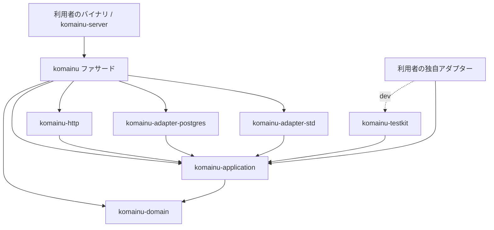
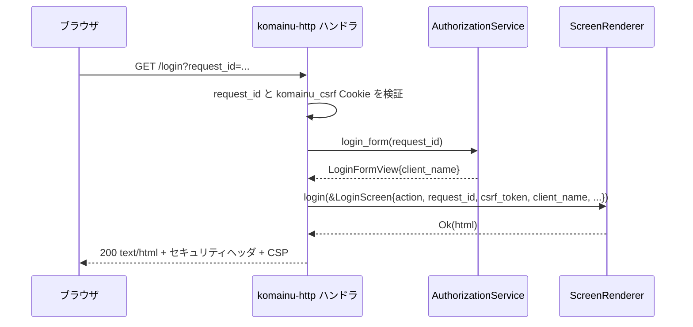
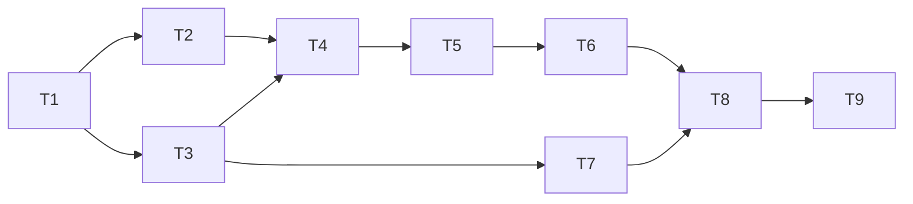

# ライブラリファサードと画面差し替え 設計書

- 状態: 草案
- 最終更新: 2026-11-23
- 関連: [認可サーバー設計書](../authorization-server/README.md)（未決 Q-3 画面カスタマイズ、Q-4 外部 IdP）

## 1. 概要

komainu を crates.io に公開し、利用者が自分のバイナリ crate で組み立てられるようにする。入口として、各 crate を feature ごとに再エクスポートし、部品（永続化、認証、画面、設定）を注入して axum の `Router` とユースケースサービスを得る builder を持つファサード crate `komainu` を新しく作る。ブラウザ画面（ログイン・同意・エラー・ログアウト完了）は `ScreenRenderer` trait を注入して差し替えられるようにする。既定の実装は今の askama テンプレートとする。既存の `komainu-server` はファサードを使う参考実装に作り直し、そのまま動くバイナリとしても残す。

## 2. 要件

### 2.1 利用者と目的

- **組み込み利用者**: 自分の Rust バイナリに komainu を組み込む開発者。永続化・認証・画面を自分の実装に差し替える。
- **アダプター作者**: `UnitOfWorkFactory`（永続化）や `ResourceOwnerAuthenticator`（認証）を独自に実装し、公開または社内で使う開発者。
- **バイナリ利用者**: 今と同じく `komainu` バイナリを設定ファイルで動かす運用者。挙動を変えない。

### 2.2 スコープ

- やること
  - ファサード crate `komainu`（feature による再エクスポートと `KomainuBuilder`）
  - `komainu-http` の画面生成を `ScreenRenderer` trait に切り出す。既定の実装は `DefaultScreens`（今の askama）
  - エラー画面の文言を固定の英語文字列ではなくエラー種別（enum）で渡し、利用者が翻訳できるようにする
  - HTML 応答の CSP を設定で差し替えられるようにする（`frame-ancestors 'none'` は常に付ける）
  - 公開する設定型・コンテキスト型に `#[non_exhaustive]` を付け、コンストラクタと `with_*` メソッドを用意する
  - `komainu-testing` を `komainu-testkit` に改名して公開し、store の適合性テストを入れる
  - `komainu-server` の組み立てをファサードの builder で置き換える
  - 全 crate を crates.io に公開できる状態にする（`cargo publish --dry-run` が通るところまで）
- やらないこと
  - リダイレクト型の外部 IdP 連携（Q-4）。外部認証は既存の `ResourceOwnerAuthenticator`（ユーザー名とパスワード）の差し替えまでとする
  - Hydra 型のログイン・同意の委譲（利用者アプリにリダイレクトして API で結果を受け取る方式）
  - 静的アセット（CSS・画像・JS）の配信。利用者が別の場所で配信し、CSP で許可する
  - `komainu-server` の CLI・設定読み込み・ops エンドポイント・定期削除ジョブを再利用できる API にすること（server の内部のままにする）
  - 実際の `cargo publish`（公開は不可逆なので、ユーザーが手で行う）
  - 画面の非同期レンダリング（renderer は同期とする）
  - 既定画面の翻訳ファイル。既定画面は英語のまま

### 2.3 機能要件

| ID | 要件 | 受け入れ条件 |
|---|---|---|
| F-1 | 利用者は `komainu` 1 つへの依存で、Pg と既定画面を使ったサーバーを組み立てられる | `examples/minimal.rs` が komainu の crate としては `komainu` だけ（加えて `tokio` と `axum` 0.8）に依存してビルドでき、`cargo run --example minimal` で起動したサーバーの `/authorize` がログイン画面へ 302 を返す |
| F-2 | feature で使わない部品を外せる | `cargo check -p komainu --no-default-features` が通り、そのとき sqlx・axum・askama が依存グラフに入らない（`cargo tree -p komainu --no-default-features -e normal` に出ない） |
| F-3 | 独自の永続化を注入できる | `KomainuBuilder::store` に `komainu-testkit` の `InMemoryUnitOfWorkFactory` を渡したとき、Pg なしで認可コードフローが最後まで通る（http の統合テスト） |
| F-4 | 独自の認証を注入できる | `KomainuBuilder::authenticator` に常に `Authenticated` を返す実装を渡したとき、どんなパスワードでもログインできる |
| F-5 | 画面を差し替えられる | `KomainuBuilder::screens` に独自の `ScreenRenderer` を渡したとき、4 画面すべての本文がその実装の返した文字列になり、ステータス・`Set-Cookie`・セキュリティヘッダは既定の場合と同じになる |
| F-6 | 差し替えた画面でも CSRF とフォームの契約は komainu が守る | 独自画面のフォームが送った `csrf_token` が `komainu_csrf` Cookie と違うとき、`POST /login` は 400 のエラー画面（`ErrorKind::CsrfMismatch`）を返す。`csrf_token` がないときは今と同じく 400（`ErrorKind::RequestNotFound`） |
| F-7 | エラー画面を翻訳できる | 独自 renderer の `error` は `ErrorKind` と `Accept-Language` ヘッダの生の値を受け取る。`Accept-Language: ja` で `/login?request_id=bad` を開いたとき、renderer に `accept_language == Some("ja")` と `ErrorKind::RequestNotFound` が渡る |
| F-8 | CSP を設定できる | `ContentSecurityPolicy::custom("default-src 'self'")` を設定したとき、HTML 応答の CSP は `default-src 'self'; frame-ancestors 'none'` になる。`frame-ancestors` を含む値は `CspError::FrameAncestorsNotAllowed` で拒否される |
| F-9 | アダプター作者が store の適合性を確かめられる | `komainu_testkit::conformance::run_store_conformance` に `InMemoryUnitOfWorkFactory` を渡すと全ケースが通り、Pg アダプターでも（`pg-tests` feature で）全ケースが通る |
| F-10 | バイナリの挙動を変えない | 既存の `crates/server/tests` がすべて変更なし、またはコンストラクタの書き換えだけで通る。E2E シナリオ（`e2e_scenario.rs`）の応答本文とヘッダが変わらない |

### 2.4 非機能要件

| ID | 項目 | 基準 | 確かめ方 |
|---|---|---|---|
| N-1 | セキュリティ | renderer を差し替えても、`X-Frame-Options: DENY`、`frame-ancestors 'none'`、`Cache-Control: no-store`、`Referrer-Policy: no-referrer`、`X-Content-Type-Options: nosniff` が HTML 応答から外れない | http の統合テスト（独自 renderer と独自 CSP の組み合わせ） |
| N-2 | セキュリティ | renderer が `Err` を返したときは、利用者実装の内容を応答に含めず、`500` と本文 `Internal Server Error`（text/plain）を返す | http の統合テスト |
| N-3 | 公開 API の安定性 | 本書で足す型・変える型（`ApplicationConfig`、`HttpConfig`、`HttpConfigError`、`CspError`、画面コンテキスト 6 型、`LoginErrorKind`、`ErrorKind`、`BuildError`、`StoreCase`）に `#[non_exhaustive]` を付ける。既存のエラー enum（`StoreError`、`AuthorizeError` など）と `RequestContext` は今回は変えない（Q-6） | `grep -n non_exhaustive` で上の型に付いていることをレビューで確かめる |
| N-4 | 公開できること | 公開する 8 crate（domain, application, adapter-std, adapter-postgres, http, testkit, komainu, komainu-server）について、`cargo publish --dry-run -p komainu-domain` が通り、`cargo package --workspace --no-verify` で 8 つの `.crate` が作れる（未公開の依存は解決できないため、検証付きの dry-run は domain だけ） | T9 の手順 |
| N-5 | ドキュメント | `komainu` の公開 API はすべて rustdoc を持ち、crate ドキュメントに最小構成の例（doctest、`no_run`）がある。http・testkit で本書が足す公開項目も rustdoc を持つ。既存 crate の rustdoc 不足は今回は埋めない（Q-5） | `RUSTDOCFLAGS="-D missing_docs" cargo doc -p komainu --no-deps` が通る。http・testkit の新規項目はレビューで確かめる |

### 2.5 前提と制約

- Rust 1.100、edition 2024、ワークスペースの規約（`unsafe_code = "forbid"`、clippy all warn）に従う。rustdoc・コメントは英語。
- 依存の版はワークスペースの `[workspace.dependencies]` に揃える。新しく足す外部依存はない（`komainu-testkit` が `tokio` を通常依存に持つだけ。`tokio` はワークスペース依存にすでにある）。
- バージョンは全 crate で同じ番号に揃える（lockstep）。初回公開は `0.1.0` のまま出す（まだ一度も公開していないため）。以後は 0.x の semver に従い、互換を壊す変更は minor を上げる。
- crate 名 `komainu` は crates.io で使える（ユーザーが確認済み）。
- 既存のアーキテクチャ（domain ← application ← adapter/http、port は application）を変えない。ファサードは依存グラフの最上位に置き、どの crate からも依存されない。
- `komainu-server` は publish を続ける（`cargo install komainu-server` でバイナリ `komainu` が入る）。

### 2.6 用語

| 用語 | 意味 |
|---|---|
| ファサード | crate `komainu`。各 crate の再エクスポートと builder だけを持ち、ビジネスルールを持たない |
| renderer | `ScreenRenderer` trait の実装。画面の HTML 文字列だけを作る |
| 画面コンテキスト | komainu が renderer に渡す読み取り専用の値（`LoginScreen` など） |
| 適合性テスト | 任意の `UnitOfWorkFactory` 実装が application の期待する契約を満たすかを確かめる共通テスト |

## 3. 全体構成



| コンポーネント | 責務 | 配置（ディレクトリ） | 詳細 |
|---|---|---|---|
| komainu（新規） | 再エクスポートと `KomainuBuilder` | `crates/komainu` | [facade.md](facade.md) |
| komainu-http（変更） | `ScreenRenderer`、`DefaultScreens`、CSP 設定、`HttpConfig`・`AppState` のコンストラクタ化 | `crates/http` | [screens.md](screens.md) |
| komainu-testkit（改名・公開） | インメモリ adapter と store の適合性テスト | `crates/testkit`（`crates/testing` から移動） | [testkit.md](testkit.md) |
| komainu-application（小変更） | `ApplicationConfig` の `#[non_exhaustive]` 化と `with_*` | `crates/application` | 本書 §4.3 |
| komainu-adapter-postgres（小変更） | 適合性テストで検証する | `crates/adapter-postgres` | [testkit.md](testkit.md) |
| komainu-server（変更） | wiring を builder 利用に置き換える | `crates/server` | 本書 §5.1 |

### 3.1 技術選定

| 対象 | 採用 | 理由 | 見送った候補 |
|---|---|---|---|
| ファサードの形 | 再エクスポート型（各 crate も個別公開） | アダプター作者が `komainu-application` だけに依存できる。crate の境界（依存方向）を保てる | 全部を 1 crate に統合（境界が弱まる）、ファサードなし（組み立てコードが利用者ごとに散る） |
| 組み立て | ファサードの `KomainuBuilder` | 既定値（SystemClock・OsSecureRandom・Argon2id・組み込み認証・既定画面）を 1 か所に置ける。server も同じ道を通るので、参考実装として成り立つ | 再エクスポートだけ |
| 画面差し替え | `ScreenRenderer` trait の注入、戻り値は HTML 文字列 | CSRF・Cookie・リダイレクト・ステータス・ヘッダを komainu に残せるので、差し替えでセキュリティを壊しにくい | Hydra 型の委譲（実装量が大きい。外部 IdP 対応と一緒に後で設計する）、実行時のテンプレートファイル差し替え（askama はコンパイル時テンプレートなので合わない）、`axum::Response` を返す（Cookie・CSRF を壊す余地がある） |
| renderer の同期・非同期 | 同期 | 必要なデータ（翻訳表など）は起動時に読めば足りる。`dyn` 互換が簡単 | 非同期（BoxFuture を返す） |
| 適合性テストの形 | 関数（`run_store_conformance`）でまとめて実行し、失敗したケース名を並べて panic | マクロより書き方が単純で、テストランナーを選ばない | テストを生成するマクロ |

### 3.2 主要な流れ

#### 組み立て（利用者のバイナリ）

1. 利用者が `PgStoreConfig` から `connect` と `migrate` を呼び、`PgUnitOfWorkFactory` を作る（今と同じ）。
2. `Komainu::builder()` に store・`ApplicationConfig`・`HttpConfig`、必要なら authenticator・screens を渡し、`build()` で `Komainu` を得る。
3. `komainu.router()` を自分の axum アプリに `merge` または `nest` し、`komainu.maintenance()` で readiness 確認や定期削除を、`komainu.admin()` でクライアント・ユーザー管理を行う。

#### 画面の表示（例: `GET /login`）



renderer が `Err` を返したときは、ハンドラが `tracing::error!` に記録し、`500 Internal Server Error`（text/plain）を返す。エラー画面の描画に失敗したときも同じにする（エラー画面を再帰的に描かない）。

## 4. コンポーネント間の契約

### 4.1 ファサード → 各 crate

ファサードは各 crate の公開 API を次のモジュール名で再エクスポートし、独自の型は builder まわり（`Komainu`、`KomainuBuilder`、`BuildError`）だけを持つ。詳細は [facade.md](facade.md)。

| モジュール | 中身 | feature |
|---|---|---|
| `komainu::domain` | `pub use komainu_domain as domain` | 常に |
| `komainu::application` | `pub use komainu_application as application` | 常に |
| `komainu::adapter_std` | `pub use komainu_adapter_std as adapter_std` | `std` |
| `komainu::adapter_postgres` | `pub use komainu_adapter_postgres as adapter_postgres` | `postgres` |
| `komainu::http` | `pub use komainu_http as http` | `http` |

### 4.2 komainu-http → renderer

`ScreenRenderer` と画面コンテキストの型、フォームの契約（フィールド名、action の URL、method）は [screens.md](screens.md) の「公開インターフェース」に書く。renderer が守るべきことは次の 3 つだけで、それ以外（ステータス、ヘッダ、Cookie、CSRF の検証）は komainu が行う。

1. コンテキストの `form` が示す action・method・hidden フィールドを、そのままフォームに出す。
2. 利用者由来の値（`client_name`、`username`、scope の説明など）を HTML エスケープする。
3. 本文として完全な HTML 文書の文字列を返す。

### 4.3 application の設定型

`ApplicationConfig` に `#[non_exhaustive]` を付ける。他の crate から構造体式（`ApplicationConfig { .. }` や `..Default::default()`）で作れなくなるので、次のメソッドを足す。フィールドは今と同じく `pub` のまま（読むのは自由）。

```rust
impl ApplicationConfig {
    pub fn with_authorization_code_ttl(self, value: time::Duration) -> Self;
    pub fn with_access_token_ttl(self, value: time::Duration) -> Self;
    pub fn with_refresh_token_ttl(self, value: time::Duration) -> Self;
    pub fn with_authorization_request_ttl(self, value: time::Duration) -> Self;
    pub fn with_login_session_ttl(self, value: time::Duration) -> Self;
    pub fn with_require_state(self, value: bool) -> Self;
    pub fn with_allow_public_clients(self, value: bool) -> Self;
    pub fn with_scopes(self, value: Vec<ScopeDefinition>) -> Self;
    pub fn with_purge_grace(self, value: time::Duration) -> Self;
    pub fn with_audit_retention(self, value: time::Duration) -> Self;
}
```

値の検証はしない（今と同じ）。`Default` の値は変えない。`ScopeDefinition` は 2 フィールドで増える見込みがないので `#[non_exhaustive]` を付けない。

`Dependencies` は利用者が手で組むこともあるので、今の形（pub フィールド、構造体式で作れる）を保つ。port を増やすのは互換を壊す変更として扱う。

### 4.4 既存の型の扱い

| 型 | 変更 |
|---|---|
| `komainu_http::HttpConfig` | フィールドを非公開にし、コンストラクタと `with_*` で作り、getter で読む（[screens.md](screens.md)） |
| `komainu_http::AppState` | フィールドを非公開にし、`AppState::new` と `with_screens` で作る |
| `komainu_application::ApplicationConfig` | §4.3 |
| `komainu_application::NonRedirectableError` | 変更なし（`ErrorKind` への変換は http の内部で行う） |
| その他の application・domain の型 | 変更なし |

## 5. コンポーネント詳細

- [facade.md](facade.md): ファサード crate `komainu`
- [screens.md](screens.md): komainu-http の画面差し替えと CSP
- [testkit.md](testkit.md): komainu-testkit と store の適合性テスト

### 5.1 komainu-server の変更

- `wiring::services(store, application, http)` の中身を `Komainu::builder()` の呼び出しに置き換える。シグネチャは `services(store: PgUnitOfWorkFactory, application: ApplicationConfig, http: HttpConfig) -> anyhow::Result<Services>` のまま保つ。`Services` は `{ app_state: AppState, maintenance, admin }` から `{ komainu: komainu::Komainu }` に変え、呼び出し側（`serve.rs`、`lib.rs`）は `komainu.router()`・`komainu.maintenance()`・`komainu.admin()` を使う。
- `server.public_base_url` の検証規則は `HttpConfig::new` / `HttpConfig::new_insecure` に移す。役割は次のように分ける。
  - `config::validate(&mut Config)`: `allow_insecure_http` を見て `new` か `new_insecure` を呼び、結果の値は捨てて検証だけに使う。`HttpConfigError` は下の表の文言の `ConfigError` に変換する。`server.content_security_policy` があれば `ContentSecurityPolicy::custom` を呼んで検証し、`CspError` は `server.content_security_policy: {CspError の Display}` に変換する。CSP の検証は `public_base_url` の検証（と truncate）の直後、`positive` の検査より前に置く（最初に見つかったエラーだけを返す今の挙動のまま）。`public_base_url` の末尾 `/` の正規化（truncate）は今のまま残す。
  - `Settings::from_config`: 検証済みの `Config` から、もう一度 `new` / `new_insecure` と `custom` を呼んで `HttpConfig` を作る（ここで `Err` になったら `anyhow` でそのまま返す。validate を通っていれば起きない）。`ApplicationConfig` は `with_*` で作る。

  | `HttpConfigError` | server の文言 |
  |---|---|
  | `NotAbsolute(e)` | `server.public_base_url is not an absolute URL: {e}` |
  | `QueryOrFragment` | `server.public_base_url must not have a query or a fragment` |
  | `InsecureScheme` | `server.public_base_url must use https (set server.allow_insecure_http = true for local development)` |
  | `UnsupportedScheme(s)` | `server.public_base_url has an unsupported scheme: {s}` |
  | `MissingHost` | `server.public_base_url must have a host` |

  文言は今の `crates/server/src/config.rs` のものと同じで、`crates/server/tests/config_exit.rs` が確かめているものを保つ。
- 依存を `komainu-http`・`komainu-adapter-*`・`komainu-application` の個別指定から `komainu`（default features）に置き換える。`komainu-domain` などを直接 `use` している箇所は `komainu::domain::...` に書き換える。
- 設定ファイルに `server.content_security_policy`（文字列、省略可）を足す。省略時は `ContentSecurityPolicy::strict()`、指定時は `ContentSecurityPolicy::custom(値)` を使い、`CspError` は設定エラー（終了コードは他の設定エラーと同じ）にする。環境変数は figment の規約どおり `KOMAINU_SERVER__CONTENT_SECURITY_POLICY` になる。
- 公開ドキュメント（リポジトリの `README.md`）の「独自画面・翻訳はできない」という記述を、ファサードと `ScreenRenderer` の案内に書き換える。

## 6. タスク計画



### T1. ApplicationConfig の non_exhaustive 化

- 依存: なし
- 対象: `crates/application/src/config.rs`、`ApplicationConfig { .. }` を構造体式で作っている全箇所（`crates/http/tests/common/mod.rs`、`crates/server/src/wiring.rs`、`crates/application/tests/common`、`crates/adapter-postgres/tests` など。`grep -rn "ApplicationConfig {" crates` で洗い出す）
- 内容: §4.3 の `#[non_exhaustive]` と `with_*` メソッドを足し、呼び出し側を書き換える。
- 完了条件: `ApplicationConfig` を crate 外で構造体式で作る箇所がなくなり、全テストが通る。
- 検証: `cargo test --workspace`、`cargo clippy --workspace --all-targets -- -D warnings`

### T2. http: HttpConfig・ContentSecurityPolicy・AppState のコンストラクタ化

- 依存: T1（どちらも `crates/server/src/wiring.rs` を書き換えるので、衝突を避けて後に回す）
- 対象: `crates/http/src/state.rs`、`crates/http/src/security_headers.rs`、新規 `crates/http/src/csp.rs`、`crates/http/src/lib.rs`、`crates/http/tests/common/mod.rs`、`crates/server/src/wiring.rs`、`crates/server/src/config.rs`
- 内容: [screens.md](screens.md) の `HttpConfig`、`HttpConfigError`、`ContentSecurityPolicy`、`CspError`、`AppState::new` を実装する。`public_base_url` の検証を server から `HttpConfig::new` / `new_insecure` に移す。security_headers が `HttpConfig` の CSP を使うようにする（F-8、N-1）。この時点では `with_screens` はまだ作らない。server への変更は、`HttpConfig::new` / `new_insecure` と `AppState::new` を呼ぶための最小限（`wiring.rs` の組み立てと `config.rs` の検証の置き換え）に限り、builder への移行は T6 で行う。
- 完了条件: screens.md「受け入れ条件」の CSP と `HttpConfig` の項目が単体テストで通る。server の設定エラーの文言が変わらない。
- 検証: `cargo test -p komainu-http -p komainu-server`

### T3. testkit への改名と公開準備

- 依存: T1
- 対象: `crates/testing` → `crates/testkit`、ルート `Cargo.toml`（members と `[workspace.dependencies]`）、`komainu-testing` を参照している全 crate の `Cargo.toml` と `use`
- 内容: [testkit.md](testkit.md) の「改名」の手順。`publish = false` を外し、crate ドキュメントを公開向けに書き換える。適合性テストはまだ入れない。
- 完了条件: `komainu-testing` という名前がリポジトリから消え（`grep -rn komainu.testing --include=*.toml --include=*.rs .` が 0 件）、全テストが通る。
- 検証: `cargo test --workspace`

### T4. http: ScreenRenderer と DefaultScreens

- 依存: T2, T3
- 対象: 新規 `crates/http/src/screens.rs`（必要なら `screens/` 配下に分割）、`crates/http/src/{authorize,login,consent,state,lib}.rs`、`crates/http/templates/*.html`、新規テスト `crates/http/tests/screens.rs`
- 内容: [screens.md](screens.md) の `ScreenRenderer`、画面コンテキスト、`ErrorKind`、`RenderError`、`DefaultScreens`、`AppState::with_screens` を実装し、ハンドラが Template 構造体を直接描かずに renderer を呼ぶようにする（F-5〜F-7、N-1、N-2）。既定画面の HTML 出力は今と 1 バイトも変えない。
- 完了条件: screens.md「受け入れ条件」がすべてテストで通る。既存の `crates/http/tests` がそのまま通る。
- 検証: `cargo test -p komainu-http`

### T5. ファサード crate komainu

- 依存: T4
- 対象: 新規 `crates/komainu/{Cargo.toml,src/lib.rs,src/builder.rs}`、ルート `Cargo.toml`、新規 `crates/komainu/tests/builder.rs`
- 内容: [facade.md](facade.md) の再エクスポート、feature、`Komainu`、`KomainuBuilder`、`BuildError` を実装する（F-2〜F-4）。
- 完了条件: facade.md「受け入れ条件」がテストで通る。`cargo check -p komainu --no-default-features`、`--no-default-features --features http`、`--no-default-features --features postgres` がそれぞれ通る。
- 検証: `cargo test -p komainu`、`cargo test -p komainu --no-default-features`、上記の `cargo check` 3 本、`cargo tree -p komainu --no-default-features -e normal | grep -E "sqlx|axum|askama"` が 0 件

### T6. server を builder 利用に置き換える

- 依存: T5
- 対象: `crates/server/Cargo.toml`、`crates/server/src/{wiring,serve,lib,config}.rs`、`crates/server/src/cli/*.rs`、`crates/server/src/cleanup.rs`、`crates/server/tests/*`（コンストラクタの書き換えが必要なものだけ）
- 内容: §5.1 のとおり。`server.content_security_policy` を設定に足す（F-10）。
- 完了条件: `crates/server/tests` がすべて通り、E2E シナリオの応答（本文とヘッダ）が変わらない。`content_security_policy` に `frame-ancestors` を含めた設定で起動すると設定エラーで終了する。
- 検証: `cargo test -p komainu-server --features pg-tests`（Docker が必要）

### T7. 適合性テストと Pg での検証

- 依存: T3
- 対象: 新規 `crates/testkit/src/conformance/*.rs`、`crates/testkit/Cargo.toml`、`crates/testkit/tests/in_memory_conformance.rs`、`crates/adapter-postgres/tests/postgres.rs`、新規 `crates/adapter-postgres/tests/conformance.rs`
- 内容: [testkit.md](testkit.md) の「適合性テスト」を実装し、インメモリと Pg の両方で通す。`postgres.rs` から適合性テストに移したケースは `postgres.rs` から消し、Pg 固有のケースだけを残す（F-9）。
- 完了条件: testkit.md「受け入れ条件」が通る。
- 検証: `cargo test -p komainu-testkit`、`cargo test -p komainu-adapter-postgres --features pg-tests`

### T8. 例とドキュメント

- 依存: T6, T7
- 対象: 新規 `crates/komainu/examples/{minimal,custom_screens}.rs`、`crates/komainu/src/lib.rs`（crate ドキュメント）、各 crate の `Cargo.toml` の `description`・`readme`・`keywords`・`categories`、リポジトリの `README.md`
- 内容: facade.md「例」の 2 本を書く。`custom_screens.rs` は独自 renderer と独自 CSP の例（日本語のログイン画面）にする。`komainu` の公開 API の rustdoc と crate ドキュメントの例を書く（F-1、N-5）。
- 完了条件: 2 本の例がビルドでき、`minimal` が F-1 の手順で動く。N-5 のコマンドが通る。
- 検証: `cargo build -p komainu --examples`、`RUSTDOCFLAGS="-D missing_docs" cargo doc -p komainu --no-deps`、`cargo test -p komainu --doc`、`DATABASE_URL=postgres://... cargo run -p komainu --example minimal` で標準出力に出た `client_id` を使い、`curl -i "http://127.0.0.1:8080/authorize?response_type=code&client_id=<出力された client_id>&redirect_uri=http%3A%2F%2F127.0.0.1%3A9000%2Fcb&scope=read&state=xyz"` が 302 で `Location` が `/login?request_id=` を含む。`cargo run -p komainu --example custom_screens` で出力された URL をブラウザで開き、日本語のログイン画面が出る

### T9. 公開の準備（dry-run）

- 依存: T8
- 対象: ルート `Cargo.toml`（`[workspace.dependencies]` の内部 crate に `version = "0.1.0"` を足す）、新規 `docs/releasing.md`
- 内容: 内部 crate への path 依存に version を併記する。公開の順序（domain → application → adapter-std → adapter-postgres → http → testkit → komainu → komainu-server）と手順を `docs/releasing.md` に書く（N-4）。実際の `cargo publish` はしない。
- 完了条件: 依存先が未公開でも確かめられる範囲として、`cargo publish --dry-run -p komainu-domain` が通り、残りの crate は `cargo package --workspace --no-verify` で `.crate` が作れる（未公開の依存を解決できないため検証付きの dry-run は domain 以外ではできない）。
- 検証: 上記 2 コマンド

## 7. 未決事項

| ID | 内容 | 仮の扱い | 決める人・時期 |
|---|---|---|---|
| Q-1 | リダイレクト型の外部 IdP 連携と、Hydra 型のログイン・同意委譲（既存設計の Q-4 を引き継ぐ） | 今回はやらない。`ResourceOwnerAuthenticator` の差し替えまで | ユーザー・OIDC 対応の設計の前 |
| Q-2 | ops エンドポイント（`/healthz`・`/readyz`・`/metrics`）と定期削除ジョブを、組み込み利用者向けにファサードで提供するか | 提供しない。利用者は `Komainu::maintenance()` の `check_ready` と `purge_expired` 系を自分で呼ぶ。HTTP メトリクスは `metrics` crate に記録されるので、利用者が exporter を入れれば出る | ユーザー・組み込み利用者からの要望が出たとき |
| Q-3 | 既定画面の多言語化（翻訳ファイルを同梱するか） | 同梱しない。既定画面は英語のみで、翻訳したい利用者は独自 renderer を書く | ユーザー・最初の公開のあと |
| Q-4 | renderer に渡す情報を増やすか（クライアントのロゴ URL・利用規約 URL など） | 今回は今の画面に出ている情報だけ。足すときは `#[non_exhaustive]` なので minor で足せる | ユーザー・クライアントのメタデータを増やすとき |
| Q-5 | 既存 crate（domain・application・adapter-*・http の既存項目）の rustdoc をすべて埋め、`-D missing_docs` をワークスペース全体にかけるか | 今回はやらない（作業量が大きく、ファサードと画面差し替えの設計とは独立しているため）。N-5 は `komainu` と新規項目だけ | ユーザー・crates.io への初回公開の前 |
| Q-6 | 既存の公開エラー enum（`StoreError`、`AuthorizeError`、`NonRedirectableError`、`LoginError`、`TokenError`、`AdminError`、`DomainError` など）と `RequestContext` に `#[non_exhaustive]` を付けるか | 今回は付けない。付けると crate 外の網羅的な match（http の `non_redirectable_message` など）や構造体式が壊れ、影響範囲が本書の範囲を超えるため。0.x のうちは variant 追加を minor で出せるので、公開をこれで止めない | ユーザー・crates.io への初回公開の前 |
