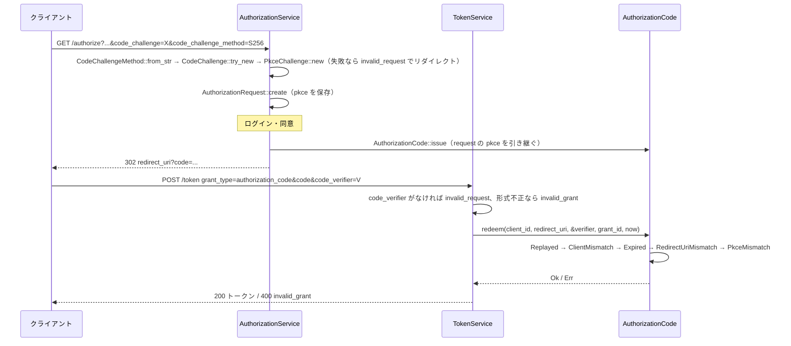
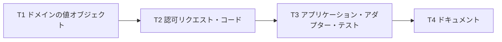

# PKCE（RFC 7636）

- 状態: 実装済み
- 最終更新: 2026-11-24
- 関連: [RFC 7636](https://www.rfc-editor.org/rfc/rfc7636)、[RFC 9700 §2.1.1](https://www.rfc-editor.org/rfc/rfc9700#section-2.1.1)、[OAuth 2.1 ドラフト §4.1.1 / §7.5.1](https://datatracker.ietf.org/doc/draft-ietf-oauth-v2-1/)、[認可サーバー設計書 §8 ロードマップ](../authorization-server/README.md#8-ロードマップ)

## 1. 概要

認可コードグラントに PKCE（Proof Key for Code Exchange）を入れる。クライアントは認可リクエストに `code_challenge` を付け、トークンリクエストに対応する `code_verifier` を付ける。認可サーバーは 2 つが対応するかを確かめ、対応しなければトークンを発行しない。

PKCE は**すべてのクライアントで必須**にし、必須を外す設定は用意しない。方式は `S256` だけを受け付ける。OAuth 2.1 ドラフト §7.5.1 と RFC 9700 §2.1.1 で PKCE を省いてよいとされているのは、OpenID Connect の `nonce` で認可コードの差し込みを防いでいる機密クライアントだけである。komainu は OIDC にまだ対応していないので、この例外は当てはまらない。

## 2. 要件

### 2.1 利用者と目的

- 公開クライアント（SPA、ネイティブアプリ）: 認可コードを横取りされても、トークンに交換されないようにする。
- 機密クライアント: 認可コードの差し込み（code injection）を防ぐ。
- 運用者: 設定を変えずに、OAuth 2.1 と同じ水準の保護が最初から有効になる。

### 2.2 スコープ

やること:

- 認可エンドポイントで `code_challenge` と `code_challenge_method` を受け取って検査し、認可リクエストと認可コードに保存する
- トークンエンドポイント（`grant_type=authorization_code`）で `code_verifier` を受け取り、保存した challenge と照合する
- PostgreSQL のマイグレーション 0003、testkit の適合テストを対応させる
- 既存のテスト、例（examples）、ドキュメント（README、getting-started、CHANGELOG、認可サーバー設計書）を PKCE 付きのフローに直す

やらないこと:

- `plain` 方式。`code_challenge_method` を省いた場合は RFC 7636 §4.3 の既定値 `plain` とみなし、拒否する
- PKCE を任意にする設定、クライアントごとの設定
- 認可サーバーメタデータの `code_challenge_methods_supported`。ロードマップ 2 番（RFC 8414）で扱う
- PKCE の検証に失敗したことを記録する監査イベント。既存の `invalid_grant` と同じく記録しない
- `client_credentials` と `refresh_token` のグラントで `code_verifier` を使うこと。値は読まない。ただし重複の検査はグラントの種類で分ける前に行う既存の作りなので、`code_verifier` が 2 回現れればどのグラントでも `invalid_request` になる（既存の `code` の重複と同じ扱い）
- 過去の設計書（`docs/design/authorization-server/http.md`、`docs/design/library-facade/README.md`）にある PKCE なしの `/authorize` の例は、当時の設計の記録として直さない

### 2.3 機能要件

HTTP の本文の条件は、`error` フィールドの値だけを比べる（本文には常に `error_description` も付く）。

| ID | 要件 | 受け入れ条件 |
|---|---|---|
| P-1 | 認可リクエストで PKCE を必須にする | `code_challenge` のない認可リクエスト（クライアントとリダイレクト URI は有効、`state=xyz`）は、`redirect_uri?error=invalid_request&error_description=code_challenge+is+required&state=xyz` へのリダイレクトになる。機密クライアントでも公開クライアントでも同じ |
| P-2 | `S256` だけを受け付ける | `code_challenge_method` がない場合、`plain` の場合、`s256`（小文字）の場合はどれも `error=invalid_request&error_description=code_challenge_method+must+be+S256` へのリダイレクトになる |
| P-3 | `code_challenge` の形式を検査する | 正規の base64url（`A-Z a-z 0-9 - _`、パディングなし、末尾のビットが 0）で 32 バイトに復号できなければ、`error=invalid_request&error_description=code_challenge+is+malformed` へのリダイレクトになる。42 文字、44 文字、`=` を含むもの、`+` や `/` を含むもの、末尾のビットが 0 でない `ZtNPunH49FD35FWYhT5Tv8I7vRKQJ8uxMaL0_9eHjNB` が該当する |
| P-4 | `code_challenge` と `code_challenge_method` の重複を拒否する | どちらかが 2 回現れると、既存の重複検査と同じ `error=invalid_request&error_description=a+parameter+appears+more+than+once` へのリダイレクトになる |
| P-5 | 正しい `code_verifier` でトークンを発行する | `code_challenge=ZtNPunH49FD35FWYhT5Tv8I7vRKQJ8uxMaL0_9eHjNA&code_challenge_method=S256` で得たコードを、`code_verifier=` に `a` を 43 個並べた値で交換すると、アクセストークンとリフレッシュトークンが返る（HTTP では `200`） |
| P-6 | `code_verifier` がなければ拒否する | `grant_type=authorization_code` で `code_verifier` がないと `TokenError::InvalidRequest`（HTTP では `400`、`error` が `invalid_request`）。コードは未使用のまま残り、正しい `code_verifier` を付けて送り直すと P-5 と同じく成功する |
| P-7 | `code_verifier` の形式を検査する | 長さが 43〜128 文字でない、または `A-Z a-z 0-9 - . _ ~` 以外の文字を含む `code_verifier` は `TokenError::InvalidGrant`。コードは未使用のまま残る |
| P-8 | 一致しない `code_verifier` を拒否する | `b` を 43 個並べた値で交換すると `TokenError::InvalidGrant`。コードは未使用のまま残り、Grant もトークンも作られない |
| P-9 | 再利用の検知は PKCE の照合より先に行う | 使用済みのコードを、形式の正しい `code_verifier`（正しい値でも一致しない値でもよい）を付けてもう一度送ると、これまでどおり `InvalidGrant` になる。そのコードから作った Grant は `code_replay` で失効し、`authorization_code.replay_detected` と `grant.revoked` の監査イベントが記録される |
| P-10 | `code_verifier` がない、または形式が不正な再送では失効させない | 使用済みのコードを `code_verifier` なしで送ると `InvalidRequest`、形式が不正な値で送ると `InvalidGrant` になり、Grant は失効せず、監査イベントも増えない（理由は §4.5） |
| P-11 | `code_verifier` を秘密として扱う | `TokenRequest` と `CodeVerifier` の `Debug` 出力に値が含まれない（テストで確かめる）。監査イベントの details に `code_verifier` を入れない（P-5・P-9 のテストで、記録された全イベントの details の値に verifier が含まれないことを確かめる） |
| P-12 | 移行前の行を消す | マイグレーション 0003 を適用すると、`authorization_requests` と `authorization_codes` の行がすべて消え、ほかの表の行は残る |

### 2.4 非機能要件

| ID | 項目 | 基準 | 確かめ方 |
|---|---|---|---|
| PN-1 | タイミング | challenge の比較は `subtle::ConstantTimeEq` で行い、`==` や `starts_with` を使わない | コードレビュー（`PkceChallenge::verify` の実装） |
| PN-2 | 秘密の露出 | `code_verifier` は DB に保存しない。保存するのは challenge だけ | `0003_pkce.sql` に verifier の列がないこと |
| PN-3 | 互換性 | §2.5 の公開 API の変更を、CHANGELOG の `Unreleased` の `Changed` に、既存の項目と同じく「何が変わり、利用者が何を直すか」の文章で書く | CHANGELOG を読む |

### 2.5 前提と制約

- 0.x の alpha なので、公開 API を破壊的に変えてよい。この設計で変わる公開 API は次のとおり。
  - `NewAuthorizationRequest`、`AuthorizationRequestRecord`、`AuthorizationCodeRecord` にフィールドが増える（構造体リテラルで作っている利用者はコンパイルが通らなくなる）
  - `AuthorizationCode::redeem` の引数が増える
  - `RedeemCodeError` に `PkceMismatch` が増える（`#[non_exhaustive]` ではないので、網羅的な `match` が壊れる）
  - `AuthorizeParams`、`TokenRequest` にフィールドが増える
  - 外部のストアアダプターは、認可リクエストと認可コードの `pkce` を保存して読み戻さなければならない。testkit の適合テスト `authorization_flow_records_roundtrip` がこれを確かめるようになる
- `komainu-domain` は `base64`（ワークスペースの `0.23`）を新しく依存に加える。`sha2` と `subtle` はすでに依存している。`komainu-jose` の `b64` モジュールは `pub(crate)` なので使えない。
- 公開クライアントは引き続き既定で無効（`clients.allow_public = false`）。PKCE を入れても既定は変えない。

## 3. 全体構成

| コンポーネント | 責務 | 配置 |
|---|---|---|
| PKCE の値オブジェクト | `CodeChallengeMethod`、`CodeChallenge`、`CodeVerifier`、`PkceChallenge` の検査と照合 | `crates/domain/src/shared/pkce.rs`（新規） |
| 認可リクエスト・認可コード | challenge を保持し、`redeem` で照合する | `crates/domain/src/authorization/request.rs`、`code.rs` |
| 認可エンドポイント | パラメータを受け取り、検査して認可リクエストに渡す | `crates/application/src/authorization/params.rs`、`mod.rs` |
| トークンエンドポイント | `code_verifier` を受け取り、`redeem` に渡す | `crates/application/src/token/request.rs`、`mod.rs` |
| PostgreSQL アダプター | 列の追加と読み書き | `crates/adapter-postgres/migrations/0003_pkce.sql`（新規）、`src/lib.rs`、`src/authorization_request.rs`、`src/authorization_code.rs` |
| testkit | 適合テストのフィクスチャ | `crates/testkit/src/conformance/fixtures.rs`、`cases.rs` |

- HTTP 層（`crates/http`）は、クエリとフォームの組をそのまま `AuthorizeParams::from_pairs` と `TokenRequest::from_pairs` に渡しているので、ソースの変更は要らない（テストだけ直す）。
- testkit のインメモリストア（`crates/testkit/src/store.rs`）は record を丸ごと持つので、変更は要らない。

### 3.1 技術選定

- base64url の符号化と復号には `base64` クレートを使う。`pkce.rs` の中に private な `const ENGINE: GeneralPurpose` を置き、`komainu-jose` の `b64.rs` と同じ設定（`URL_SAFE`、`with_encode_padding(false)`、`DecodePaddingMode::RequireNone`、`with_decode_allow_trailing_bits(false)`）にする。
- ハッシュは既存の `sha2::Sha256`、比較は既存の `subtle::ConstantTimeEq`。

### 3.2 主要な流れ



## 4. コンポーネント間の契約

### 4.1 ドメイン: `crates/domain/src/shared/pkce.rs`

`shared/mod.rs` から `pub use pkce::{CodeChallenge, CodeChallengeMethod, CodeVerifier, PkceChallenge};` で公開する（`lib.rs` の `pub use shared::*;` でクレート直下にも出る）。

```rust
/// `code_challenge_method`. Only `S256` is supported (RFC 7636 §4.2).
#[derive(Debug, Clone, Copy, PartialEq, Eq, Hash)]
pub enum CodeChallengeMethod {
    S256,
}

impl CodeChallengeMethod {
    /// `"S256"`. Stored in the database as-is.
    pub fn as_str(&self) -> &'static str;
}

/// Case-sensitive: only `"S256"` is accepted (same pattern as `AuthorizationRequestStatus`).
impl FromStr for CodeChallengeMethod {
    type Err = DomainError; // DomainError::invalid("code_challenge_method", "must be S256")
}

/// `code_challenge` for S256: base64url (no padding) of a 32-byte SHA-256 digest.
#[derive(ValueObject)]
#[value_object(validate = validate_code_challenge, error = DomainError)]
pub struct CodeChallenge(String);
// validate: ENGINE.decode must succeed and give exactly 32 bytes.
// Error: DomainError::invalid("code_challenge", "must be 43 base64url characters").
// Accessors come from the derive: `as_inner() -> &String`, `into_inner() -> String`.

/// `code_verifier` (RFC 7636 §4.1): 43-128 characters of `[A-Za-z0-9-._~]`.
pub struct CodeVerifier(Secret<String>);

impl CodeVerifier {
    /// Checks the characters first, then the length.
    /// Errors: `DomainError::invalid("code_verifier", "invalid character")` or
    /// `DomainError::invalid("code_verifier", "length must be 43 to 128")`.
    pub fn try_new(value: Secret<String>) -> Result<Self, DomainError>;
    pub fn expose(&self) -> &str;
}

/// `CodeVerifier([REDACTED])`: `f.debug_tuple("CodeVerifier").field(&self.0).finish()`,
/// same as `OpaqueToken`. No `Clone`, `PartialEq`, `Display` or serde.
impl fmt::Debug for CodeVerifier {}

/// The challenge stored with an authorization request and its code.
#[derive(Debug, Clone, PartialEq, Eq)]
pub struct PkceChallenge {
    challenge: CodeChallenge,
    method: CodeChallengeMethod,
}

impl PkceChallenge {
    pub fn new(challenge: CodeChallenge, method: CodeChallengeMethod) -> Self;
    pub fn challenge(&self) -> &CodeChallenge;
    pub fn method(&self) -> CodeChallengeMethod;
    /// S256: `ENGINE.encode(Sha256::digest(verifier.expose().as_bytes()))` compared with
    /// `challenge.as_inner()` byte-wise by `ct_eq` (both are 43 bytes).
    pub fn verify(&self, verifier: &CodeVerifier) -> bool;
}
```

`CodeChallenge` の `Debug`、`Clone`、`PartialEq`、`Eq`、`Hash` は `ValueObject` の derive が生成する（`State` や `ClientId` と同じ）。そのため、手で付け足す必要はない。

### 4.2 ドメイン: 認可リクエスト（`request.rs`）

```rust
pub struct NewAuthorizationRequest {
    // 既存のフィールドはそのまま
    pub pkce: PkceChallenge,
}

pub struct AuthorizationRequestRecord {
    // 既存のフィールドはそのまま
    pub pkce: PkceChallenge,
}

impl AuthorizationRequest {
    pub fn pkce(&self) -> &PkceChallenge;
}
```

`create`、`to_record`、`from_record` は `pkce` をそのまま運ぶ。`approve` と `deny` は変えない。

### 4.3 ドメイン: 認可コード（`code.rs`）

```rust
pub struct AuthorizationCodeRecord {
    // 既存のフィールドはそのまま
    pub pkce: PkceChallenge,
}

impl AuthorizationCode {
    /// `pkce` is copied from `request.pkce()`. Signature unchanged.
    pub fn issue(/* 既存どおり */) -> Result<Self, DomainError>;

    pub fn pkce(&self) -> &PkceChallenge;

    /// Checks, in this order: Replayed, ClientMismatch, Expired, RedirectUriMismatch,
    /// PkceMismatch. Only Replayed records an event; the other errors leave the code unchanged.
    pub fn redeem(
        &mut self,
        client_id: &ClientId,
        redirect_uri: Option<&RedirectUri>,
        code_verifier: &CodeVerifier,
        grant_id: GrantId,
        now: OffsetDateTime,
    ) -> Result<(), RedeemCodeError>;
}

// derive は既存どおり（Debug, Clone, Copy, PartialEq, Eq）。
pub enum RedeemCodeError {
    Replayed { grant_id: GrantId },
    ClientMismatch,
    Expired,
    RedirectUriMismatch,
    /// `code_verifier` does not match the stored challenge.
    PkceMismatch,
}
```

### 4.4 アプリケーション: 認可エンドポイント

`AuthorizeParams`（`crates/application/src/authorization/params.rs`）:

```rust
pub struct AuthorizeParams {
    // 既存のフィールドはそのまま（state の後に追加）
    pub code_challenge: Option<String>,
    pub code_challenge_method: Option<String>,
}
```

`from_pairs` の `collect_params` の名前の配列の末尾に `"code_challenge"` と `"code_challenge_method"` を加える。空の値は既存と同じく「ない」として扱い、重複には数える。

`AuthorizationService::start`（`crates/application/src/authorization/mod.rs`）では、PKCE の検査をスコープの検査（`invalid_scope`）の直後、保留中の認可リクエストの作成の直前に入れる。リダイレクトしてよい段階なので、エラーはすべて既存の `fail(...)` でリダイレクトする。手順のコメントは、現在の `// 10` を `// 11` に、`// 11` を `// 12` に振り直し、PKCE の検査を `// 10` とする。

| 順 | 条件 | エラー | `error_description` |
|---|---|---|---|
| 1-9 | 既存の検査（手順 5 の重複の検査は、PKCE のパラメータも対象になる） | 既存どおり | 既存どおり |
| 10a | `code_challenge` がない | `InvalidRequest` | `code_challenge is required` |
| 10b | `code_challenge_method` がない、または `S256` でない | `InvalidRequest` | `code_challenge_method must be S256` |
| 10c | `code_challenge` が `CodeChallenge::try_new` を通らない | `InvalidRequest` | `code_challenge is malformed` |
| 11 | 保留中の認可リクエストを `pkce` 付きで作成する（現在の 10） | — | — |
| 12 | 現在の 11 | — | — |

同意後のコード発行（現在 `mod.rs` で `AuthorizationCode::issue` を呼んでいる箇所）は変えない。`issue` の中で `pkce` が引き継がれる。

### 4.5 アプリケーション: トークンエンドポイント

`TokenRequest`（`crates/application/src/token/request.rs`）:

```rust
pub struct TokenRequest {
    // 既存のフィールドはそのまま（refresh_token の後、duplicated の前に追加）
    pub code_verifier: Option<String>,
}
```

- `from_pairs` の `collect_params` の名前の配列の末尾に `"code_verifier"` を加える。
- 手書きの `Debug` では、`refresh_token` の後に `.field("code_verifier", &Redacted(&self.code_verifier))` を足す。`crates/application/tests/token.rs` の `token_request_debug_redacts_code_and_refresh_token` の期待値は次のようになる（`code_verifier` を `Some("v".repeat(43))` にした場合）。

  ```text
  TokenRequest { grant_type: Some("authorization_code"), code: Some([REDACTED]), redirect_uri: None, scope: None, refresh_token: Some([REDACTED]), code_verifier: Some([REDACTED]), duplicated: [] }
  ```

  テスト名は `token_request_debug_redacts_secrets` に変える。末尾の `assert!(!text.contains("abc123") && !text.contains("rt-xyz"))` には、verifier の値を含まないことの確認も加える。

`TokenService` の `authorization_code`（`crates/application/src/token/mod.rs`）の検査順は次のとおり。`code_verifier` は `parse_token` と同じく `CodeVerifier::try_new(Secret::new(raw.to_owned()))` で作る。

| 順 | 条件 | `TokenError` |
|---|---|---|
| 1 | `code` がない | `InvalidRequest`（既存） |
| 2 | `code_verifier` がない | `InvalidRequest` |
| 3 | `code` が `parse_token` を通らない | `InvalidGrant`（既存） |
| 4 | `code_verifier` が `CodeVerifier::try_new` を通らない | `InvalidGrant` |
| 5 | コードが見つからない | `InvalidGrant`（既存） |
| 6 | `redirect_uri` が不正 | `InvalidGrant`（既存） |
| 7 | `redeem` が `Replayed` | 既存どおり `Step::Replay`（Grant を `CodeReplay` で失効） |
| 8 | `redeem` がそのほかのエラー（`PkceMismatch` を含む） | `InvalidGrant`（既存の `Err(_)` の枝） |

手順 2 と 4 をコードの検索より前に置くので、`code_verifier` がない、または形式が不正な再送では Grant を失効させない（P-10）。これは意図した変更である。正規のクライアントは常に verifier を持っているので、攻撃者が先にコードを使った後で正規のクライアントが送れば、これまでどおり手順 7 で失効する。逆に、コードだけを盗んで verifier を持たない者が、再送によって正規の Grant を失効させること（サービス妨害）はできなくなる。

`client_credentials` と `refresh_token` は `code_verifier` を読まない。

### 4.6 PostgreSQL アダプター

`crates/adapter-postgres/migrations/0003_pkce.sql`:

```sql
-- Codes and requests created before PKCE carry no challenge; drop them (P-12).
DELETE FROM authorization_codes;
DELETE FROM authorization_requests;

ALTER TABLE authorization_requests
    ADD COLUMN code_challenge text NOT NULL CHECK (char_length(code_challenge) = 43),
    ADD COLUMN code_challenge_method text NOT NULL CHECK (code_challenge_method IN ('S256'));

ALTER TABLE authorization_codes
    ADD COLUMN code_challenge text NOT NULL CHECK (char_length(code_challenge) = 43),
    ADD COLUMN code_challenge_method text NOT NULL CHECK (code_challenge_method IN ('S256'));
```

- `crates/adapter-postgres/src/lib.rs` の `migrate` に `Migration::new(3, Cow::Borrowed("pkce"), MigrationType::Simple, include_str!("../migrations/0003_pkce.sql").into_sql_str(), false)` を足し、`Migrator::with_migrations` の配列の末尾に加える。
- `src/authorization_request.rs` と `src/authorization_code.rs` の INSERT と SELECT に 2 列を加える。UPDATE（`authorization_request.rs:98`、`authorization_code.rs:117` 付近）は既存の作りが全部の列を書いているので、それに揃えて 2 列を加える。書き込みは `pkce.challenge().as_inner()` と `pkce.method().as_str()`。読み込みは既存と同じく `codec::valid(...)` を使い、壊れた値は `StoreError::Other("corrupted authorization_requests.code_challenge")` のような列名入りのエラーにする（列名は `authorization_requests.code_challenge`、`authorization_requests.code_challenge_method`、`authorization_codes.code_challenge`、`authorization_codes.code_challenge_method`）。
- 外部キーで `authorization_codes` や `authorization_requests` を参照している表はないので、削除で他の表の行は消えない。
- 影響は 2 つある。どちらも許容する。
  - 使用済みのコードも消すので、移行前に使ったコードの再利用は検知できなくなる。もともと `purge` が期限切れのコードを猶予期間の後に消しているので、検知できる期間が短くなるだけである。
  - grants の purge は「トークンもコードも参照していない Grant」を消す。コードを消すと、トークンが残っていない古い Grant が次の purge で早めに消える。トークンが残っている Grant は消えないので、動作中の認可には影響しない。

### 4.7 testkit

- `crates/testkit/src/conformance/fixtures.rs` に、共通の verifier と challenge を返すヘルパーを置く（既存のヘルパーに揃えて `pub(super) fn code_verifier() -> CodeVerifier`、`pub(super) fn pkce() -> PkceChallenge`。値は §4.8）。request と code を作る既存のフィクスチャは `pkce()` を使う。
- `crates/testkit/src/conformance/cases.rs` の `try_redeem` は `code_verifier()` を `redeem` に渡す。
- 新しいケースは足さない。既存の `authorization_flow_records_roundtrip` が request と code の record を `PartialEq` で往復比較しているので、`pkce` の保存と読み込みもこれで確かめられる。ケースの数（`CASES: [StoreCase; 10]`）と名前の一覧（`crates/testkit/tests/in_memory_conformance.rs`、`docs/design/library-facade/testkit.md`）は変わらない。

### 4.8 テストで使う値

| 用途 | 値 |
|---|---|
| 正しい verifier | `a` を 43 個並べた値 |
| 対応する challenge | `ZtNPunH49FD35FWYhT5Tv8I7vRKQJ8uxMaL0_9eHjNA` |
| 一致しない verifier | `b` を 43 個並べた値（challenge は `8BtXImJhrjdWuTk24cTmuEn5pbCTP6O5GEO_QZW52WQ`） |
| 最長の verifier | `a` を 128 個並べた値（challenge は `aDbPE7rEAOkQUHHNavRwhN-srU5eMCyUv-0k4BOvtz4`） |
| RFC 7636 付録 B の verifier | `dBjftJeZ4CVP-mB92K27uhbUJU1p1r_wW1gFWFOEjXk`（challenge は `E9Melhoa2OwvFrEMTJguCHaoeK1t8URWbuGJSstw-cM`） |

### 4.9 テストヘルパーの方針

- 認可 URL や `AuthorizeParams` を作る既存のヘルパーは、既定で `code_challenge=ZtNPunH49FD35FWYhT5Tv8I7vRKQJ8uxMaL0_9eHjNA&code_challenge_method=S256` を加える。トークン交換を作るヘルパーは、既定で `code_verifier`（`a` を 43 個並べた値）を加える。
- パラメータがない場合のテストは、`crates/application/tests/common/mod.rs` の `params(client_id, extra)` に空の値を渡して作る（例: `&[("code_challenge", "")]`）。空の値は「ない」として扱われる。HTTP 層とファサードのテストでは、パラメータがない場合を確かめない。
- `params()` は同じ名前の要素を置き換えるので、重複は作れない。P-4 のテストは、既存の `duplicate_parameters_are_rejected`（`crates/application/tests/authorization.rs:132`）に倣って作る。
  - `params(...)` の結果の `duplicated` に `"code_challenge"` や `"code_challenge_method"` を push して `start` に渡す
  - `AuthorizeParams::from_pairs` に生のペアを渡し、PKCE の名前の重複が `duplicated` に入ることを確かめる。151 行目のコメント「five known names」は「seven known names」に直す

## 5. 実装の注意点

コンポーネントが小さいので、詳細は §4 の契約に含めた。ここでは注意点だけを挙げる。

- `CodeChallenge` の検査は「文字の種類と長さ」ではなく、「正規の base64url として復号でき、32 バイトになること」で行う。これで P-3 の末尾ビットの条件も満たせる。
- `CodeVerifier` の長さは `len()` で数えてよい。先に文字の種類を検査するので、残る文字はすべて ASCII である。

## 6. タスク計画



T2 で公開型が変わると、T3 で直すまで `komainu-domain` 以外のビルドが通らない。T2 と T3 は 1 つのブランチで続けて進める。

### T1 ドメインの値オブジェクト

- 依存: なし
- 対象: `crates/domain/Cargo.toml`（`base64.workspace = true` を追加）、`crates/domain/src/shared/pkce.rs`（新規）、`crates/domain/src/shared/mod.rs`
- 内容: §4.1 の 4 つの型と単体テスト
- 完了条件:
  - §4.8 の値と RFC 7636 付録 B の値で `verify` が `true`、一致しない verifier で `false` になる
  - 次の境界値の判定がテストで確かめられている: 42/43/44 文字の challenge、42/43/128/129 文字の verifier、`+`・`/`・`=` を含む challenge、`~` と `.` を含む verifier（受理）、空白や `+` を含む verifier（拒否）、末尾ビットが 0 でない challenge、method の `plain` と `s256`
  - `format!("{verifier:?}")` が `CodeVerifier([REDACTED])` になる
- 検証: `cargo test -p komainu-domain shared::pkce`、`cargo clippy -p komainu-domain --all-targets -- -D warnings`

### T2 認可リクエストと認可コード

- 依存: T1
- 対象: `crates/domain/src/authorization/request.rs`、`code.rs`、`crates/domain/src/token/mod.rs`（テストのフィクスチャ）
- 内容: §4.2・§4.3 の変更と単体テスト。テスト用のヘルパー（`request(provided)`、`issued_code(provided)` など）は §4.8 の challenge を使う
- 完了条件:
  - `redeem` が正しい verifier で `Ok` を返す
  - 一致しない verifier では `Err(PkceMismatch)` を返し、状態は `Issued` のまま残る
  - 使用済みのコードに一致しない verifier を渡すと `Err(Replayed { .. })` になる
  - `ClientMismatch` と `PkceMismatch` が同時に成り立つときは `ClientMismatch` を返す
  - `to_record` と `from_record` で `pkce` が往復する
- 検証: `cargo test -p komainu-domain`

### T3 アプリケーション、PostgreSQL アダプター、testkit、呼び出し側のテスト

- 依存: T2
- 対象:
  - ソース: `crates/application/src/authorization/params.rs`、`mod.rs`、`crates/application/src/token/request.rs`、`mod.rs`、`crates/adapter-postgres/migrations/0003_pkce.sql`（新規）、`crates/adapter-postgres/src/lib.rs`、`src/authorization_request.rs`、`src/authorization_code.rs`、`crates/testkit/src/conformance/fixtures.rs`、`cases.rs`、`crates/komainu/examples/custom_screens.rs`
  - テスト: `crates/application/tests/common/mod.rs`、`authorization.rs`、`token.rs`、`crates/http/tests/common/mod.rs`、`authorize.rs`（433 行付近の独自の URL を含む）、`token.rs`（`code_exchange_body`）、`crates/komainu/tests/builder.rs`、`crates/server/tests/e2e_scenario.rs`、`crates/adapter-postgres/tests/postgres.rs`
- 内容:
  - §4.4〜§4.7 の変更と、§4.9 の方針に沿ったテストヘルパーの更新
  - 要件のテストは次の場所に置く
    - P-1〜P-4: `crates/application/tests/authorization.rs`
    - P-5〜P-10、P-11 の `TokenRequest` の Debug と監査 details: `crates/application/tests/token.rs`
    - P-11 の `CodeVerifier` の Debug: T1 の単体テスト
    - P-12: `crates/adapter-postgres/tests/postgres.rs`。既存の `migrate_upgrades_from_0001` に倣い、0001 と 0002 だけの `Migrator` を手で組んで適用する。0002 までのスキーマにはリポジトリの実装（0003 の列が前提）が使えないので、生の SQL で `clients` → `grants` → `authorization_requests` → `authorization_codes`（`grant_id` にその Grant を設定）の順に 1 行ずつ入れる。外部キーがあるので、この順にする。その後で `migrate` を実行し、requests と codes が空で、clients と grants の行が残ることを確かめる
  - `crates/server/tests/e2e_scenario.rs` の `e2e_full_scenario_and_no_secrets_in_logs` では、ログに出てはならない値の確認に verifier の値を加える
  - `custom_screens` の例は、出力する URL に固定の challenge を加え、その URL はログイン画面を見るためのものであることと、対応する verifier（`a` を 43 個並べた値）をコメントに書く
- 完了条件: P-1〜P-12 が上記のテストで確かめられ、ワークスペース全体のテストが通る
- 検証: `cargo fmt --all -- --check`、`cargo clippy --workspace --all-targets --features pg-tests -- -D warnings`、`cargo test --workspace`、`DATABASE_URL=postgres://... cargo test --workspace --features pg-tests`、`cargo build -p komainu --examples`

### T4 ドキュメント

- 依存: T3
- 対象: `README.md`、`docs/getting-started.md`、`CHANGELOG.md`、`docs/design/authorization-server/README.md`、この設計書
- 内容:
  - `README.md`: 対応機能に PKCE（`S256`、全クライアントで必須）を加え、「Not supported (yet)」から PKCE を消す
  - `docs/getting-started.md`: 認可 URL の前に、verifier と challenge を作る手順を加える。
    - verifier（43 文字）: `VERIFIER=$(openssl rand -base64 32 | tr '+/' '-_' | tr -d '=')`
    - challenge: `CHALLENGE=$(printf %s "$VERIFIER" | openssl dgst -sha256 -binary | openssl base64 -A | tr '+/' '-_' | tr -d '=')`
    - 認可 URL に `&code_challenge=$CHALLENGE&code_challenge_method=S256` を、トークンの `curl` に `-d code_verifier=$VERIFIER` を加える
  - `CHANGELOG.md` の `Unreleased`:
    - `Added`: PKCE
    - `Changed`: 全クライアントで必須になったこと、§2.5 の公開 API の変更と利用者が直すこと、マイグレーション 0003 が認可リクエストと認可コードを消すこと
  - `docs/design/authorization-server/README.md`:
    - 9 行目と 36 行目の「PKCE は後のステップ」という記述を、PKCE は実装済みでこの設計書を参照する、という内容に直す
    - §8 の 1 番の行を「済」にしてこの設計書へリンクし、状態の列は「次のリリースで実装済み（Unreleased）」にする。ほかの行の番号は振り直さない。リリース時に状態の列をバージョン名に直すのは、リリース作業で行う
  - この設計書の「状態」を「実装済み」にする
- 完了条件: getting-started の手順をそのままなぞると、トークンが取れる
- 検証: getting-started の手順を手で実行する

## 7. 未決事項

| ID | 内容 | 仮の扱い | 決める人・時期 |
|---|---|---|---|
| U-1 | OIDC に対応したとき、`nonce` を使う機密クライアントに PKCE の省略を許すか | 許さない（全クライアント必須のまま） | ユーザー・OIDC のステップの前 |
| U-2 | `code_challenge_methods_supported` の公開 | `["S256"]` を公開する想定 | ユーザー・メタデータ（RFC 8414）のステップ |
| U-3 | PKCE の検証に失敗したことを監査に残すか | 残さない（既存の `invalid_grant` と同じ） | ユーザー・OSS 公開前 |
