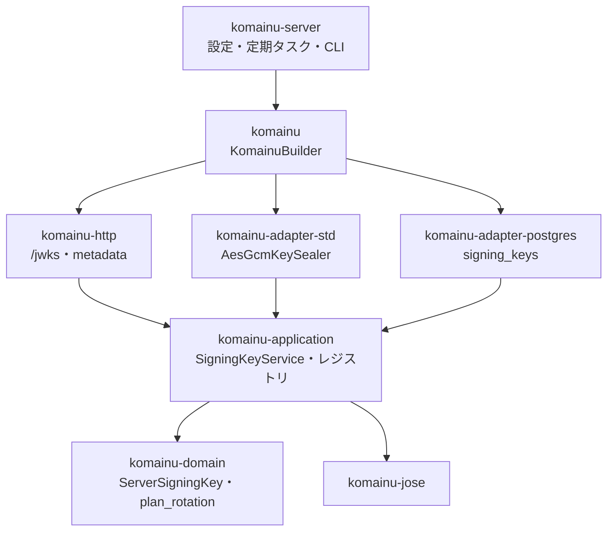
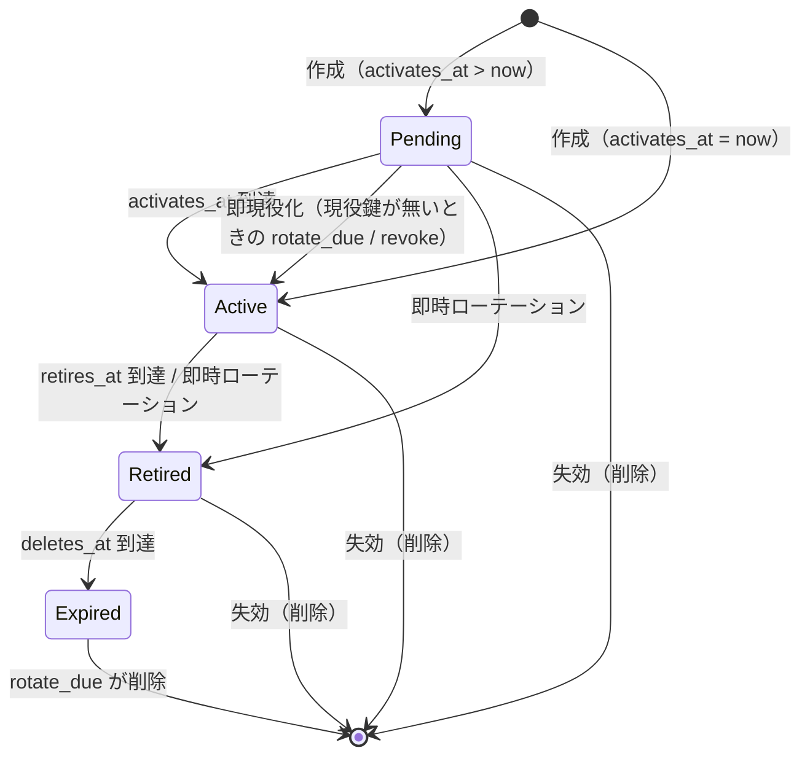
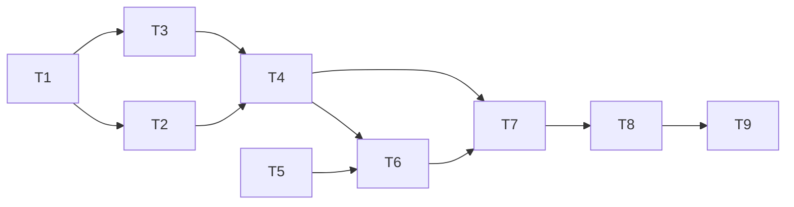

# 署名鍵の管理と拡張ポイント 設計書

対象 Issue: #27（トラッキング: #35 M1）

## 1. 概要

認可サーバー（AS）自身の署名鍵を生成・暗号化保存・自動ローテーションし、`GET /jwks` で公開する。application 内に「現役鍵で JWS / JWT に署名する口」を用意し、後続の RFC 9068（JWT アクセストークン、#29）や JAR / JARM などが鍵管理を作り直さずに使えるようにする。

あわせて、トークンエンドポイントのグラント種別とクライアント認証方式を、クレート内部の登録式の仕組み（trait + レジストリ）に載せ替える。RFC 8414 メタデータの `grant_types_supported` / `token_endpoint_auth_methods_supported` / `revocation_endpoint_auth_methods_supported` と署名アルゴリズムの一覧はレジストリから自動で組み立て、設定で個別に無効化した方式は一覧からもエンドポイントからも消す。

## 2. 要件

### 2.1 利用者と目的

- **運用者**（komainu サーバーを動かす人）: 鍵暗号化鍵を設定するだけで、署名鍵の生成・ローテーション・削除が自動で回る。漏えい時は CLI で即時ローテーション・失効ができる。使わないグラントや認証方式を設定で止められる。
- **ライブラリ利用者**（`komainu` クレートを組み込む人）: `KomainuBuilder` に鍵暗号化の実装（`KeySealer`）と署名の設定を渡せば同じ機能が使える。
- **後続 issue の実装者**: `SigningKeyService::sign_jwt` / `sign_jws` で署名でき、新しいグラントや認証方式はハンドラーを 1 つ書いてレジストリに足すだけでメタデータまで反映される。

### 2.2 スコープ

やること:

- AS 署名鍵のドメインモデル、ローテーション計画（純粋関数）、PostgreSQL とインメモリの永続化
- 秘密鍵の暗号化（AES-256-GCM、鍵暗号化鍵は設定から渡す）
- 自動ローテーション（定期タスク）と手動操作（CLI: 一覧・即時ローテーション・失効・鍵暗号化鍵の生成）
- `GET /jwks` とメタデータの `jwks_uri`
- application 内の署名 API（`sign_jws` / `sign_jwt`）
- グラント種別・クライアント認証方式の内部レジストリへの載せ替えと、supported 一覧の自動生成
- グラント種別・認証方式の設定による個別無効化

やらないこと:

- 署名 API を使う機能（JWT アクセストークン #29、JWT Introspection 応答、JAR / JARM、`signed_metadata`）
- 鍵暗号化鍵の交換（既存の暗号文の再暗号化）。交換したいときは鍵を全部失効させて作り直す（§3.3）
- 外部 KMS / HSM の実装（`KeySealer` port を差し替えれば対応できる形にはする）
- 拡張ポイントのライブラリ利用者への公開（`pub(crate)` に留める）
- クライアントの公開鍵（#19）、Bearer ヘルパー（#11）

### 2.3 機能要件

| ID | 要件 | 受け入れ条件 |
|----|------|--------------|
| F-1 | 署名が有効（鍵暗号化鍵と `algorithms` が設定済み）なら、起動時に各アルゴリズムの現役鍵を用意する | 空の DB で `serve` を起動すると、`listen` より前に `algorithms` の各アルゴリズムについて現役の鍵が 1 つずつ作られ、`GET /jwks` がそれらを返す |
| F-2 | 現役鍵の満了 `prepublish` 前に次の鍵を作り、満了時に切り替える | 現役鍵の `retires_at` の 7 日前（既定）を過ぎてローテーションが走ると、`activates_at = 旧鍵の retires_at` の次の鍵ができ、その時点から JWKS に載る。`retires_at` を過ぎると署名は次の鍵で行われる |
| F-3 | 退役した鍵は `retire_overlap` の間 JWKS に残し、その後削除する | 退役後 7 日（既定）は JWKS に残り署名には使われない。`deletes_at` を過ぎてローテーションが走ると行が削除され JWKS から消える |
| F-4 | 秘密鍵は DB に暗号化して保存する | `signing_keys.sealed_private_key` は先頭 1 バイトが `0x01` の AES-256-GCM 暗号文で、PKCS#8 の平文を含まない。別の鍵暗号化鍵では復号に失敗する |
| F-5 | 即時ローテーション | `komainu key rotate --alg ES256` を実行すると、新しい鍵がその時点で現役になり、それまでの ES256 の現役鍵・次の鍵は即座に退役（`retire_overlap` 後に削除）する。サーバーの各台はキャッシュ有効期間 60 秒以内に新しい鍵で署名を始める。新しい鍵は事前公開されないので、検証側の JWKS キャッシュが切れるまで検証に失敗し得る（漏えい時の対応として許容し、getting-started に注意として書く） |
| F-6 | 失効 | `komainu key revoke <kid>` を実行すると行が削除され、JWKS と署名から（各台のキャッシュ有効期間 60 秒以内に）消える。失効した鍵がそのアルゴリズムの最後の現役鍵なら、同じトランザクションで新しい現役鍵を作る（次の鍵があればそれを即現役にする。signing-keys.md §振る舞い（plan_rotation）と同じ規則） |
| F-7 | `GET /jwks` | 署名有効時は 200、`Content-Type: application/json;charset=UTF-8`（既存の `JSON_CONTENT_TYPE`）、`Cache-Control: public, max-age=300`、本文は `{"keys":[...]}`（次の鍵・現役・退役の鍵、各 JWK に `kid`・`use":"sig"`・`alg`）。署名無効時は 404 |
| F-8 | メタデータの `jwks_uri` | 署名有効時のみ `"jwks_uri": "{HttpConfig::public_base_url()}/jwks"`（`token_endpoint` と同じ基底）を含む。無効時はキーごと出さない |
| F-9 | 署名 API | `sign_jwt(SigningAlgorithm::Es256, &claims, Some("at+jwt"))` が、ヘッダーに現役鍵の `kid` と `alg: ES256` を持つ JWT を返し、`GET /jwks` の鍵で検証できる。有効でないアルゴリズムを指定すると `SigningKeyError::AlgorithmNotEnabled` |
| F-10 | グラント・認証方式のレジストリ | 既存のトークンエンドポイント・失効エンドポイント・メタデータの振る舞いが変わらない（既存テストがそのまま通る） |
| F-11 | supported 一覧の自動生成 | `grant_types_supported` / `token_endpoint_auth_methods_supported` / `revocation_endpoint_auth_methods_supported` / `*_auth_signing_alg_values_supported` がレジストリに登録され、利用可能なものだけから作られる |
| F-12 | グラント種別の無効化 | `disabled_grant_types = ["client_credentials"]` で、メタデータから消え、`grant_type=client_credentials` は `unsupported_grant_type`、その種別を含むクライアントの登録・更新は `AdminError::GrantTypeDisabled`。`refresh_token` を無効にするとリフレッシュトークンを発行しない |
| F-13 | 認証方式の無効化 | `disabled_auth_methods = ["client_secret_post"]` で、メタデータから消え、その方式での `/token` `/revoke` は `invalid_client`、その方式でのクライアント登録・更新は `AdminError::AuthMethodDisabled` |
| F-14 | 監査 | 鍵の作成・退役・削除・失効を監査イベント（`signing_key.created` / `signing_key.activated` / `signing_key.retired` / `signing_key.deleted` / `signing_key.revoked`）に残す。定期タスクは actor `system`、CLI は actor `admin` |

### 2.4 非機能要件

| ID | 項目 | 基準 | 確かめ方 |
|----|------|------|----------|
| N-1 | 秘密鍵の取り扱い | 平文の秘密鍵・鍵暗号化鍵をログ・監査・エラーメッセージ・`Debug` 出力に出さない。復号した鍵はメモリキャッシュ以外に保持しない | `SealedPrivateKey` と `AesGcmKeySealer` の `Debug` 出力のテスト、コードレビュー |
| N-2 | 複数台 | 複数台が同時にローテーションしても、アルゴリズムあたりの鍵の作成は 1 回だけ | PostgreSQL のみのテスト（T4、`crates/adapter-postgres/tests/signing_keys.rs`）: 同じプールで `SigningKeyService` を 2 つ作り、`tokio::join!` で `rotate_due` を同時に走らせると、作成は合計 1 件 |
| N-3 | 署名の性能 | 署名 API は DB にアクセスしない（キャッシュ有効期間 60 秒の間）。処理時間の数値基準は設けない | 単体テストで `InMemoryUnitOfWorkFactory::begin_count()` が増えないことを確かめる |
| N-4 | 鍵の伝播 | 次の鍵は現役になる `prepublish`（既定 7 日、最小 1 時間）前から JWKS に載る。各台のキャッシュ 60 秒 + HTTP キャッシュ 300 秒より十分長い | 設定の検証テスト |
| N-5 | 互換性 | 署名を無効のまま（既定）なら、既存の API・メタデータ・CLI の出力は変わらない（`jwks_uri` も出ない） | 既存テストが通る |

### 2.5 前提と制約

- `komainu-jose` の `SigningKey::generate_es256` / `generate_rsa(RsaKeySize)` / `to_pkcs8_der` / `from_pkcs8_der` / `with_thumbprint_kid` / `verifying_key().to_jwk()`、`jws::sign`、`jwt::encode` を使う。jose 自体には手を入れない。
- domain は jose に依存しない（`crates/domain/Cargo.toml` を変えない）。鍵の公開 JWK は文字列、秘密鍵は暗号文のバイト列として持つ。
- RSA 鍵は 2048 ビット（`RsaKeySize` の 2048 のバリアント）。
- 暗号化は `aes-gcm = { version = "0.11.1", default-features = false, features = ["aes", "alloc"] }`（RustCrypto。sha2 0.11 / p256 0.14 と同じ世代。crates.io で 0.11.1 が正式版であることを確認済み）を `adapter-std` だけに足す。ノンスは aes-gcm の `getrandom` ではなく `SecureRandom` から作るので `getrandom` feature は使わない。
- 既存の規約: エラーは `thiserror`、port は `BoxFuture<'_, Result<_, StoreError>>`、監査は `AuditEvent`、設定は TOML + `KOMAINU_` 環境変数（`__` 区切り）。

## 3. 全体構成

| コンポーネント | クレート | 責務 | 詳細 |
|----------------|----------|------|------|
| 署名鍵ドメイン | `komainu-domain` | `ServerSigningKey`、状態判定、`SigningPolicy`、`plan_rotation` | [signing-keys.md §domain](signing-keys.md#domain) |
| 署名鍵の永続化 | `komainu-application`（port）、`komainu-adapter-postgres`、`komainu-testkit` | `SigningKeyRepository`、マイグレーション、インメモリ実装、conformance | [signing-keys.md §永続化](signing-keys.md#永続化) |
| 鍵の暗号化 | `komainu-application`（port）、`komainu-adapter-std` | `KeySealer`、`AesGcmKeySealer` | [signing-keys.md §鍵の暗号化](signing-keys.md#鍵の暗号化) |
| 署名鍵サービス | `komainu-application` | ローテーション、失効、一覧、JWKS、署名、キャッシュ、監査 | [signing-keys.md §SigningKeyService](signing-keys.md#signingkeyservice) |
| 拡張ポイント | `komainu-application` | `GrantHandler` / `ClientAuthMethod` とレジストリ、無効化、`ServerCapabilities` | [extension-points.md](extension-points.md) |
| HTTP・ファサード・サーバー | `komainu-http`、`komainu`、`komainu-server` | `/jwks`、`jwks_uri`、builder、設定、起動時と定期のローテーション、CLI | [server.md](server.md) |



### 3.1 技術選定

| 対象 | 選定 | 理由 |
|------|------|------|
| 秘密鍵の保存 | DB の `signing_keys` テーブル（port 経由） | 複数台で同じ鍵を共有でき、ローテーションをトランザクションで行える |
| 暗号化 | AES-256-GCM（`aes-gcm` 0.11.1）、AAD に kid | 認証付き暗号で改ざんと行の入れ替えを検出できる。RustCrypto でワークスペースと世代が揃う |
| 複数台の排他 | `pg_advisory_xact_lock` | トランザクション終了で自動解放。テーブルロックより他の処理を止めない |
| kid | RFC 7638 サムネイル（`with_thumbprint_kid`） | 公開鍵から一意に決まり、採番が要らない |
| 拡張ポイント | `pub(crate)` の trait + `Vec<Box<dyn _>>` のレジストリ | 公開 API を増やさずに内部の分岐を整理できる。公開は後から判断できる |

### 3.2 主要な流れ

#### 定期ローテーション（各台、`rotation_interval_secs` ごと。起動時にも 1 回）

```mermaid
sequenceDiagram
  participant T as 定期タスク
  participant S as SigningKeyService
  participant DB as PostgreSQL
  T->>S: rotate_due(ctx)
  S->>DB: BEGIN; pg_advisory_xact_lock
  S->>DB: SELECT * FROM signing_keys
  S->>S: plan_rotation(keys, algorithms, now, policy)
  S->>S: 鍵の生成・暗号化（作成分）
  S->>DB: UPDATE（即現役化）/ INSERT（作成）/ DELETE（期限切れ）/ 監査
  S->>DB: COMMIT（ロック解放）
  S->>S: キャッシュを破棄
```

2 台目は 1 台目の COMMIT まで待ち、COMMIT 後の状態で `plan_rotation` を計算するので、作成は起きない。

#### 鍵の状態遷移



JWKS に載るのは Pending・Active・Retired。署名に使うのは Active のうち `activates_at` が最も新しいもの。

#### 署名

`sign_jwt(alg, claims, typ)` → キャッシュ（60 秒）が古ければ UoW で `list` し、Pending・Active の鍵を `KeySealer::open` で復号してキャッシュ → `now` 時点の Active からアルゴリズムの鍵を選ぶ → `jwt::encode`。

### 3.3 設計判断の記録

| 判断 | 理由 |
|------|------|
| 鍵暗号化鍵が未設定なら署名機能ごと無効（鍵を作らず `jwks_uri` も出さない） | 平文保存の選択肢を作らない。既定の挙動（N-5）を変えない |
| 鍵暗号化鍵の交換は対象外 | 再暗号化には新旧 2 つの鍵を同時に扱う設定が必要で、M1 の範囲を超える。交換は「`key revoke` で全鍵を消す → 鍵暗号化鍵を差し替えて再起動」で行える（その時点で発行済みの JWT は検証できなくなる。M1 では署名済みトークンを発行する機能がまだ無いので影響しない） |
| 失効は行の削除 | 漏えいした鍵を JWKS に残す意味が無い。退役（猶予あり）は即時ローテーションで行う |
| 無効化したグラントは `unsupported_grant_type` | RFC 6749 §5.2 で「AS がその種別を扱わない」場合のコード。`unauthorized_client` は「このクライアントには許されない」場合で、従来どおりクライアントの `grant_types` に無いときに返す |
| `authorization_code` は無効化できない | `/authorize` と `response_types_supported` まで連動させる必要があり、M1 では利用場面が無い。設定で指定したら起動時の検証エラー |
| 既存の `allow_public_clients` / `issuer` による可否はそのまま | `none` は `allow_public_clients`、`private_key_jwt` と jwt-bearer は `issuer` が要る、という「利用可能か」の判定をハンドラーの `is_available` に移すだけで、意味は変えない。クライアント登録時のエラーも従来どおり（`PublicClientsDisabled` など） |
| domain の `GrantType` / `TokenEndpointAuthMethod` enum は残す | クライアントの保存形式・管理 API が enum を使っている。ハンドラーは担当する enum 値を返す |
| JWKS のパスは `/jwks` | RFC 8414 の `jwks_uri` は任意の URL。`/.well-known/jwks.json` は IANA に登録された名前ではない |

## 4. コンポーネント間の契約

各コンポーネントの公開インターフェースは詳細ファイルに書く。ここではコンポーネントをまたぐ取り決めだけを書く。

- **鍵の識別子**: `kid` は `SigningKey::with_thumbprint_kid` で付けた RFC 7638 サムネイル（base64url、43 文字）。domain の `SigningKeyId` と DB の `signing_keys.kid` と JWKS の `kid` は同じ文字列。
- **秘密鍵の受け渡し**: application が `SigningKey::to_pkcs8_der()` の DER を `KeySealer::seal(plaintext, aad)` に渡す。`aad` は `b"komainu:signing-key:" + kid の UTF-8`。戻り値 `SealedPrivateKey` を domain の `ServerSigningKey` に入れて保存する。読み出しは逆順（`open` → `SigningKey::from_pkcs8_der` → `with_thumbprint_kid`）。
- **公開鍵**: `ServerSigningKey::public_jwk` は `verifying_key().to_jwk()` の文字列（`kid`・`use`・`alg` 入り）。JWKS はこれを `VerifyingKey::from_jwk` で戻して `JwkSet::new(..).to_json()` で組み立てる。
- **時刻**: すべて `Dependencies::clock` の `now()`（UTC）。DB は `timestamptz`。
- **署名の有効判定**: `ApplicationConfig::signing` が `Some` なら有効。builder は `Some` のときに `KeySealer` が渡されていなければ `BuildError::MissingKeySealer`。`Dependencies::signing_keys: Option<Arc<SigningKeyService>>` は有効なときだけ `Some`。HTTP は `AppState` に `pub(crate) signing_keys: Option<Arc<SigningKeyService>>` を足し（`AppState::new` の引数は変えない）、`AppState::with_signing_keys` で入れたかどうかで `/jwks` と `jwks_uri` を切り替える。
- **無効化の設定**: `ApplicationConfig::disabled_grant_types: BTreeSet<GrantType>` / `disabled_auth_methods: BTreeSet<TokenEndpointAuthMethod>`。レジストリ・`ServerCapabilities`・`AdminService` が同じ値を見る。
- **設定の検証**: `ApplicationConfig::validate() -> Result<(), ApplicationConfigError>`（型名はこれに統一）。無効化の組み合わせ（extension-points.md §無効化）と、署名有効時の `retire_overlap >= access_token_ttl`（`RetireOverlapTooShort`）を見る。builder の `build` とサーバーの設定検証の両方がこれを呼ぶ。`ApplicationConfigError` は application の lib.rs と `komainu` から再公開する。
- **ロック**: ローテーション・即時ローテーション・失効は、UoW を開いて最初に `signing_keys().lock_rotation()` を呼ぶ。読み取り（一覧・JWKS・署名用の読み込み）はロックしない。

## 5. コンポーネント詳細

- [signing-keys.md](signing-keys.md): domain、永続化、鍵の暗号化、`SigningKeyService`
- [extension-points.md](extension-points.md): グラント・認証方式のレジストリと無効化、`ServerCapabilities`
- [server.md](server.md): `/jwks` とメタデータ、`KomainuBuilder`、サーバーの設定・定期タスク・CLI、ドキュメント

## 6. タスク計画



T1〜T4（署名鍵）と T5（拡張ポイントの載せ替え）は互いに独立している。T6 は T4 が作る `ApplicationConfig::validate` / `ApplicationConfigError` にバリアントと規則を足すので T4 の後に行う。

### T1. domain: 署名鍵の型とローテーション計画

- 依存: なし
- 対象: 新規 `crates/domain/src/signing_key/{mod.rs,key.rs,policy.rs,rotation.rs}`、`crates/domain/src/lib.rs`
- 内容: [signing-keys.md §domain](signing-keys.md#domain) のすべて。F-2、F-3、F-5、F-6 の前提
- 完了条件: signing-keys.md §受け入れ条件「domain」のユニットテストが通る
- 検証: `cargo test -p komainu-domain`、`cargo clippy --workspace --all-targets -- -D warnings`

### T2. 永続化: port・マイグレーション・インメモリ実装

- 依存: T1
- 対象: `crates/application/src/port/{repository.rs,store.rs,mod.rs}`、新規 `crates/adapter-postgres/migrations/0005_signing_keys.sql`、新規 `crates/adapter-postgres/src/signing_key.rs`、`crates/adapter-postgres/src/{uow.rs,lib.rs}`、`crates/testkit/src/store.rs`、`crates/testkit/src/conformance/{cases.rs,fixtures.rs}`、`impl UnitOfWork` があるテスト（`crates/testkit/tests/in_memory_conformance.rs` の `BrokenUow` など。`rg "impl UnitOfWork for"` で全件を探す）
- 内容: [signing-keys.md §永続化](signing-keys.md#永続化)。N-2 の前提
- 完了条件: signing-keys.md §受け入れ条件「永続化」の conformance ケースがインメモリと PostgreSQL の両方で通る
- 検証: `cargo test --workspace`、`cargo test -p komainu-adapter-postgres --features pg-tests`

### T3. 鍵の暗号化: KeySealer と AesGcmKeySealer

- 依存: T1
- 対象: 新規 `crates/application/src/port/sealer.rs`、`crates/application/src/port/mod.rs`、`crates/application/src/lib.rs`、新規 `crates/adapter-std/src/sealer.rs`、`crates/adapter-std/src/lib.rs`、`crates/adapter-std/Cargo.toml`、ルート `Cargo.toml`（`[workspace.dependencies]` に signing-keys.md §鍵の暗号化 のとおりの `aes-gcm`）
- 内容: [signing-keys.md §鍵の暗号化](signing-keys.md#鍵の暗号化)。F-4、N-1
- 完了条件: signing-keys.md §受け入れ条件「鍵の暗号化」が通る
- 検証: `cargo test -p komainu-adapter-std`

### T4. application: SigningKeyService

- 依存: T2、T3
- 対象: 新規 `crates/application/src/signing/{mod.rs,config.rs,error.rs,cache.rs}`、`crates/application/src/{config.rs,deps.rs,lib.rs,audit.rs}`、`crates/application/Cargo.toml`（`jwt::encode` の `T: Serialize` のために `serde.workspace = true` を追加）、`crates/testkit/src/{env.rs,lib.rs,store.rs}`（`TestEnv::with_signing`、`InMemoryUnitOfWorkFactory::begin_count`）、新規 `crates/testkit/src/sealer.rs`（`TestKeySealer`）、`Dependencies` のリテラルがあるファイル（`rg "Dependencies \{"` で全件。`crates/komainu/src/builder.rs` はこの時点では `signing_keys: None`）、新規 `crates/application/tests/signing.rs`、新規 `crates/adapter-postgres/tests/signing_keys.rs`（N-2）
- 内容: [signing-keys.md §SigningKeyService](signing-keys.md#signingkeyservice)、`SigningConfig`、`AuditKind` の 5 種、`ApplicationConfig::validate` の `RetireOverlapTooShort`（型と規則は [extension-points.md §無効化](extension-points.md#無効化) の設定の節のうち `RetireOverlapTooShort` に関わる部分）（`validate` と `ApplicationConfigError` が T6 より先に必要になるので、このタスクで `validate` と型を作り、T6 はバリアントと規則を足す）。F-1（サービス部分）、F-2、F-3、F-5、F-6、F-9、F-14、N-2、N-3
- 完了条件: signing-keys.md §受け入れ条件「SigningKeyService」と N-2 のテストが通る
- 検証: `cargo test --workspace`、`cargo test -p komainu-adapter-postgres --features pg-tests`（`--no-run` でもビルドが通ることは必ず確かめる）

### T5. 拡張ポイント: レジストリへの載せ替え

- 依存: なし
- 対象: 新規 `crates/application/src/token/{grant.rs,auth.rs}`、`crates/application/src/token/mod.rs`、`crates/application/src/capabilities.rs`
- 内容: [extension-points.md](extension-points.md) の §レジストリ と §ServerCapabilities。`builtin` は組み込みをすべて登録するだけで、`disabled_*` による除外は T6 で足す（フィールドがまだ無いため）。振る舞いは変えない。F-10、F-11
- 完了条件: 既存の `cargo test --workspace` がテストを変えずに通る。extension-points.md §受け入れ条件「レジストリ」が通る
- 検証: `cargo test --workspace`、`cargo clippy --workspace --all-targets -- -D warnings`

### T6. 拡張ポイント: 無効化の設定

- 依存: T4、T5
- 対象: `crates/application/src/{config.rs,capabilities.rs}`、`crates/application/src/token/{mod.rs,grant.rs,auth.rs}`、`crates/application/src/admin/{mod.rs,error.rs}`、`crates/application/tests/` と `crates/http/tests/`（`/revoke` の `invalid_client`、basic の 401 + `WWW-Authenticate`）の該当テスト、`crates/server/src/cli/mod.rs`（`admin_exit` の `match` は網羅的なので、新しい 2 バリアントの変換をこのタスクで足す）、ほかに `AdminError` を `match` している箇所（`rg "AdminError::" crates/server crates/komainu`）
- 内容: [extension-points.md §無効化](extension-points.md#無効化)。F-12、F-13
- 完了条件: extension-points.md §受け入れ条件「無効化」が通る
- 検証: `cargo test --workspace`

### T7. HTTP とファサード: /jwks・jwks_uri・builder

- 依存: T4、T6
- 対象: `crates/http/src/{lib.rs,state.rs,metadata.rs}`、新規 `crates/http/src/jwks.rs`、新規 `crates/http/tests/jwks.rs`、`crates/komainu/src/{builder.rs,lib.rs}`、`crates/komainu/Cargo.toml`（必要なら）
- 内容: [server.md §HTTP](server.md#http) と [server.md §ファサード](server.md#ファサード)。F-7、F-8
- 完了条件: server.md §受け入れ条件「HTTP」「ファサード」が通る
- 検証: `cargo test --workspace`

### T8. サーバー: 設定・起動時と定期のローテーション・CLI

- 依存: T7
- 対象: `crates/server/src/{config.rs,wiring.rs,serve.rs}`、新規 `crates/server/src/rotation.rs`、`crates/server/src/cli/mod.rs`、新規 `crates/server/src/cli/key.rs`、`crates/server/src/lib.rs`（`execute` の振り分け）、`crates/server/tests/` の該当テスト
- 内容: [server.md §サーバー](server.md#サーバー)。F-1、F-5、F-6、F-12、F-13（設定の読み込み）、N-4
- 完了条件: server.md §受け入れ条件「サーバー」が通る
- 検証: `cargo test --workspace`、`cargo test -p komainu-server --features pg-tests`（PostgreSQL を使うテストがある場合）

### T9. ドキュメント

- 依存: T8
- 対象: `docs/getting-started.md`、`docs/design/authorization-server/README.md`（§8 ロードマップに行を追加）
- 内容: [server.md §ドキュメント](server.md#ドキュメント)
- 完了条件: getting-started に鍵暗号化鍵の生成と設定、`komainu key` の使い方、`disabled_*` の設定が載っている。ロードマップに「AS 署名鍵・JWKS・グラントと認証方式の拡張ポイント（#27） | 済」の行がある
- 検証: `cargo test --workspace --doc`、目視

## 7. 未決事項

なし。
