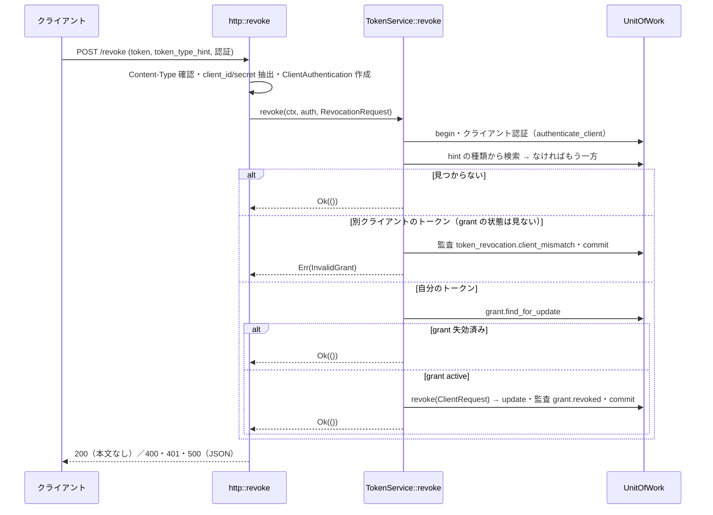
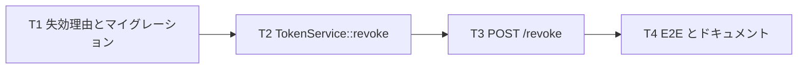

# トークン失効エンドポイント（RFC 7009）設計書

- 状態: 草案
- 最終更新: 2026-11-23
- 関連: [RFC 7009](https://www.rfc-editor.org/rfc/rfc7009)、[RFC 6749 §2.3 / §5.2](https://www.rfc-editor.org/rfc/rfc6749)、[認可サーバー設計書](../authorization-server/README.md)

## 1. 概要

クライアントが、不要になったアクセストークンやリフレッシュトークンを認可サーバーに失効させる `POST /revoke` エンドポイントを追加する。用途はログアウトやアプリのアンインストールである。

komainu はトークン単体に失効状態を持たない。アクセストークンとリフレッシュトークンは、親の grant が active の間だけ有効になる。この設計を変えず、どちらのトークンを提示されても **その grant を失効させる**。同じ grant から発行したアクセストークンとリフレッシュトークンは、すべて同時に使えなくなる。

処理は `TokenService::revoke` に置き、`/token` と同じクライアント認証を使う。ファサード（`komainu` crate）の公開 API は変えない。`Komainu::router()` が返すルーターに `/revoke` が加わる。

## 2. 要件

### 2.1 利用者と目的

| 利用者 | 目的 |
|---|---|
| クライアント開発者 | ログアウト時などに、手元のトークンを RFC 7009 に従って失効させる |
| 組み込み利用者（Rust 開発者） | HTTP を通さず `TokenService::revoke` を呼んで失効させる。`Komainu::router()` を使えば `/revoke` も自動で公開される |
| 運用者 | 失効の記録を監査ログ（`grant.revoked`、reason `client_request`）とメトリクスで追う |

### 2.2 スコープ

- やること
  - `POST /revoke`（`application/x-www-form-urlencoded`）。パラメータは `token`（必須）と `token_type_hint`（任意）
  - クライアント認証は `/token` と同じ: `client_secret_basic`、`client_secret_post`、public client（`client_id` のみ。`clients.allow_public` が有効なときだけ）
  - 失効理由 `RevocationReason::ClientRequest`（`"client_request"`）の追加と、Postgres マイグレーション 0002
  - 監査イベントの種類 `token_revocation.client_mismatch` の追加、メトリクス `komainu_revocation_requests_total` の追加
  - README の対応一覧と CHANGELOG の更新
- やらないこと
  - アクセストークン単体の失効（トークンテーブルに状態列を足すこと）
  - 認可サーバーメタデータ（RFC 8414）の `revocation_endpoint`。メタデータエンドポイント自体がまだない
  - CORS（RFC 7009 §2.1 の JavaScript クライアント向け記述）、レート制限
  - `unsupported_token_type` エラー。対応するトークンの種類はアクセストークンとリフレッシュトークンの 2 つだけで、どちらも失効できるので、このエラーを返す場面がない
  - RFC 7009 §2.2.1 の 503 + `Retry-After`。ストアのエラーは `/token` と同じく 500 `server_error` にする

### 2.3 機能要件

「有効なクライアント認証」は、`/token` で認証に成功する組み合わせを指す。

| ID | 要件 | 受け入れ条件 |
|---|---|---|
| F-1 | アクセストークンを提示すると、その grant が失効する | クライアント A が自分のアクセストークン T を `token=T` で失効させると 200 になる。その後 `verify_access_token(T)` が `Ok(None)` を返し、同じ grant のリフレッシュトークンを `/token` に出すと 400 `invalid_grant` になる |
| F-2 | リフレッシュトークンを提示すると、その grant が失効する | クライアント A が自分のリフレッシュトークン R を失効させると 200 になる。その後 R での `/token` は 400 `invalid_grant`、同じ grant のアクセストークンは `verify_access_token` が `Ok(None)` になる |
| F-3 | 期限切れ・ローテーション済みのトークンでも、見つかれば grant を失効させる | ローテーション済みの R_old を失効させると 200 になる。同じ grant の最新のリフレッシュトークン R_new も使えなくなり、`refresh_token.replay_detected` は記録されない。期限切れ（`expires_at <= now`）のアクセストークンやリフレッシュトークンでも、同じように grant が失効する。purge で行が消えたトークンは F-5 と同じ「見つからない」扱いになる |
| F-4 | 失効させた grant は `grant.revoked` として監査に残る | F-1 の後、監査ログに kind `grant.revoked`、outcome `success`、actor `client`、details `reason=client_request` と `grant_id` を持つイベントがちょうど 1 件ある |
| F-5 | 存在しないトークンは成功扱いにする（RFC 7009 §2.2） | 発行していない文字列を `token` に渡すと 200 になる。`OpaqueToken::try_new` が受け付けない文字列（513 バイト以上、または 0x20〜0x7e 以外のバイトを含むもの。非 ASCII や制御文字など）も 200 になる。どれも DB の grant は変わらず、監査イベントも記録されない。512 バイトちょうどで発行していない値も 200 になる |
| F-6 | 自分のトークンで、grant が失効済みなら成功扱いにし、何もしない | 同じトークンで 2 回失効させると、2 回とも 200 になる。`grant.revoked` は 1 件だけ記録される |
| F-7 | 別のクライアントに発行されたトークンは拒否する（RFC 7009 §2.1）。grant の状態は見ない | クライアント B がクライアント A のトークンを提示すると 400、`error=invalid_grant` になる。A の grant は active のままで、監査に kind `token_revocation.client_mismatch`、outcome `failure`、client_id `B` のイベントが 1 件記録される。A の grant が失効済みでも、同じく 400 になり、mismatch が記録される |
| F-8 | `token_type_hint` は探す順番だけに使う | `token_type_hint=refresh_token` にアクセストークンを渡しても失効する（逆も同じ）。`token_type_hint=foo` のような不明な値は無視して 200 になる |
| F-9 | クライアント認証は `/token` と同じ規則に従う | 誤ったシークレットを Basic で送ると 401 `invalid_client` に `WWW-Authenticate: Basic realm="komainu"` が付き、`client_authentication.failed` が記録される。`client_secret_post` の誤りは 401 でヘッダなし。認証情報なしは 401。無効化されたクライアントは 401。public client を許さない設定（サーバーでは `clients.allow_public = false`、アプリケーション層では `ApplicationConfig` の `allow_public_clients = false`）で、public client が `client_id` だけを送ると 401。どの場合も失効は起きない |
| F-10 | パラメータの誤りは `invalid_request` にする | 次のどれも 400 `invalid_request` になる。サービス側の判定: `token` がない・空、`token` か `token_type_hint` が 2 回以上ある。HTTP 層の判定: Content-Type が form でない、`client_id` か `client_secret` が 2 回以上ある、Basic と body の `client_secret` を同時に使う、Basic の ID と body の `client_id` が違う、body に `client_secret` だけがある（後ろの 3 つは既存の `client_auth::client_authentication` の判定） |
| F-11 | 応答の形式 | 成功時は 200、本文なし、`Cache-Control: no-store` と `Pragma: no-cache` が付く。エラー時は `/token` と同じ JSON（`{"error","error_description"}`、`Content-Type: application/json;charset=UTF-8`、同じ cache ヘッダ）。ただし、フレームワークが返す 405（メソッド違い）と 413（body が上限を超えた）は、`/token` と同じくこの形式の対象外とする |
| F-12 | メトリクスを記録する | 成功で `komainu_revocation_requests_total{result="success"}`、エラーで `result` にエラーコード（例 `invalid_client`）を付けて 1 増える |

### 2.4 非機能要件

| ID | 項目 | 基準 | 確かめ方 |
|---|---|---|---|
| N-1 | 秘密の扱い | `token` の値と `client_secret` を、ログ・監査 details・`Debug` 出力に一切出さない | `RevocationRequest` の `Debug` 出力に token 値が含まれないことを単体テストで確認する。監査 details のキーを F-4・F-7 のテストで確認する |
| N-2 | 一貫性 | 失効は 1 つの UoW 内で、grant の更新と監査の追記を一緒にコミットする | in-memory ストアのテストで、コミット後に grant の状態と監査件数がそろっていることを確認する |
| N-3 | デッドロック回避 | ロックを取る順番は `/token` のリフレッシュ処理と同じ「refresh_token → grant」にする | コードレビューで確認する（§5.2 の手順に従っていること） |
| N-4 | 互換性 | 既存の `/token`・`/authorize` の挙動は変えない。既存テストの期待値も変えない。ただし、シナリオを追加したことによる件数の更新（T4 の E2E 監査件数）と、conformance の `CASES` へのケースの追加（T1）は除く | `cargo test --workspace --features pg-tests` が通る |

### 2.5 前提と制約

- `AuditKind` と `RevocationReason` は `#[non_exhaustive]` ではない公開 enum である。variant を足すと網羅 match を書いている利用者のコードが壊れる。0.x の alpha 期間なので許容し、CHANGELOG の `Changed` に書く
- `grants.revocation_reason` の CHECK 制約は 0001 で列制約として作っている。Postgres が付ける名前は `grants_revocation_reason_check` である
- トークンは SHA-256 のハッシュ（`TokenHash`）で保存しているので、平文のトークンから直接引ける

## 3. 全体構成

| コンポーネント | 責務 | 配置 | 詳細 |
|---|---|---|---|
| ドメイン | 失効理由 `ClientRequest` の追加 | `crates/domain/src/token/grant.rs` | §5.1 |
| アプリケーション | パラメータ解釈、クライアント認証、トークン検索、grant の失効、監査 | `crates/application/src/token/{mod,request,error}.rs`、`crates/application/src/audit.rs`、`crates/application/src/support.rs` | §5.2 |
| HTTP | `POST /revoke` のハンドラ、エラー応答、メトリクス | `crates/http/src/revoke.rs`（新規）、`crates/http/src/{lib,oauth_error,metrics}.rs` | §5.3 |
| Postgres アダプタ | CHECK 制約の更新 | `crates/adapter-postgres/migrations/0002_client_request_revocation.sql`（新規）、`crates/adapter-postgres/src/lib.rs` | §5.4 |
| testkit | `client_request` で失効した grant の保存・読み出しを確かめるケース | `crates/testkit/src/conformance/cases.rs` | §5.4 |

リポジトリの port（`GrantRepository`、`AccessTokenRepository`、`RefreshTokenRepository`）には手を入れない。既存の `AccessTokenRepository::find` と `RefreshTokenRepository::find_for_update` で足りる。

### 3.1 技術選定

新しい依存は追加しない。

### 3.2 主要な流れ



## 4. コンポーネント間の契約

### 4.1 アプリケーションの公開 API（`komainu-application`）

`RevocationError`、`RevocationRequest`、`TokenTypeHint` を、`crates/application/src/token/mod.rs` の `pub use error::...` / `pub use request::...` に加える。`crates/application/src/lib.rs` の `pub use token::{...}` にも加える。

```rust
// crates/application/src/token/request.rs

/// `token_type_hint` の値（RFC 7009 §2.1）。
#[derive(Debug, Clone, Copy, PartialEq, Eq)]
pub enum TokenTypeHint {
    AccessToken,
    RefreshToken,
}

impl TokenTypeHint {
    /// "access_token" / "refresh_token" を変換する。それ以外は None（ヒントなしとして扱う）。
    pub fn parse(value: &str) -> Option<Self>;
}

/// `POST /revoke` のフォームパラメータ。空の値は「なし」とみなす。
/// `client_id` と `client_secret` はここでは読まない（HTTP 層が取り出す）。
#[derive(Clone, Default)]
pub struct RevocationRequest {
    pub token: Option<String>,
    /// 生の値。解釈は TokenTypeHint::parse で行う。
    pub token_type_hint: Option<String>,
    /// 上の 2 つのうち、2 回以上現れたパラメータ名。
    pub duplicated: Vec<&'static str>,
}

impl RevocationRequest {
    /// support::collect_params で "token" と "token_type_hint" を集める。他の名前は無視する。
    pub fn from_pairs(pairs: impl IntoIterator<Item = (String, String)>) -> Self;
}

// Debug は手で実装し、token の値を "[REDACTED]" に置き換える（token_type_hint と duplicated はそのまま出す）。
impl std::fmt::Debug for RevocationRequest { /* ... */ }
```

```rust
// crates/application/src/token/error.rs

/// 失効エンドポイントのエラー（RFC 7009 §2.2.1 と RFC 6749 §5.2）。
#[derive(Debug, thiserror::Error)]
pub enum RevocationError {
    #[error("invalid_request")]
    InvalidRequest,
    /// TokenError::InvalidClient と同じ意味。
    #[error("invalid_client")]
    InvalidClient { basic_attempted: bool },
    /// トークンが別のクライアントに発行されている。
    #[error("invalid_grant")]
    InvalidGrant,
    /// Display は TokenError::Server と同じ形にそろえる。
    #[error("store error: {0}")]
    Server(StoreError),
}

impl RevocationError {
    /// "invalid_request" / "invalid_client" / "invalid_grant" / "server_error"
    pub fn code(&self) -> &'static str;
}

impl From<StoreError> for RevocationError { /* Server に包む */ }
```

```rust
// crates/application/src/token/mod.rs

impl TokenService {
    /// RFC 7009 のトークン失効。振る舞いは §5.2。
    /// Ok(()) は「失効させた」「見つからない」「すでに失効済み」のどれか（呼び出し側は区別しない）。
    pub async fn revoke(
        &self,
        ctx: &RequestContext,
        auth: ClientAuthentication,
        request: RevocationRequest,
    ) -> Result<(), RevocationError>;
}
```

`TokenService::revoke` が返すエラーと、HTTP 層での扱い:

| エラー | `revoke` が返すとき | HTTP 層の扱い |
|---|---|---|
| `InvalidRequest` | `token` がない・空、`token` か `token_type_hint` の重複 | 400 |
| `InvalidClient { basic_attempted }` | クライアント認証の失敗 | 401。`basic_attempted` なら `WWW-Authenticate: Basic realm="komainu"` |
| `InvalidGrant` | 別クライアントのトークン | 400 |
| `Server(StoreError)` | ストアの失敗 | 500。`tracing::error!` で記録する |

HTTP 層は、`revoke` を呼ぶ前に、独自の判定で `InvalidRequest` または `InvalidClient` を返すことがある（F-10 の HTTP 層の判定、および Basic ヘッダの形式が壊れているときの 401）。判定の順番は次のとおり。

1. HTTP 層: Content-Type の確認 → `client_id`・`client_secret` の重複の確認 → `client_authentication`（資格情報の形式の検査）
2. サービス: パラメータの検査 → クライアント認証

このため、たとえば「Basic ヘッダが壊れていて、`token` もない」場合は 401 になる。

### 4.2 監査イベント（`komainu-application`）

`AuditKind` に 1 つ足す。

| variant | `as_str()` | outcome | actor | client_id | subject | details |
|---|---|---|---|---|---|---|
| `TokenRevocationClientMismatch` | `"token_revocation.client_mismatch"` | `Failure` | `Client` | 認証したクライアント | なし | `token_type`（`"access_token"` か `"refresh_token"`）、`grant_id`（トークンの grant の UUID 文字列） |

grant を失効させたときは、既存の `support::grant_events(deps, ctx, &mut grant, AuditActor::Client)` で `grant.revoked`（details `grant_id`、`reason=client_request`）を作る。

### 4.3 HTTP API（`komainu-http`）

`POST /revoke`

- リクエスト
  - `Content-Type: application/x-www-form-urlencoded`（`form::is_form_content_type` で判定する）
  - body パラメータ: `token`（必須）、`token_type_hint`（任意）、`client_id`・`client_secret`（`client_secret_post` か public client のとき）
  - ヘッダ: `Authorization: Basic ...`（`client_secret_basic` のとき）
  - body の上限は既存の `RequestBodyLimitLayer`（`max_body_bytes`、既定 16384）に従う
- 応答

| 状況 | ステータス | 本文 | ヘッダ |
|---|---|---|---|
| 成功（失効・見つからない・失効済み） | 200 | なし（長さ 0） | `Cache-Control: no-store`、`Pragma: no-cache` |
| `invalid_request` | 400 | `{"error":"invalid_request","error_description":"The request is malformed."}` | `Content-Type: application/json;charset=UTF-8`、上の cache ヘッダ |
| `invalid_client` | 401 | `{"error":"invalid_client","error_description":"Client authentication failed."}` | 同上。Basic を試したときは `WWW-Authenticate: Basic realm="komainu"` |
| `invalid_grant` | 400 | `{"error":"invalid_grant","error_description":"The token was issued to another client."}` | 同上 |
| `server_error` | 500 | `{"error":"server_error","error_description":"Temporarily unavailable."}` | 同上 |

GET など POST 以外のメソッドは axum の既定どおり 405 になる。

### 4.4 メトリクス

| 名前 | 種類 | ラベル | 値 |
|---|---|---|---|
| `komainu_revocation_requests_total` | counter | `result` | `"success"` か `RevocationError::code()` の値 |

### 4.5 データ

`grants.revocation_reason` が取る値に `'client_request'` を足す。テーブルの形は変えない。

```sql
-- crates/adapter-postgres/migrations/0002_client_request_revocation.sql
ALTER TABLE grants DROP CONSTRAINT grants_revocation_reason_check;
ALTER TABLE grants ADD CONSTRAINT grants_revocation_reason_check
    CHECK (revocation_reason IN ('code_replay', 'refresh_token_replay', 'client_disabled', 'user_disabled', 'client_request'));
```

## 5. コンポーネント詳細

### 5.1 ドメイン

- `RevocationReason` に `ClientRequest` を足す。`as_str()` は `"client_request"`、`FromStr` は `"client_request"` を受け付ける
- 同じ対応を持つ `crates/application/src/support.rs` の `reason_str` にも arm を足す
- `Grant::revoke` は変えない（すでに失効済みなら何もせず、イベントも出さない）

受け入れ条件:
- `RevocationReason::ClientRequest.as_str()` が `"client_request"` になり、`"client_request".parse()` が `Ok(ClientRequest)` になる

### 5.2 アプリケーション: `TokenService::revoke`

手順（`now = deps.clock.now()`）:

1. `request.duplicated` が空でなければ `InvalidRequest`
2. `request.token` が `None` なら `InvalidRequest`
3. クライアントを認証する。`exchange` と同じ形で行う。`authenticate_client` 自体は変えない
   1. `let uow = self.deps.store.begin().await?;`（`StoreError` は `From` で `Server` になる）
   2. `let (mut uow, client) = self.authenticate_client(ctx, uow, &auth).await` を呼び、返る `TokenError` を変換する: `InvalidClient { basic_attempted }` → `RevocationError::InvalidClient { basic_attempted }`、`Server(e)` → `Server(e)`。`authenticate_client` が返すのは今この 2 つだけである。他の variant が返ったら `Server(StoreError::Other("unexpected client authentication error".to_owned()))` にする。認証失敗の監査は `authenticate_client` が書く
   - パラメータの検査（1・2）を認証の前に行うのは、`/token`（`exchange`）と同じ順番にするためである
4. `parse_token(token)` が `None`（形式に合わない）なら、UoW をコミットせずに捨てて `Ok(())`
5. `hash = token.hash()`。`TokenTypeHint::parse` の結果で探す順番を決める。`Some(RefreshToken)` なら「リフレッシュ → アクセス」、それ以外（`AccessToken`、不明な値、なし）は「アクセス → リフレッシュ」
   - アクセス: `uow.access_tokens().find(&hash)`
   - リフレッシュ: `uow.refresh_tokens().find_for_update(&hash)`（ロックを取るので、同じトークンで同時に走るローテーションとは直列になる）
   - 期限やローテーション状態は見ない（F-3）
6. どちらでも見つからなければ、UoW を捨てて `Ok(())`
7. 見つかったトークンの `client_id()` が認証したクライアントの ID と違えば、`token_revocation.client_mismatch`（§4.2）を `append` してコミットし、`InvalidGrant` を返す。grant は読まないので、grant が失効済みかどうかに関係なくこうなる（F-7）
8. `uow.grants().find_for_update(token.grant_id())` で grant を取る。`None` なら（外部キーがあるので通常は起きない）`Server(StoreError::Other("grant not found for token".to_owned()))`
9. grant がすでに失効済みなら、UoW を捨てて `Ok(())`
10. `grant.revoke(RevocationReason::ClientRequest, now)`、`uow.grants().update(&grant)`、`grant_events(deps, ctx, &mut grant, AuditActor::Client)` を `append_all` してコミットし、`Ok(())`

`verify_access_token` と `/token` のリフレッシュ処理は、すでに grant が active かどうかを確かめている。そのため、grant を失効させるだけで F-1・F-2 の後半が成り立つ。

受け入れ条件: `crates/application/tests/revocation.rs`（新規、in-memory ストア）で確かめる。範囲は次のとおり。HTTP 層の部分は §5.3 で確かめる。
- F-1〜F-8 はすべて確かめる。HTTP のステータスは、対応する `Result`（`Ok(())` / `Err(InvalidGrant)` など）に読み替える
- F-9 は、返るエラーの variant（`InvalidClient { basic_attempted }` の値を含む）、`client_authentication.failed` の監査、失効が起きないことまで確かめる
- F-10 はサービス側の判定だけを確かめる

加えて、次のとき次のようになることを確かめる。
- `token_type_hint=access_token` でリフレッシュトークンを渡すと、アクセス側で見つからず、リフレッシュ側で見つかって失効する
- `RevocationRequest` の `Debug` 出力に token の値が含まれない

### 5.3 HTTP: `crates/http/src/revoke.rs`

- `pub(crate) async fn revoke(State<AppState>, Ctx, HeaderMap, Bytes) -> Response`。router に `.route("/revoke", post(revoke::revoke))` を足す（`/token` の次）
- body の読み方は `token::token` と同じにする。`client_id` と `client_secret` を取り出し（secret はすぐ `Secret` に包む）、どちらかが 2 回以上あれば `InvalidRequest`。残りを `RevocationRequest::from_pairs` に渡す。Content-Type が form でなければ `InvalidRequest`
- `client_auth::client_authentication` は `TokenError` を返す。`InvalidRequest` → `RevocationError::InvalidRequest`、`InvalidClient { b }` → `RevocationError::InvalidClient { b }` に変換する（この関数は今この 2 つしか返さない）。`client_auth.rs` 自体は変えない
- エラー応答: `oauth_error.rs` に `pub(crate) fn revocation_error_response(&RevocationError) -> Response` を足す。ステータスとヘッダの決め方は `token_error_response` と同じにし、`error_description` は §4.3 の表の文言にする。共通部分を private 関数に切り出すかどうかは実装者に任せる
- 成功応答: `StatusCode::OK` で本文は空。`Cache-Control: no-store` と `Pragma: no-cache` を付け、Content-Type は付けない。このため `oauth_error.rs` に `pub(crate) fn no_store_headers() -> HeaderMap`（cache の 2 ヘッダだけ）を足す。`token_headers()` は、それに Content-Type を加える形に書き換えてよい。`token_headers()` が返す内容は変えないこと
- `Server` のときは `tracing::error!(error = %source, "revocation endpoint store error")`
- `metrics.rs` に `pub(crate) fn count_revocation_request(result: &str)` を足す（§4.4）

受け入れ条件: F-9〜F-11 と、F-1・F-7 の HTTP 版（200 と 400 `invalid_grant`）を `crates/http/tests/revoke.rs`（新規、`tests/common` の Harness を使う）で確かめる。F-10 は HTTP 層の判定をすべて含める。F-12（メトリクス）は、komainu-http にレコーダーを差し込むテスト基盤がないので、T4 で `crates/server/tests/serve.rs` で確かめる。

### 5.4 Postgres アダプタと testkit

- `crates/adapter-postgres/src/lib.rs` の `migrate` に `Migration::new(2, Cow::Borrowed("client_request_revocation"), MigrationType::Simple, include_str!("../migrations/0002_client_request_revocation.sql").into_sql_str(), false)` を足し、`with_migrations(vec![init, client_request])` にする
- grant の保存・読み出しは `RevocationReason::as_str` / `FromStr` を使っているので、コードの変更は要らない
- `crates/testkit/src/conformance/cases.rs` にケース `grant_revoked_by_client_request_roundtrip` を足す。`CASES` の要素数を 9 から 10 にする。内容は、grant を insert → `revoke(ClientRequest)` → update → commit → 新しい UoW で `find` すると `GrantStatus::Revoked { reason: ClientRequest, .. }` になること

受け入れ条件（`crates/adapter-postgres/tests/postgres.rs` にテストを足す。`pg-tests` 機能のとき動く）:
- テスト `migrate_upgrades_from_0001`: 空の DB（`start_raw()`）で、まずテスト内で組み立てた「0001 だけの `Migrator`」を実行する。具体的には `Migration::new(1, Cow::Borrowed("init"), MigrationType::Simple, include_str!("../migrations/0001_init.sql").into_sql_str(), false)` を持つ `Migrator::with_migrations` を使う。version・description・SQL は `migrate` 内のものとそろえる（チェックサムが一致しないと `migrate` が失敗するため）。その後 `migrate` を 2 回呼んで、どちらもエラーにならないこと。さらに、`PgUnitOfWorkFactory` で client と grant を insert し、`revoke(ClientRequest)` → `GrantRepository::update` → commit が成功すること
- conformance の新しいケースが in-memory ストアと Postgres の両方で通る

## 6. タスク計画



### T1. 失効理由 `ClientRequest` とマイグレーション 0002

- 依存: なし
- 対象: `crates/domain/src/token/grant.rs`、`crates/application/src/support.rs`（`reason_str`）、`crates/adapter-postgres/migrations/0002_client_request_revocation.sql`（新規）、`crates/adapter-postgres/src/lib.rs`、`crates/adapter-postgres/tests/postgres.rs`、`crates/testkit/src/conformance/cases.rs`
- 内容: §5.1、§5.4
- 完了条件: §5.1・§5.4 の受け入れ条件を満たす。domain に `as_str`・`FromStr` の単体テストがある
- 検証: `cargo test -p komainu-domain`、`cargo test --workspace --features pg-tests`（Docker が必要）

### T2. `TokenService::revoke`

- 依存: T1
- 対象: `crates/application/src/token/{mod,request,error}.rs`、`crates/application/src/audit.rs`、`crates/application/src/lib.rs`、`crates/application/tests/revocation.rs`（新規）
- 内容: §4.1、§4.2、§5.2
- 完了条件: §5.2 の受け入れ条件のテストがすべて通る
- 検証: `cargo test -p komainu-application`、`cargo clippy --workspace --all-targets --features pg-tests -- -D warnings`

### T3. `POST /revoke`

- 依存: T2
- 対象: `crates/http/src/revoke.rs`（新規）、`crates/http/src/{lib,oauth_error,metrics}.rs`、`crates/http/tests/revoke.rs`（新規）
- 内容: §4.3、§4.4、§5.3
- 完了条件: §5.3 の受け入れ条件のテストがすべて通る
- 検証: `cargo test -p komainu-http`、`cargo clippy --workspace --all-targets --features pg-tests -- -D warnings`

### T4. E2E シナリオとドキュメント

- 依存: T3
- 対象: `crates/server/tests/e2e_scenario.rs`、`crates/server/tests/serve.rs`、`README.md`、`CHANGELOG.md`、`docs/design/authorization-server/http.md`
- 内容:
  - E2E（`e2e_scenario.rs`）: 「F-9: a `skip_consent` client never shows the consent screen.」の手順で quiet クライアントのコードを得た直後、Logout の前に次を足す
    0. 既存の `secrets.push(("code quiet", code))` を `secrets.push(("code quiet", code.clone()))` に変える
    1. `h.exchange_code((&quiet_id, &quiet_secret), &code)` でコードを交換する。quiet は `authorization_code` だけを許すクライアントなので、リフレッシュトークンは出ない（シナリオを変えないため、quiet の作成オプションは変えない）
    2. 得たアクセストークンを、quiet の認証情報（Basic）で `POST /revoke` に送り、200 で本文が空であること。送るために `Harness` に `async fn revoke(&self, client: (&str, &str), pairs: &[(&str, &str)]) -> (StatusCode, HeaderMap, String)` を足す（既存の `token` ヘルパーと同じ作りで、宛先を `/revoke` にする）
    3. そのアクセストークンの `verify` が `None` になること
    4. 新しいアクセストークンを `secrets` に push し、ログ・監査に秘密が出ないことの検査の対象にする
  - E2E の件数の表を直す: `("token.issued", 4)` → `5`（コメントも「Three code exchanges, ...」に直す）、`("grant.revoked", 3)` → `4`（コメントに「the revocation endpoint revokes the quiet client's grant」を足す）。ほかの値は変えない
  - メトリクス（`serve.rs` の `serve_health_metrics_and_sigterm`）: client_credentials でトークンを得た後（応答本文を `serde_json::from_str::<serde_json::Value>` で読んで `access_token` を取り出す）、そのアクセストークンを同じクライアントの Basic 認証で `POST /revoke` し、200 であることを確かめる。その後 `/metrics` の本文に `komainu_revocation_requests_total` が含まれることを確かめる（F-12）
  - README: 対応機能の一覧（`- Token endpoint (POST /token) ...` の次）に `- Token revocation endpoint (POST /revoke, RFC 7009). Revoking either token revokes the whole grant` を足す。34 行目の `token introspection and revocation\nendpoints` を `the token introspection endpoint` に書き換える
  - `docs/design/authorization-server/http.md` のエンドポイント表に `| POST /revoke | トークン失効エンドポイント（[token-revocation](../token-revocation/README.md)） |` の行を足す
  - CHANGELOG の `[Unreleased]`:
    - `Added`: `POST /revoke`（RFC 7009）、`TokenService::revoke`、公開型 `RevocationRequest`・`RevocationError`・`TokenTypeHint`、監査イベント `token_revocation.client_mismatch`、メトリクス `komainu_revocation_requests_total`、マイグレーション 0002（`migrate` で自動適用）
    - `Changed`: `AuditKind::TokenRevocationClientMismatch` と `RevocationReason::ClientRequest` の追加（網羅 match を書いているコードは壊れる）
- 完了条件: E2E と `serve.rs` のテストが通る。README・CHANGELOG・http.md に上の記述がある
- 検証: `cargo test --workspace --features pg-tests`、`cargo fmt --all -- --check`

## 7. 未決事項

| ID | 内容 | 仮の扱い | 決める人・時期 |
|---|---|---|---|
| U-1 | `AuditKind`・`RevocationReason` を `#[non_exhaustive]` にして、今後の追加を破壊的変更にしないか | 今回は付けない（付けること自体が破壊的変更なので、0.1.0 正式版の前にまとめて判断する） | メンテナ・0.1.0 リリース前 |
| U-2 | RFC 8414 メタデータを実装するときに `revocation_endpoint` と `revocation_endpoint_auth_methods_supported` を載せる | 今回はやらない | メタデータを設計するとき |
